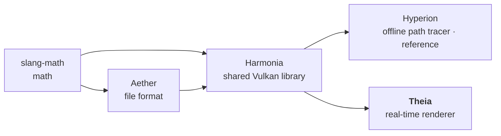

# AGENTS.md — Theia

Short orientation for working in this repository. The full description of the renderer, its flags,
the build, the verification steps and the conventions is in [README.md](README.md). Outstanding
work, measured baselines and the release history are in [PLAN.md](PLAN.md).

## What this repository is

Theia is the real-time renderer of a five-repository family. It draws each frame with a GPU-driven
mesh-shader rasterizer and a hardware-ray-traced global-illumination pass, and it converges to
Hyperion, the family's offline reference renderer, through frame accumulation. Both renderers call
the same path integrator (`Harmonia/shaders/path_integrator.slang`) and the same OpenPBR BSDF, so
a parity difference is almost always caused by an input that one renderer assembles differently
(camera, exposure, scene data), not by the estimator.



Aether and Harmonia are consumed through CMake `FetchContent`. The application is a thin
`harmonia::app::App` subclass that injects a `harmonia::app::IRenderer`; Harmonia owns the window,
accumulation, denoiser, tone mapping and presentation.

## Where things are

| Path | Content |
|------|---------|
| `src/demo/Application.cpp` | Frame recording, the camera, resize |
| `src/demo/ApplicationInput.cpp` | Input handling: the keys, the mouse look, the EV100 keys |
| `src/demo/ApplicationCompute.cpp` | GI dispatch (`buildGiFrameParams`), the async-compute path, camera placement |
| `src/demo/main.cpp` | Flags specific to Theia; shared flags come from Harmonia's `CliParser` |
| `src/theia/renderer/`, `src/theia/pipelines/` | `ForwardRenderer`, the rasterizer (one class, two source files) |
| `src/theia/cull/`, `src/theia/depth/` | Instance frustum cull, draw issue, Forward+ light lists, Hi-Z pyramid |
| `src/theia/gi/` | `GiPass`: GI compute stage and manifold-sampling wiring |
| `src/theia/postfx/` | Motion vectors and TAA |
| `src/theia/scene/` | `Scene`: meshlets, GPU buffers, BLAS and TLAS |
| `shaders/gi.comp.slang` | The GI stage: direct-light reservoir, path reservoir, shifts |
| `shaders/forward_render.frag.slang` | Forward shading |
| `ARCHITECTURE.md` | Layers, modules and the machine-checked include contract |

The stage order is fixed: GI pass, motion vectors, TAA, then the shared accumulation, denoiser and
tone mapper. Motion vectors and TAA are recorded in `Application::onSceneFrameReady`, after the GI
pass and all of its continuation batches. See [How it works](README.md#how-it-works).

## Running

```powershell
build/theia.exe --scene cornell_classic --output out.exr    # headless capture: EXR + PNG
build/theia.exe --scene shaderball_base                     # interactive window
build/theia.exe --scene cornell_classic --output out.exr --offscreen-frames 256 --width 320 --height 240
```

- There is no `--offscreen` flag; `--output` starts a capture. Convergence quality is
  `--offscreen-frames`.
- Flags specific to Theia: `--sms-mode`, `--no-restir-pt`, `--no-restir-pt-path`, `--no-restir-di`,
  `--taa` / `--no-taa`, `--no-camera-jitter`. They, the shared flags Theia relies on and every
  `THEIA_*` debug variable are listed in [Running](README.md#running); the complete table of
  shared flags is in Harmonia's README.
- A capture (`--output`) is the raw estimator result: denoiser, TAA, firefly clamps, the
  roughness regularization, the material LOD tier and the radiance cache are off, and camera jitter
  is forced on. Fireflies in a capture are true variance. With `--glare` the PNG of a capture
  carries the lens glare of Harmonia's stage; the EXR never does.
- A scene with a `[haze]` section is rendered with its distance haze: the GI pass composites
  every pixel through `Harmonia/shaders/haze.slang`. It is part of the estimator, so it is in the
  EXR, and Hyperion applies the same module.
- Motion blur comes from Harmonia's `--shutter` and `--time-samples`: the accumulation frames of
  an output frame are spread over the exposure and all of them accumulate into one image. Compare
  a shuttered frame with Hyperion rendered with the same flags and the same `--rng-seed`; the
  jitter of each time sample depends on the seed.
- A scene with a `[haze]` section renders with its distance haze, through the shared
  `Harmonia/shaders/haze.slang`; nothing is switched on for it.
- Lens glare comes from Harmonia's `--glare` and `--glare-threshold`: it is in the PNG of a
  capture, never in the EXR, and `--no-postfx` turns it off.
- A black window at start-up and after every resize is normal while pipelines are built.

## Parity and screenshots

The parity budget is 320×240, a Hyperion reference at 256 samples per pixel and 256 Theia frames
(`--offscreen-frames 256`), over the 14 scenes in `Harmonia/tools/validation_manifest.toml`. The
thresholds, the scripts and the method are Harmonia's
([README](../Harmonia/README.md#parity-methodology),
[tools](../Harmonia/tools/README.md),
[PLAN.md](../Harmonia/PLAN.md#7-parity-methodology)). The gallery in `screenshots/` is 1280×720 at
256 frames; its Hyperion counterparts use 64 samples per pixel. See
[Testing and verification](README.md#testing-and-verification).

## Gotchas

Each of these has cost a debugging cycle.

- Which assets a binary reads is decided at configure time. The Aether assets directory is baked
  into the executable (`THEIA_ASSETS_DIR`). Without `-DFETCHCONTENT_SOURCE_DIR_AETHER=<path>` it is
  the clone that FetchContent makes of Aether inside the build directory, not a working tree.
  Editing another Aether checkout changes nothing, and two "different" renders give identical
  metrics.
- A parity reference must be clean. Render Hyperion at 256 samples per pixel (`hyperion --spp 256`);
  a low-sample reference makes the comparison measure noise.
- The GI pass is the only source of indirect light, reflections, occlusion and transmission. There
  is no mode without it.
- The path reservoir has no temporal merge; do not add one back. It double-counts re-selected
  history on heavy-tailed paths (measured 2.8 % too dark on cornell indirect light at 1024 frames),
  and accumulation already integrates over time.
- `GiHit.geoNormal` is the raw outward-winding normal and is never pre-flipped to face the ray.
  The side bit `dot(geoNormal, wo) < 0` selects the dielectric exit branch (inverted IOR, total
  internal reflection); consumers flip a local copy by the outgoing direction.
- The GI pass trusts the re-traced closest hit for the primary surface, not the instance index the
  rasterizer wrote into the GI buffer. That buffer is draw-order dependent for overlapping
  transparent surfaces. Do not add an index equality check back; it produces black holes on
  overlapping glass.
- Bulk subsurface and transmission scattering run the shared volumetric walk (`runMediumWalk`)
  with per-channel extinction. Pure absorbers (single-scatter albedo 0, for example transmission with
  `transmission_scatter = 0` and `transmission_depth > 0`) take the exact Beer–Lambert branch.
- Manifold sampling runs only on scenes with emissive triangles and `max_depth` ≥ 3. Its scene
  adapter is `shaders/sms_scene.slang`. A failed shading reconstruction is not proof that a shadow
  ray is clear. The host never accumulates an unfinished frame.
- New compute shader entry points must be added to `THEIA_ENTRY_SHADERS` in `CMakeLists.txt`, and
  new non-entry Slang modules to `COMPILE_SLANG_EXTRA_DEPENDS` there. Otherwise the SPIR-V is missing
  or stale and the shader fails to load at runtime.
- The mesh draw is one device-generated sequence on purpose. `SV_DrawIndex` counts within a
  sequence, not across sequences, so one sequence per instance would make every sequence read
  entry 0 of the compact list. The task shader selects the instance by workgroup id.
- Descriptor ranges carry buffer creation sizes, never the rounded memory-requirement size.
  `GiPass` needs one descriptor buffer per frame slot and the reservoir barrier in
  `GiPass::record`; both protect reproducible captures.
- Scenes must carry a camera placement (`[camera]` with `translate` and a rotation, inline or
  through a preset that has both). Harmonia's loader rejects a scene without one; a preset that only
  sets `vertical_field_of_view` or `ev100` does not satisfy it.
- An animated scene captured with `--output` but without `--sequence-frames` restarts the
  accumulation on every tick and yields a single-sample image.
- The shared TLAS update policy rebuilds the acceleration structure on every 128th update of an
  animated scene and on every update of a static one. A rebuild is a new structure, so a consumer
  that keeps its bindings per frame slot has to write the TLAS again for each frame: the GI pass
  writes it into the descriptor buffer of the slot it records. With the binding written once per
  slot, the pass traced the replaced structure from the 129th animation update on, and every
  moved object appeared where it stood at the 128th.
- Instance cull bounds are recomputed and uploaded together with the animated instance
  transforms. Computed once at build, they culled a moved instance at its rest position: on the
  ground the GI pass still drew it, because it re-traces the primary surface, but against the
  sky it disappeared.
- A capture of the local stress-test scene (it is not part of the repository) does not repeat
  pixel for pixel (about 0.1 to 1 percent of the pixels differ between two runs of the same
  command; `PLAN.md`, known limitations, has the
  measurements and what was excluded). Do not use two Theia runs as equal in a comparison.
  Prove that a flag leaves the EXR alone within one run, or against Hyperion, which repeats.
- Every term the GI pass adds to a pixel goes through the haze of a scene with a `[haze]`
  section: the terms of the main kernel through `hazePixel`, a term added after that composite
  through `hazeTransmittance`. A new term that skips both is too bright in a hazed scene.
- The main GI kernel returns early for a background pixel, a visibility miss under manifold
  sampling and a self-emissive surface, all before its emit stage. A later kernel that reads
  per-pixel state must get a valid value for those pixels too: `combineMain` runs for every
  pixel and trusts `t_ptParams[pixelIdx].misc.z`, which the kernel clears at its top;
  `initializeSmsPixel` does the same for the manifold-sampling slots. A new per-pixel buffer
  without such a reset keeps the state of the last frame in which the pixel showed geometry.

## Test scenes

- Quick iteration: `cornell_classic`, `cornell_spheres`, `cornell_suzanne`, `dragon_teapot`.
- `ABeautifulGame` is expensive; do not use it for quick test renders.

## Build and test

```powershell
cmake -S . -B build -G Ninja -DCMAKE_BUILD_TYPE=Release `
      -DCMAKE_C_COMPILER=clang-cl -DCMAKE_CXX_COMPILER=clang-cl `
      -DCMAKE_TOOLCHAIN_FILE="<vcpkg-root>/scripts/buildsystems/vcpkg.cmake"
cmake --build build
cd build; ctest --output-on-failure
```

- Tests are serialised and the GPU jobs saturate the GPU: run one job and one repository's suite at
  a time.
- `ctest -LE analysis` runs the module suite only; the `analysis` label holds the clang-tidy,
  architecture and dead-code checks.
- `tools/check_arch.py` measures `src/` against `ARCHITECTURE.md`. The `arch` block in that file is
  the contract and changes only when the architecture itself changes; the diagrams between the
  `check_arch` markers are regenerated with `--diagram`. `CMakeLists.txt` mirrors the module graph
  as target links, so using a symbol across an undeclared edge also fails to link. See
  [ARCHITECTURE.md](ARCHITECTURE.md).
- CI (`.github/workflows/build.yml`) builds on Windows and Linux and runs the lint job; it never
  runs the tests. Build warning-clean and run the lint commands locally before pushing.
- Details, the Linux recipe and the analysis lanes are in
  [Building](README.md#building) and [Testing and verification](README.md#testing-and-verification).

## Conventions

- Defects are fixed in the code that owns them. A tolerance is never loosened to make a test pass;
  a Vulkan validation message is a bug; a compiler warning fails the build.
- Behaviour is parameter-driven (flags, config structs, push constants, `THEIA_*` toggles), and
  each knob is documented where it lives.
- Code shared 1:1 with Hyperion goes down into Harmonia. Theia never depends on Hyperion.
- Vulkan features are core or `KHR`/`EXT` only; no vendor extensions.
- The denoiser, TAA and the interactive tiers are presentation stages, never part of the
  estimator; no neural or AI-based techniques.
- The GPU decides what is drawn; the host reads back only completion and error status.
- No source file above 1000 lines; classes live in `namespace theia`.
- Commits are per repository; push only on request. See
  [Conventions](README.md#conventions).
