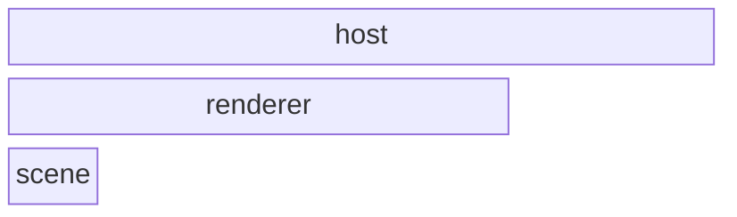
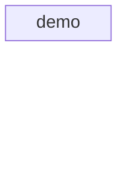
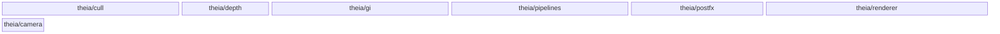
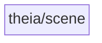

# Architecture

Theia is built in three layers. The bottom layer, `scene`, holds the GPU scene layout. The middle
layer, `renderer`, holds the culling, depth, rasterizer, global-illumination and post-processing
modules that consume the scene. The top layer, `host`, holds the thin demo application. Dependencies
point downwards only.

Theia never depends on Hyperion. The two renderers are siblings: code that both of them needs goes
down into Harmonia, and a `hyperion/` include violates the contract.

The diagrams below are generated from the contract by `tools/check_arch.py --diagram` and are
compared with it on every check.

<!-- check_arch: diagram BEGIN -->
### the layers



### layer host - the modules



### layer renderer - the modules



### layer scene - the modules


<!-- check_arch: diagram END -->

## The machine contract

The `arch` block below is the contract. `tools/check_arch.py` extracts the include graph of `src/`
and compares it with the block; `ctest` runs the check as `test_arch`. The block changes only when
the architecture itself changes. How to read it:

- `scan`, `extensions` and `exclude` define what is measured: the `.hpp` and `.cpp` files under
  `src/`.
- `unclassified: error`: every measured file must belong to a declared module.
- `external` lists the include roots of other repositories that are allowed (`aether`, `harmonia`,
  `slang-math`, `SDL3`, `vma`, `volk`). `forbidden: hyperion` makes a `hyperion/` include a
  violation.
- `quotes_relative: true` and `repo_fallback: false`: a quoted include resolves relative to the
  including file. `unresolved: info` reports a quoted include that resolves to nothing without
  failing the check.
- `within_layer: deny`: an include between two modules of the same layer must be declared with an
  `allow` line, even though the modules share a layer. Nothing is allowed by default.
- `cycles: true`: include cycles are detected at file level.
- `header_size: error`: a file with more than 1000 lines fails the check.
- `smells: report`: the refactoring smell proxies (large module, hub, mutual pair, orphan) are
  reported and never fail the check.
- `layer` declares the stack, bottom first. An `allow` edge from a lower to a higher layer is a
  violation even when it is declared.
- `module <path> in <layer>`: a module is the directory `<src>/<path>/`, assigned to a layer.
- `allow A -> B`: module A may include the headers of module B. Any other include between two
  modules is a violation.

The namespace knobs are not set. Theia's classes live in `namespace theia` by convention; the check
does not enforce it.

```arch
scan: src
extensions: .hpp, .cpp
exclude: build, _deps, .git
unclassified: error
external: SDL3, aether, harmonia, slang-math, vma, volk
forbidden: hyperion
quotes_relative: true
repo_fallback: false
cycles: true
namespace_root:
namespace_module:
namespace_require:
unresolved: info
within_layer: deny              # undeclared same-layer edges: violations
header_size: error               # the standing bloat rule (hard gate; the bloat queue is drained)
smells: report                 # refactoring-catalog proxies: report-only signals

layer scene
layer renderer
layer host

module theia/scene in scene
module theia/renderer in renderer
module theia/pipelines in renderer
module theia/cull in renderer
module theia/postfx in renderer
module theia/gi in renderer
module theia/depth in renderer
module theia/camera in renderer
module demo in host

allow theia/renderer -> theia/scene
allow theia/renderer -> theia/camera
allow theia/pipelines -> theia/renderer
allow theia/pipelines -> theia/camera
allow theia/cull -> theia/scene
allow theia/pipelines -> theia/scene
allow theia/renderer -> theia/cull
allow theia/renderer -> theia/depth
allow theia/cull -> theia/renderer
allow theia/cull -> theia/depth
allow theia/depth -> theia/renderer
allow theia/postfx -> theia/renderer
allow theia/postfx -> theia/camera
allow theia/gi -> theia/renderer
allow theia/gi -> theia/scene
allow theia/gi -> theia/camera
allow demo -> theia/renderer
allow demo -> theia/scene
allow demo -> theia/cull
allow demo -> theia/postfx
allow demo -> theia/gi
allow demo -> theia/camera
```

## The modules

| Layer | Module under `src/` | Content |
|-------|----------------------|---------|
| `host` | `demo` | `Application`, the `harmonia::app::App` subclass that implements `IRenderer` and `IFrameCompletion`. Its code is split into `Application.cpp` and `ApplicationCompute.cpp`. Also `main.cpp`, `ViewAccumulation.hpp` and `EnvImportanceResources.hpp` |
| `renderer` | `theia/renderer` | `ForwardRenderer`, the rasterizer (`ForwardRenderer.cpp`), `PassTimer`, and the two small headers the other modules of the layer share: `RendererConstants.hpp` and `ShaderPath.hpp` |
| `renderer` | `theia/pipelines` | The pipeline and descriptor-set-layout creation of `ForwardRenderer` (`ForwardRendererPipelines.cpp`) |
| `renderer` | `theia/cull` | `GpuCullPass`, `GpuDrivenState`, `LightCuller` |
| `renderer` | `theia/depth` | `HiZPass` |
| `renderer` | `theia/gi` | `GiPass` (`GiPass.cpp`, `GiPassSms.cpp`) |
| `renderer` | `theia/postfx` | `MotionVectorPass`, `TaaPass` |
| `renderer` | `theia/camera` | Header only: `CameraController.hpp`, `CameraJitter.hpp` |
| `scene` | `theia/scene` | `Scene` and its GPU layouts `GpuInstance`, `GpuInstanceBounds`, `GpuMeshlet` |

Two facts explain edges that look surprising at first:

- `theia/renderer` holds the shared headers `RendererConstants.hpp` and `ShaderPath.hpp`. Every
  other module of the renderer layer includes them, which is why `theia/cull`, `theia/depth`,
  `theia/gi` and `theia/postfx` have edges into `theia/renderer`.
- `theia/pipelines` is the second source file of the `ForwardRenderer` class. The two files call
  each other's members, so they form one static library in the build.
- `theia/scene` implements the scene-builder hooks of Harmonia's scene layer
  (`createTriangleMesh`, `finishBuild`) and owns the top-level acceleration structure. Harmonia's
  scene layer has no ray-tracing code of its own; the shared ray-tracing helpers live in
  `harmonia::scene_rt`.

## Rules for changes

- Add an include only along a declared edge. A new dependency is first declared as an `allow` line
  in the contract, then used.
- New code goes into the module that owns the data or the pass. A new module is declared in the
  contract together with its layer.
- A file with more than 1000 lines is split along a responsibility. `Application.cpp` was split
  when the GI dispatch and the async-compute submission moved to `ApplicationCompute.cpp`, and
  `ForwardRenderer.cpp` when the pipeline creation moved to
  `src/theia/pipelines/ForwardRendererPipelines.cpp`.
- The build follows the contract. `CMakeLists.txt` links every module as its own target
  (`theia_scene`, `theia_camera`, `theia_depth`, `theia_cull`, `theia_renderer`, `theia_gi`,
  `theia_postfx`, `theia_demo`) in the direction of the contract, so a symbol that is used across
  an undeclared edge also fails to link. `theia_renderer_core` is the header-only part of
  `theia/renderer`.

## Shapes that are intentional

Some module relationships look like refactoring targets but are deliberate:

- The chain `demo` → `theia/renderer` → `theia/scene` is the layering itself, not a pass-through to
  collapse.
- The async-compute submission flow stays in `Application` (`onBeforeSceneStages`). It implements a
  hook of the host and submits to queues that the host provides; moving it into a renderer class
  would invert that relationship.
- `Scene::uploadBuffer` is an adapter between Harmonia's expected-value API and the `VkResult` plus
  output-parameter style of the scene build. It is applied uniformly and is not a layer to remove.
