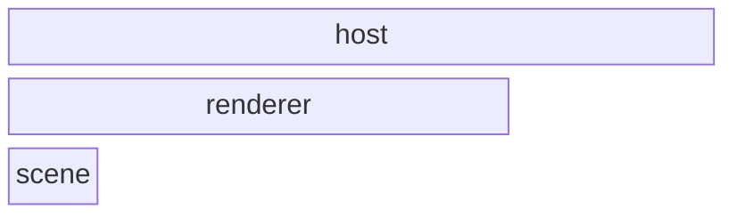
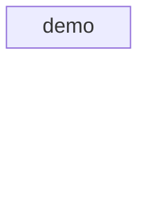
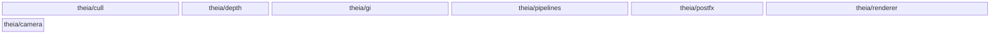
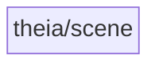

# Architecture

The checked-in architecture contract for Theia (the check-arch reflexion
gate). One leaf (`theia/scene`), the renderer consuming it, and the thin
`demo` host on top. **Theia never depends on Hyperion** — the sibling
renderers are independent; shared code goes down into Harmonia (a
`hyperion/` include is a hard violation).

<!-- check_arch: diagram BEGIN -->
### the layers



### layer host - the modules



### layer renderer - the modules



### layer scene - the modules


<!-- check_arch: diagram END -->

## The machine contract

```arch
scan: src
extensions: .hpp, .cpp
exclude: build, _deps, .git
unclassified: error
external: SDL3, harmonia, slang-math, vma, volk
forbidden: hyperion
quotes_relative: true
repo_fallback: false
cycles: true
namespace_root:
namespace_module:
namespace_require:
unresolved: info
within_layer: deny              # undeclared same-layer edges: violations
header_size: error               # the standing bloat rule (hard gate; the 2026-10 bloat queue is drained)
smells: report                 # refactoring-catalog proxies: report-only review signals

layer scene
layer renderer
layer host

module theia/scene in scene
module theia/renderer in renderer
module theia/pipelines in renderer
module theia/cull in renderer
module theia/postfx in renderer
module theia/gi in renderer
module theia/depth in renderer
module theia/camera in renderer
module demo in host

allow theia/renderer -> theia/scene
allow theia/renderer -> theia/camera
allow theia/pipelines -> theia/renderer
allow theia/pipelines -> theia/camera
allow theia/cull -> theia/scene
allow theia/pipelines -> theia/scene
allow theia/renderer -> theia/cull
allow theia/renderer -> theia/depth
allow theia/cull -> theia/renderer
allow theia/cull -> theia/depth
allow theia/depth -> theia/renderer
allow theia/postfx -> theia/renderer
allow theia/postfx -> theia/camera
allow theia/gi -> theia/renderer
allow theia/gi -> theia/scene
allow theia/gi -> theia/camera
allow demo -> theia/renderer
allow demo -> theia/scene
allow demo -> theia/cull
allow demo -> theia/postfx
allow demo -> theia/gi
allow demo -> theia/camera
```
