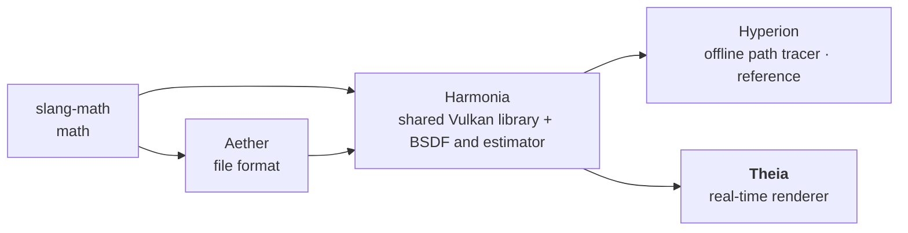

# PLAN — Theia

Outstanding work, the working rules of the project, the measured baselines and the release history of
the real-time renderer. How the code works is described in [README.md](README.md). Work on the
shared estimator and BSDF is planned in `Harmonia/PLAN.md`, because both renderers use them.

## Context

Theia is the real-time renderer of a five-repository family:

The family's goal is to improve both renderers with current algorithms, adopting each technique in
the shared Harmonia estimator and BSDF wherever both renderers benefit, and per renderer only where
they genuinely diverge. Theia converges to Hyperion, the unbiased reference: a capture approaches
the Hyperion image as its frame count grows. The parity comparison (metrics, thresholds, scripts and
which metric catches which failure) belongs to Harmonia:
[README.md](../Harmonia/README.md#parity-methodology) and
[PLAN.md, section 7](../Harmonia/PLAN.md#7-parity-methodology).

## At a glance

- Current release: v1.0.0-pre-alpha (2026-11-28), with Aether and Harmonia pinned to
  v1.0.0-pre-alpha.
- The dense-scene animation-scaling investigation is open with Harmonia and Aether; the other
  remaining work is listed under [Roadmap](#roadmap) and [Known limitations](#known-limitations).
- The interactive path tracer runs ReSTIR PT: one multi-bounce path reservoir for the indirect term,
  spatial reuse only, with the reconnection shift up to the fourth path vertex; a direct-light
  reservoir for emissive and environment light; and specular manifold sampling for caustics on
  scenes with emitters. An A-SVGF denoiser and TAA stabilise the window; a capture uses neither and
  relies on accumulation alone.

## How to continue

Development happens on `main`. CI builds for pushes to `main`, for pull requests that target
`main`, and on manual dispatch. Dependency pins move only in coordinated releases, in the order
slang-math, Aether, Harmonia, Theia. Estimator work that touches both renderers starts in
`Harmonia/PLAN.md`. Finished work is removed from this file; its record is the release history in
[Baseline](#baseline) and `git log`.

### Roadmap

| Item | State | Notes |
|------|-------|-------|
| Per-frame bounds for skinned and morphed meshes | Not started | Restores frustum and occlusion culling for deforming meshes (see the known limitations) |
| Per-vertex deformation in the motion vectors | Not started | Removes TAA ghosting on fast deformation in the window |
| Temporal reuse of the path reservoir without recursion bias | Optional, not started | The only accepted way to give the path reservoir temporal memory: an unbiased form such as GRIS pairwise MIS with canonical-sample accounting. It would also remove the recursion bias of the direct-light reservoir's temporal merge. A plain streamed temporal merge is ruled out (see the baselines) |
| Basic normalization in the direct-light reservoir merges | Optional, not started | Levels 0 and 1 of `THEIA_BIAS_CORRECTION` compute the `OFF` formula of RTXDI and level 2 adds its visibility test. RTXDI's `BASIC` normalization (`piSum`) and the source-side BSDF and facing term of `RAY_TRACED` are not implemented |
| Dual motion vectors | Recorded idea, not specified | A second set of motion vectors for the reprojection of the denoiser and TAA (ReSTIR PT Enhanced, section 6.4). A presentation-stage idea with no design yet |
| Dense-scene animation scaling | In progress | Aether reusable evaluation is committed; Theia and Hyperion now consume one scratch scene for camera and instances. Full renderer gates and GPU timing are pending. Previously measured on 109,694 draw instances: camera evaluation 72–98 ms, scene stamp 72–82 ms, transform sync plus TLAS interval 13–23 ms per instant; GI stays about 26 ms. The shared work and acceptance criteria are in `Harmonia/PLAN.md`, section 5.1 |
| UV-tangent anisotropy in the raster direct-light path | Complete | Full gates, analytic-light parity and the final 60-image gallery pass |
| Forward texture replacement and extra OpenPBR maps | Complete | All 16 slots are wired; full parity and the final gallery pass |
| Automated haze regression coverage | Complete | CPU-double integral oracle, loader tests and every GI composite family pass; full suite 94/94 |
| Texture and scene scalability | In progress | `kMaxBindlessTextures = 256` and about 1.1 GB of uncompressed textures at mip 0 limit dense scenes; the official OpenPBR scene has 3.156 billion source pixels. DDS/BC7 direct upload is being implemented in Harmonia. Add scalable descriptor handling and a scene-cost log with load time, triangles, instances and memory by buffer; test beyond 256 textures |
| Thin-lens depth of field | Complete | Dedicated 256-sample DOF comparison: SSIM 0.827895, Rel-MSE 0.005727, histogram correlation 0.999931 |
| Analytic-light NEE in GI and Hyperion | Implemented, focused GPU verification complete | Shared `evalAnalyticLightNEE` samples point, spot, directional and rectangular lights, including roll and world-space extents. Hyperion and both Theia GI entry points call it. The 256-sample `analytic_lights` EXR comparison passes with SSIM 0.844926, Rel-MSE 0.004624 and zero validation diagnostics |
| OpenPBR display-transform mismatch | Fixed and verified | Final v8 full-resolution OpenPBR parity: SSIM 0.826779, Rel-MSE 0.080253 and zero diagnostics. Both AgX PNGs independently match their EXRs within one 8-bit level |
| `GpuCullPass::reserve` before `initialize` | Complete | Supported order and capacity are covered by regression tests |
| Regression-test robustness and missing branches | Complete | Includes TLAS, cull-capacity, glare, visibility-miss, self-emissive and loader-driven animated bounds coverage |
| Validation and documentation gaps | Not started | Parameterize glare validation scenes instead of the single Cornell scene, remove the duplicate haze bullets in `AGENTS.md`, and correct the sequence-capture accumulation comment in `Application.cpp` |

Decided and closed:

- Wavefront GI, a split of the GI kernel into generate, trace and shade stages over persistent
  records: built to bit-identical images and measured at about twice the cost of the single-kernel
  pass at 320p and at 1080p, dominated by record traffic. It was removed. `PassTimer`
  (`THEIA_PASS_TIMING`) and the move-resets-accumulation contract (`ViewAccumulationGate`) remain
  from that work. Conditions for a revisit are recorded in `Harmonia/PLAN.md` (section 5.1).
- ReSTIR PG path guiding: implemented and then removed after measurement showed no variance
  reduction on the test scenes (`Harmonia/PLAN.md`, section 5.5).
- slang-math migration: Theia has nothing to migrate. The trigonometric calls in
  `src/theia/camera/CameraController.hpp` combine scalar angles, which the slang-math rules leave to
  `std`.
- Node hierarchies: compounding of transforms is resolved in Aether, and Theia consumes the flat
  instance list.

### Known limitations

1. Skinned and morphed meshes are never culled. Their bounds are computed in the rest pose and
   inflated to a conservative envelope (`kSkinnedBoundsRadius` in `src/theia/scene/Scene.cpp`), so
   they are always drawn. A per-frame bounds update would restore culling.
2. Motion vectors cover instance transforms only. Per-vertex deformation is not in them, so TAA
   can ghost on fast deformation in the window. The accumulation renders each animation state on
   its own and is not affected.
3. The temporal merge of the direct-light reservoir has no test of the surface. A pixel whose
   surface changed since the previous frame, for example ground revealed behind a moved object,
   inherits candidates that were chosen for the old surface; the spatial merge has the position and
   normal test. The error is a few percent on one frame after a disocclusion, and in a shuttered
   capture of an animated scene it appears in every frame, because the pose changes from time
   sample to time sample: on `motion_blur`, the trail of the mover is 3.2 % darker in luminance
   than the mean of its instants rendered alone, where Hyperion agrees with that mean to 0.2 %.
   The parity limits still hold for the shuttered frame. A test that compares the previous
   frame's surface with the current one would remove the error.
4. Manifold-sampling reuse (`--sms-mode reuse`) is experimental.
5. `--indirect-ambient`, `--deterministic-replay` and `--rng-debug` are accepted by the shared
   argument parser but no Theia shader reads them.
6. `--no-restir-di` together with `--no-restir-pt` leaves a scene that is lit only by the
   environment map without its direct light: in such a scene the environment's direct light is
   sampled by the direct-light reservoir only. The combination is for debugging emissive scenes.
7. A capture of the local stress-test scene (not part of the repository) does not repeat pixel
   for pixel. Measured on 2026-11-26 at 1280×720,
   frame 152, 128 accumulation frames, the same command run several times: 4,700 to 11,600 of
   921,600 pixels differ between two runs, by 0.018 at most (mean 2×10⁻⁷). With one accumulation
   frame three runs fell into two outcomes: two were equal except for one pixel, the third
   differed from them at 60 pixels, a few by a factor of 11. The differing pixels lie on the
   water, in clusters of 100 to 300 pixels around the boat and the pier, and the sizes are
   multiples of one accumulation frame's contribution. The same at 64, 127, 129 and 256
   accumulation frames and at a path depth of 1; the same without haze, without camera jitter,
   with a matte sea, in the single-queue path, without Hi-Z culling, without ReSTIR PT, without
   the direct-light reservoir and without both. So it is not the haze, the glare, the shutter,
   the sample count, the periodic TLAS rebuild, ReSTIR or the async-compute split, and it is not
   seeded randomness: the runs take a discrete decision at start-up. The suspicion is an
   order-dependent tie in a draw or a traversal. `cornell_classic` and `haze` repeat exactly,
   and Hyperion repeats the scene exactly. Until the cause is found, a comparison must not
   take two Theia runs as equal: prove that a flag leaves the EXR alone within one run (PNG
   against EXR) or against Hyperion.

### ReSTIR-PT refinements

The path reservoir implements ReSTIR PT (Lin, Kettunen and Wyman, PACMCGIT 2026) with these parts:

- vector-valued resampling weights: every merged candidate is fully evaluated at the current pixel,
  and the final shade uses the marginalised sum rather than the selected candidate alone;
- paper-faithful resampling: each neighbour is either shifted or replayed; there is no pairwise-MIS
  averaging and no sharing of shifts between neighbours;
- a reconnection shift for the second vertex and, under the hybrid rule, for the third and fourth
  vertex, with a telescoping GRIS Jacobian and footprint-in-radius rejection; a candidate may also be
  reconnected to a vertex reached by next-event estimation;
- Russian roulette only when a path is first sampled; replayed paths skip it;
- a three-kernel split in which replay walks run uniformly over a GPU-compacted stream;
- compatibility-guided neighbour selection for the spatial reuse.

Hybrid shift. The reconnection vertex is the first pair of consecutive vertices whose sampled lobes
are both rough enough and far enough apart. The rule uses the roughness of the lobe actually sampled
at each vertex (`BSDFSample.lobeAlpha` in `Harmonia/shaders/bsdf_shared.slang`: diffuse, subsurface and
sheen lobes count as roughness 1, delta lobes as 0) and is evaluated in `integrateSurface` right
after the lobe is sampled. Paths reach the fourth vertex (`kMaxHybridK` in
`Harmonia/shaders/path_integrator.slang`), replaying up to two recorded hops. The fixtures
`hybrid_k3` and `hybrid_k4` in `Harmonia/tests/assets/sms` exercise the third- and fourth-vertex
bodies; `tools/qualify_gap_c.py` and `tools/qualify_k4.py` measure them. Two differences to the
reference implementation (DQLin/ReSTIR_PT) are recorded:

- The reference's diffuse-assignment condition is deliberately not ported. Under this capture rule
  it would disable the adaptive choice of the reconnection vertex.
- The reference's case of a prefix edge sampled by next-event estimation cannot occur here: every
  path edge in this estimator is BSDF-sampled, and next-event estimation is a shadow-ray term.

On these fixtures the family thresholds cannot be met by any variant, Hyperion included (see the
baselines). They are judged by the noise-envelope criterion instead: the gap between Theia and
Hyperion must not exceed Hyperion's disagreement with itself on all four metrics, with the envelope
measured in the same run from two reference seeds.

### Measured baselines

A change must not regress these numbers.

| Measurement | Value | Conditions |
|-------------|-------|------------|
| Energy bias of manifold sampling | 0.15–1.2 % (limit 2 %) | `tools/qualify_sms.py --stage correctness`: ROI energy against the Hyperion reference, 8192 frames, four seeds pooled; the fixtures `C1`, `C2` and `C3` of the script |
| Equal-time quality of manifold-sampling reuse | 2.5× lower MSE on absorption-prefix chains; no loss on light-tailed scenes | `tools/qualify_sms.py --stage performance`, at 2 s and 8 s |
| Frame-time cost of manifold-sampling reuse | about 5 % | `reuse` against `local` |
| Temporal merge of the path reservoir | 2.8 % too dark | Cornell indirect light at 1024 frames; the reason the path reservoir has no temporal merge |
| GI pass time on `cornell_classic`, 64 frames | 1.51 ms at 320p, 31.1 ms at 1080p | `THEIA_PASS_TIMING=1`, after the replay stream compaction (before: 1.42 ms and 34.9 ms) |
| Wavefront GI experiment | about 2× the cost of the single-kernel GI pass | 320p and 1080p |
| Parity budget | 320×240, Hyperion 256 spp, Theia 256 frames; thresholds 120 / 250 / 0.6 / 0.8 | `Harmonia/tools/validation_manifest.toml` |
| Noise envelope on the hybrid fixtures | Hyperion against itself: mean difference 2342 at 256 spp and 1459 at 4096 spp, against a threshold of 120 | `tools/qualify_gap_c.py`, `tools/qualify_k4.py`, `tools/exercise_bias_mode.py`; these fixtures use the noise-envelope criterion |

The qualification thresholds of `tools/qualify_sms.py` are: reference split-seed uncertainty at most
0.5 %, energy tolerance 2 % at 8192 frames, timing tolerance 5 %.

## Governance

### Definition of done

A change is complete when:

- the build is warning-clean. A compiler warning is a build error (`/W4 /WX` with clang-cl,
  `-Wall -Wextra -Werror -Wpedantic` with Clang or GCC);
- `ctest` passes;
- a representative headless render runs without any Vulkan validation message.

A release additionally requires:

- `cmake --build build --target verify-full` (build, `ctest`, `format-check`, `clang-tidy`,
  `cppcheck`);
- the parity comparison against Hyperion over the 14-scene manifest
  (`Harmonia/tools/render_and_validate.py`);
- the Vulkan validation check over the full 30-scene gallery
  (`Harmonia/tools/check_vulkan_validation.py`);
- regenerated screenshots with `tools/generate_gallery.ps1`.

### Working rules

- Defects are fixed at once, in the code that owns them, by their cause. They are never deferred,
  and never hidden behind a loosened tolerance, a special case or a clamp.
- Behaviour is parameter-driven. A change in behaviour flows through a flag, a config struct, a
  push constant or a `THEIA_*` toggle, and every knob is documented where it lives.
- A technique belongs on the converging path only if its contribution vanishes as the sample count
  grows, or if it lives in the interactive-only tier that capture mode bypasses. Irreducible bias
  stays out of the converging path; neural and AI-based techniques are not used.
- The remaining rules, including the no-temporal-merge rule and the shared BSDF contracts, are in
  [Conventions](README.md#conventions) of the README.

### Releases

Commits are made per repository and pushed only on request. Dependencies move in coordinated
releases in the order slang-math, Aether, Harmonia, Theia. The release commit of Theia bumps the
`FetchContent` pins in `CMakeLists.txt` and the project version. Every release is recorded in
[Baseline](#baseline); `RELEASE_NOTES.md` holds the notes of the releases that have notes. Tags
are pushed together with the release commits.

## Baseline

The release history, newest first.

### v1.0.0-pre-alpha (2026-11-28)

- Pre-alpha development snapshot and GitHub backup; consumes the shared Harmonia medium-exit
  radiance transport in the GI adapter and regenerates the README gallery.

### Previously unreleased baseline

- OpenPBR emission no longer suppresses the coexisting BSDF. Forward shading evaluates analytic
  direct lighting on emissive surfaces, GI retains their environment/indirect transport, and the
  shared secondary estimator carries emission plus BSDF continuation. The haze oracle covers the
  new emitter terms with an independent numerical optical-depth integral and a positive control.
  k=2 and k≥3 reconnection shifts reject emissive x_k vertices and fall back to complete replay,
  because the cached suffix does not carry target-side EDF/MIS ownership.
  The final 1920×1080 v10 title capture passes Theia against Hyperion at 256 samples with SSIM
  0.802524, Rel-MSE 2.351234, histogram correlation 0.998456 and zero diagnostics. Directly against
  the official JPEG at equal encoded dimensions, Hyperion reaches SSIM 0.687283; the native
  1820×1024 comparison needs no resampling and scores 0.640925 Hyperion / 0.651881 Theia.
- OpenPBR primary visibility now preserves stochastic opacity layers under both pinhole and thin-lens
  rays; a fully transparent outer shell no longer discards the visible inner surface. Forward texture
  replacement, all 16 map slots, UV-tangent anisotropy and textured HDR emission are verified. On the
  final 1920×1080 v8 title scene, Theia against Hyperion at 256 samples has SSIM 0.826779, Rel-MSE
  0.080253 and zero diagnostics. The dedicated DOF comparison passes with SSIM 0.827895.
- Motion blur in sequence captures, from Harmonia's `--shutter` and `--time-samples`. A sequence
  capture accumulates all time samples of an output frame and no longer restarts the accumulation
  when the animation tick changes. On `motion_blur`, at 320×240, Theia against Hyperion with the
  same flags and seed: sharp against sharp SSIM 0.81 and histogram correlation 0.89, shuttered
  against shuttered SSIM 0.82 and 0.81; a sharp against a shuttered frame fails both.
- The GI pass traces the scene's current acceleration structure after the periodic TLAS rebuild.
  Its descriptor kept the structure bound when the scene was set, so from the 129th animation
  update on it traced the replaced one: a capture of 256 accumulation frames of a shuttered frame,
  or the 129th frame of a long sequence, showed every moved object at its pose of the 128th
  update. Regression tests drive the real GI pass across a rebuild of a static scene and across
  the periodic rebuild of an animated one, in both frame slots.
- The instance cull pass sizes its compact instance list from the scene. The list used to hold a
  fixed 4096 instances, and a scene with more visible instances wrote past it.
- Instance cull bounds follow the animated instance transforms. A moved instance was culled at its
  rest position; the GI pass still shaded it over ground, because it re-traces the primary
  surface, but against the sky it was missing (sharp Theia against Hyperion on `motion_blur`,
  frame 4: tone-mapped PSNR from 17 dB to 30 dB).
- Distance haze of a scene (`[haze]` in Aether). The GI pass composites every pixel through the
  shared module `Harmonia/shaders/haze.slang`; the path-reservoir term loses the transmittance
  only. At 1024 samples per pixel on `haze`, Theia against Hyperion: with haze SSIM 0.957 and
  histogram correlation 0.875, without haze 0.958 and 0.925; a hazed against a clear frame fails.
  The transmittance read back from the five cubes of the scene matches the formula within 0.006
  in both renderers.
- Lens glare is a stage of Harmonia (`--glare`, `--glare-threshold`) and reaches Theia through
  the shared tone mapper: the PNG of a capture carries it, the EXR does not. On the local
  stress-test scene at 1280×720, frame 320, 128 accumulation frames, glare 0.2 above 6: the PNGs
  of both renderers
  are within one step of 255 of the prediction from their own EXR, Theia against Hyperion has
  SSIM 0.873 and luminance correlation 0.987, and the glare around the sun is 2.61 against 2.56
  of 255 in the two renderers.
- The GI stage no longer adds the stored light path of an earlier frame to a
  pixel that has become background. The main kernel returns before its emit
  stage for a background pixel and left the pixel's path-reservoir block at
  its last value; `combineMain` then took the block as current and added its
  candidates to the pixel. In a sequence capture of that scene the sun glints
  of the wheel's red spokes stayed in the sky from frame 96 on, at the screen
  positions where the spokes had passed: at one pixel red 168 where the sky is
  0.9, creeping to 176 by frame 195, while the same frame captured alone shows
  the sky. The kernel now clears the flag for every pixel before it can return.
  Regression test `tests/module/test_gi_stale_path_state.cpp` drives the real
  GI pass with a block of pixels that is floor in one frame and background in
  the next: without the fix all 6144 pixels of the block change, with it none.
- The anisotropy of a material without a tangent map follows the texture
  coordinates (Harmonia's shared `surface.slang`); its frame used to come from
  the normal alone. The gallery screenshots of `openpbr_specular` and
  `openpbr_metals` are rendered with the new frame.

### v1.0.0 (2026-11-26)

Stable public baseline; pins Aether v1.0.0 and Harmonia v1.0.0. Aether is declared as an explicit
external include boundary in the architecture contract, documentation references are checked
strictly, and the architecture and dead-code checks are clean. The accepted file splits and
large-module shapes are documented in `ARCHITECTURE.md` and unchanged. See
[RELEASE_NOTES.md](RELEASE_NOTES.md).

### v0.12.0 (2026-11-24)

Pins Harmonia v0.12.0 and Aether v0.12.0. Scene-camera assembly and animated camera placement come
from Harmonia's shared `CameraAssembly`; navigation, camera jitter, the accumulation reset and the
presentation are unchanged. The README gallery is regenerated at 1280×720 with 256 frames.

### v0.11.0 (2026-11-23)

Documentation and roadmap alignment and static-analysis repairs; pins 0.11.0.

### v0.10.0 (2026-11-20)

Pins Harmonia v0.10.0 and Aether v0.10.0.

- The reconnection shift reaches the fourth path vertex (prefix replay over recorded hops,
  `THEIA_SHIFT_MASK` bit for the fourth vertex, `kMaxHybridK = 4`), checked against Hyperion's
  self-noise.
- The reconnection vertex is chosen with the roughness of the sampled lobes.
- `THEIA_BIAS_CORRECTION`: the three levels of the direct-light reservoir's merges, with level 0
  computing the same formula as level 1 and level 2 adding the visibility test.
- Scenes require a camera placement (Harmonia's loader rejects a scene without one).
- Documentation aligned with the code and the gallery regenerated.

### Between v0.8.4 and v0.9.0

Recorded by date, without a separate release entry (2026-11-09 and 2026-11-15):

- Replay stream compaction: the GI pass runs as emit, uniform replay and combine kernels.
- Compatibility-guided neighbour selection replaces the Gaussian pairing texture for the spatial
  reuse of the path reservoir.
- The material LOD tier and the world-space radiance cache, both interactive-only.
- Object motion vectors with a per-instance transform history, and the per-frame TLAS refit for
  animated scenes. Sequence renders pin the animation tick to the output frame.
- The prefix distance condition of the reconnection shift.

### v0.9.0 (2026-11-16)

Pins Harmonia v0.9.0 and Aether v0.9.0.

- Deformation: the shared `DeformPass` (linear-blend or dual-quaternion skinning, and morph targets)
  runs from the animation tick and is followed by a BLAS refit and the TLAS update. Deforming meshes
  get conservative culling bounds. The dual-quaternion blend needs no renderer code.
- The parity thresholds are recalibrated to 120 / 250 / 0.6 / 0.8.
- An animated camera (`[camera] node`) with frame seek (`--frame`), and one animation clock with
  time-based captures (`--capture-every-ms`, `--start-seconds`).
- The known limitations on deforming meshes are recorded.

### v0.8.4 (2026-11-07)

Pins Harmonia v0.7.23 and Aether v0.8.1. All nine pipeline-creation sites (three graphics in
`src/theia/pipelines/ForwardRendererPipelines.cpp` and six compute: GiPass, GpuCullPass,
LightCuller, HiZPass, MotionVectorPass, TaaPass) create their pipelines through Harmonia's
`PipelineBinaryCache`.

### v0.8.3 (2026-11-06)

Pins Harmonia v0.7.21 and Aether v0.8.1. No renderer change: the release takes over Harmonia's Vulkan
capability wave through the pin (memory-budget startup log and offscreen-capture guard,
present-timing telemetry, subgroup feature set). The gallery is re-rendered.

### v0.8.2 (2026-11-05)

Pins Harmonia v0.7.20 and Aether v0.8.1. Specular manifold sampling with spatiotemporal reuse (the
PSMS-ReSTIR port, Hong et al. 2025): a temporal merge and spatial reservoir reuse with
device-local history, the reference's population semantics and defensive pairwise MIS.

### v0.8.1 (2026-11-03)

Pins Harmonia v0.7.19 and Aether v0.8.1. Timestamp lifecycle fix and shared BSDF and lifetime fixes
through Harmonia. The gallery is regenerated at 1280×720 with 256 frames. No manifold sampling.

### v0.8.0 (2026-10-30)

Pins Harmonia v0.7.18 and Aether v0.8.1, and, transitively, slang-math v0.8.0. The wavefront GI
experiment: stage one (generate, trace and shade over persistent records) is built to bit-identical
images, measured at about twice the cost of the single-kernel GI pass and parked. Kept from it:
`PassTimer` (`THEIA_PASS_TIMING`), the medium-scene verification budget, the move-resets-accumulation
contract (`ViewAccumulationGate`) and `reconstructGiHitFromQuery` in `shaders/gi.comp.slang`.

### v0.7.17, v0.7.16, v0.7.15 (2026-10-16 to 2026-10-27)

Pin updates (v0.7.17 pins Aether v0.8.0, Harmonia v0.7.16, slang-math v0.5.0) and documentation
updates.

### v0.7.14 (2026-10-15)

Pins Harmonia v0.7.13. The scene module joins `namespace theia`, like the rest of the code. An
architecture check guards the layering: `theia/scene` below the renderer below the demo, no cycles,
and no `hyperion/` include.

### v0.7.13 (2026-10-11)

Pins Harmonia v0.7.12. The layering migration: every `harmonia::` reference names its layer
(`harmonia::core::Buffer`, `harmonia::scene::SceneBase`, `harmonia::app::App`).

### v0.7.12 (2026-10-10)

Pins Harmonia v0.7.11. Descriptor ranges of the light list and of the instance and bounds buffers
carry the buffer creation size instead of the rounded memory-requirement size. Opacity micromaps are
built on the KHR acceleration-structure API.

### v0.7.11 (2026-10-09)

Pins Harmonia v0.7.10 and, transitively, slang-math v0.3.0. Build-only CI on Windows and Linux.
`buildGiFrameParams` and `buildMotionVectorParams` assemble the frame parameters once for both queue
paths; `createOneSetLayout` replaces the duplicated descriptor-set-layout code. `--frames-per-flip`
configures the accumulation frames per swapchain flip (default 1).

### v0.7.10 (2026-09-28)

Pins Harmonia v0.7.9. The reconnection shift follows ReSTIR PT Enhanced: an adaptive reconnection
vertex, a selection that depends on the mode, and invertibility checks.

### v0.7.9 (2026-09-26)

Pins Harmonia v0.7.9. Theia matches Hyperion: the bias floor (mean difference at convergence, in
1/255 units, against a high-spp Hyperion reference) drops from 5.11 to 2.22.

### v0.7.8 (2026-09-23)

Pins Harmonia v0.7.8 and Aether v0.7.4. The capture becomes estimator-pure: `--output` switches off
the firefly clamps and the secondary-bounce roughness regularization and forces camera jitter on.
The parity baseline is re-measured: the clamp and jitter bias is gone. `tools/check_tidy.py` (also
registered as `test_tidy`), the sanitizer lane and deterministic host-side floating point are added.

### v0.7.7 (2026-08-02)

`geometry_opacity` becomes a presence weight. The rasterizer's alpha test is replaced by a stochastic
coverage draw, and the shadow and GI ray queries resolve non-opaque candidates with the matching
transmittance.

### v0.7.6 (2026-08-02)

Pins Harmonia v0.7.6: present pacing.

### v0.7.5 (2026-08-01)

An unknown command-line argument is an error. The CPU-counted draw is removed: every mesh draw is
either device-generated or indirect. The `--no-rt-gi` fallback (a split-sum image-based lighting
path) is removed; the GI pass is the single path. A regression test covers the two-mode output
contract of the denoiser.

### v0.7.4 (2026-07-30)

The denoiser is switched off for captures (the two-mode output contract).

### v0.7.3 (2026-07-29)

Refactoring: `EnvImportanceResources` and `CameraController` leave `Application`; `GpuDrivenState`,
`RenderState` and `DescriptorState` leave `ForwardRenderer`.

### v0.7.2 (2026-07-29)

Refactoring: `Application::recordFrame`, `SceneOutputCopyPass::record` and the pipeline creation are
split into functions.

### v0.7.1 (2026-07-26)

The multi-bounce path reservoir for the indirect term, with the random-replay shift and spatial
reuse only.

Earlier history is in `git log`.
