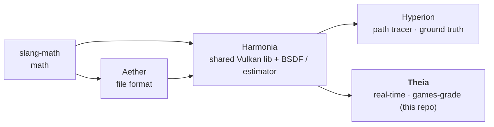

# PLAN — Theia

**Release:** v0.8.4 - **VK5 pipeline-binary cache wired** (all 9 pipeline-creation sites through
Harmonia's `core::PipelineBinaryCache`; consumes Harmonia v0.7.23 — pin bump) + alignment audit.
Galleries re-rendered with the cache on: 24/30 scenes byte-identical, the 6 speckle-class glass
scenes gate-PASS at EXR precision (mean ≤ 0.001, SSIM 1.0). **Work continues on `main`** (the
`dev/gi-sms-restir` branch is retired; its full history is `git log` and the Baseline below).

**C track: shipped.** The PSMS-ReSTIR port (Hong et al., SIGGRAPH Asia 2025; reference at `external/PSMS-ReSTIR`) is complete and qualified on the C1/C2/C3 track: pooled-energy bias 0.15-1.2% at the 8192-frame gate (gate 2%, pooled SE ~1.8%), deterministic same-seed captures, a 2.5x equal-time MSE win on absorption-prefix chains and parity on light-tailed scenes, reuse at ~5% frame-time overhead. SMS sampling is active by default (`--sms-mode local`); spatiotemporal reuse via `--sms-mode reuse`. Eleven root-caused bring-up defects were fixed on the way (receipts: Baseline v0.8.2, the git log of the merge wave, and the qualification manifest under `build/sms-qualification/run_manifest.json`). The gallery regression check after the merge: byte-identical or pixel-identical everywhere except speckle-level firefly shifts on the glass-bearing scenes (cornell_spheres/suzanne, dragon_teapot, shaderball_transmission), means <=0.07/255.

**Known follow-ups (non-blocking):** the `qualify_sms.py` equal-time stage's +-5% wall-clock acceptance includes subprocess startup and can report timing-inconclusive despite separated quality numbers; the README gallery convention needs a refresh whenever estimator-affecting changes ship (SMS is default-on, so glass-bearing scenes shift noise realizations).

**Living source of truth for outstanding work.** Shipped items are removed from the work
lists; the shipped record is the *Baseline* below and `git log`. Only outstanding work is
tracked here.

**How to read this plan** — *human / PM:* *How to continue* is the prioritized next-up list.
*AI agent picking up work:* read `AGENTS.md` (orientation, gotchas — especially the
no-temporal-merge rule) → *How to continue* (your task) → *Governance* (definition of done +
guardrails) **before editing**.

## Context

Theia is the **real-time, games-grade tier** of a five-repo rendering pipeline:

The family goal: improve both renderers with the latest industry algorithms, adopting each
technique in the **shared Harmonia estimator + BSDF** wherever both benefit; per-renderer
only where they genuinely diverge. **Theia converges to Hyperion** (the unbiased ground
truth) — the gate is a strict-AND metric set (mean_diff / rel_mse / SSIM /
luminance-histogram) over 14 scenes; methodology and tools live in Harmonia
(`Harmonia/PLAN.md` *Parity methodology*, `Harmonia/tools/`). Most estimator work is tracked in
Harmonia; this file tracks Theia's roadmap and the items it consumes. Sibling plans: `Harmonia/PLAN.md`,
`Hyperion/PLAN.md`, `Aether/PLAN.md`, `slang-math/PLAN.md`.

**Shipped GI state (orientation):** Theia's interactive GI runs **ReSTIR PT** — one unified
reservoir driven by the shared path integrator, which **absorbs DI** (`useRestirDi` is forced
false whenever PT is on — the `gp.useRestirDi = m_useRestirDi && !m_useRestirPt` assignment in
`buildGiFrameParams` (`src/demo/Application.cpp`) and the GI record path; the DI candidate
path lives inside the same reservoir — the reservoir writes in `GiPass.cpp`
`updateDescriptors`) — plus spatial-only path reuse (see the
no-temporal-merge guardrail) and A-SVGF as an interactive-only presentation stage (identity
for offscreen capture). Stage order is **GI → MotionVector → TAA → Accumulation → Denoiser →
ToneMap** (renderer-side record order in `src/demo/Application.cpp` — GI `:549`/`:621`,
MotionVector `:629`/`:875`, TAA `:632`/`:882`; the shared Accumulation/Denoiser/ToneMap stages
in `Harmonia/src/harmonia/app/App.cpp:302/:313/:337`) — deliberate; do not reorder.

## At a glance

- **Prior:** v0.8.3 - Vulkan capability wave consumed via Harmonia v0.7.21 (VK21 memory-budget
  startup log + offscreen guard; VK18 present-timing telemetry; VK4 subgroup set); README gallery
  regenerated on the capability-set change. v0.8.2 - GI-SMS caustics with spatiotemporal reuse
  (the PSMS-ReSTIR port, Hong et al. 2025). v0.8.1 - timestamp lifecycle fix and general shared
  fixes. v0.8.0 - PERF5 wavefront arc adjudicated and parked; PassTimer instrumentation.
- **Quality gates (family-uniform):** blocking lint (Q2-Q6) on every push -
  clang-format pinned 22.1.3, ruff contract in `ruff.toml` (identical x5), cppcheck,
  bandit, actionlint 1.7.12, yamllint. Coverage stays a local activity (the test
  suite needs a GPU).
- **Next:** the PERF4/PERF5 arc is **removed 2026-11-15** (measured does-not-serve Theia real-time; tombstones + triggers in Harmonia PLAN section 5.1; the design/stage record stays in git - Baseline v0.8.0).
  Theia's live items: **GI-ENH** remaining (paper-faithful hybrid-shift gaps —
  prefix-replay invertibility closed 2026-11-15, k≥4, sampled-lobe alpha; §"ReSTIR-PT refinements") and the
  shared-estimator adopters as they land in `Harmonia/PLAN.md` (C11, C12 wire into
  the shared passes).
## How to continue

**Working branch is `main`.** All three family repos (Harmonia, Theia, Hyperion)
develop on `main`; the `dev/gi-sms-restir` branch is retired. CI (build-only,
dual-OS + lint) runs on every main push - build locally, warning-clean, and run
the applicable checks/lint before pushing. Dependency pins move only in
coordinated release waves (see Baseline).

**GI-SMS status:** shipped in v0.8.2 (see Baseline and the C-track summary above).
The renderer defaults to `--sms-mode local`; `reuse` enables the spatiotemporal
reservoir chain. The path reservoir's no-temporal-merge rule (Governance) is
unaffected - SMS reservoirs are a different mechanism and are the published
method. Follow-ups are recorded at the top of this plan; new SMS work starts
from the follow-up list, never from re-litigating the qualified estimator.

**Non-SMS active items** live in the Roadmap below (ANI3 done 2026-11-15; the remaining rows carry their own status) and in the family plans (`Harmonia/PLAN.md` is the estimator
authority).
### Roadmap

| ID | Task | Deps | Status |
|----|------|------|--------|
| I6 | **Configurable frames-per-flip** (Theia window): render **N** accumulation frames per one swapchain present (**default N = 1** = current behaviour). N > 1 converges the *displayed* image faster per flip on a static/slow camera (each presented frame is the accumulation of N jittered sub-frames) at the cost of flip rate and input latency; accumulation still resets on camera move (as today). The interactive-window analogue of the headless `--offscreen-frames` path, distinct from TAA (which reprojects+blends rather than pure-accumulates). CLI flag `--frames-per-flip <N>` (default 1); validate against the convergence gate. Self-contained — VK6 present pacing is later polish, not a prerequisite. **Add the flag to the shared parser** (`Harmonia/src/harmonia/app/CliParser.cpp`), not to Theia's silent-swallow arg loop (that loop was the B5 bug — unknown args must hard-error). **Shipped:** `--frames-per-flip <N>` (default 1 = classic cadence) — the render half runs every frame, only the display/present half is gated per flip; N = 1 is byte-identical to the old loop. **Verified (this pass):** the cadence lives wholly in the pinned Harmonia v0.7.15 (`CliParser::applyCommonArg` flag → `AppConfig::framesPerFlip`; `AppPresent.cpp` mainLoop gate `m_framesSinceFlip >= max(framesPerFlip, 1)` around `presentFrame` only) — Theia consumes it unchanged via `main.cpp`'s applyCommonArg delegation, so there is no Theia-side flag loop. Accumulation/TAA/ReSTIR resets are per-render-frame (`Application::onUpdate` view-signature → `resetAccumulation()`, `m_cameraMoving` TAA gate) and run upstream of the flip gate, so N > 1 cannot miss a camera-move reset. CPU consumer-contract test added: `tests/module/test_cli_flags.cpp` (default = 1, resolve, clamp-to-1, invalid value consumes the token, independent of `--offscreen-frames`). | — | **done** |
| ANI3 | **Object motion vectors** - **DONE 2026-11-15**: per-instance velocity now reaches TAA + ReSTIR temporal reuse. The dependency audit found a real gap first: the raster/GI `instanceTransforms` buffers were uploaded ONCE at build and never refreshed after `setAnimationTime` (only the TLAS knew stamped poses - animated instances drew at their REST pose in the mesh/GI shaders while rays hit the animated pose). Fixed: `Scene::updateTlas` now calls `Scene::syncInstanceTransforms()` BEFORE consuming the dirty flag - CURRENT buffer <- stamped pose, PREV buffer <- last rendered pose (in-place `Buffer::uploadData`: stable handles, queue-ordered behind in-flight work; CPU mirrors for tests). `motion_vector.comp.slang` gained binding 3 (current transforms) and computes `prevWorldPos = prevT * inv(curT) * wpos` with an inlined affine inverse (slangc has NO `inverse()` intrinsic - verified 1.4.363) plus an exact same-transform fast path that keeps the static model bit-identical. Receipts: module **61/61** (new `SceneAnim_InstanceTransformSync`: no-stamp no-op + prev/current shift contract); static A/B **bit-identical** vs the post-S3 baseline (0.000 / SSIM 1.000000); animated end-to-end (temp cornell variant: cube instance -> `[[node]]` + Y-translation track + required `[animation_clock]`) - t=0 **bit-identical** to the static scene (animated pipeline at rest == static behavior), t=30 frames shows the center-column structural diff of the cube's swept region (mean 0.128 vs diffuse accumulation noise 0.099) proving stamped transforms reach the raster; 0 VUID, exit 0. | ANI1 (Aether) | **done** |
| MOD4 | **Swapchain recreate on resize - VK_EXT_swapchain_maintenance1 release path** - **DONE 2026-11-15 (v1)**: the report dependency shipped in Harmonia - swapchainMaintenance1 enabled, Swapchain::present chains per-image present fences, Swapchain::recreate waits the old fence + vkReleaseSwapchainImagesKHR before retiring the handle (the v1 goal: recreate no longer waits on presentation-engine retirement), and App::handleResize no longer opens with a whole-device idle for the swapchain half (AppPresent.cpp MOD4 v1 sync notes: fence-covered retirement; the extension-absent fallback keeps the legacy idle). Theia consumes it through the sibling checkout. The rebuild-half narrowing is explicitly deferred HARMONIA-side (AppPresent.cpp: needs an onResize sync contract); pre-rotation + present-fence reuse stay with Harmonia MOD4 follow-ups. | Harmonia change | **done** |
| SM6-Theia | **slang-math trig migration slice** - verified **zero migratable sites** (sweep v0.7.0-era, 3 patterns over `src/theia` + `src/demo`): the cited CameraController trig is the spherical-to-cartesian formula - five scalar std:: calls over two scalar angles, not the per-component vector pattern; the remaining sites are scalar-on-scalar, which the scalar/vector collision rule sanctions (std:: stays). The saturate slice was already consumed (prior migration). No pin bump applies - slang-math arrives transitively via Harmonia since the dead direct declare was removed. Track origin: slang-math/PLAN.md SM6. | slang-math v0.7.0 | **done (verified empty)** |
| ~~PERF5~~ | removed 2026-11-15: the Theia wavefront wire - **measured does-not-serve the real-time purpose** (stage-1 ~2x GI cost at 320p and 1080p, record-traffic dominated; implementation reverted - Baseline v0.8.0 records what stayed: PassTimer, the calibrated + medium-scene gates, the ViewAccumulationGate, reconstructGiHitFromQuery). Revisit triggers in the Harmonia PERF4 tombstone; design/stage history in git. | - | **removed (measured does-not-pay)** |

### PERF5 wavefront design (stage 10a) - REMOVED 2026-11-15

The stage-10a design, WavePath/WaveHit/WaveCollect buffer layouts, the stage plan
(10b-10e), the calibration tables and the abort criteria were removed with the
PERF5 roadmap item (measured does-not-serve the real-time purpose; the implementation
was reverted). The complete section survives in git history (pre-removal
Theia/PLAN.md); the shipped leftovers are recorded in Baseline v0.8.0: PassTimer
(THEIA_PASS_TIMING), the calibrated + medium-scene verification gates, the
ViewAccumulationGate, and the reconstructGiHitFromQuery salvage.

### Code health

| ID | Task | Deps | Status |
|----|------|------|--------|
| CH-T1 | **Review `theia/renderer` for an internal split** — 23 files / 5093 lines, the family's largest module (the `large module` proxy). Candidate seams: the mesh-shader geometry path vs GI (`GiPass`) vs the post-fx cluster (TAA / A-SVGF / MotionVector).
      Techniques (refactoring.guru): Extract Class for the seams; Extract Method + Replace Method with
      Method Object for `ForwardRenderer.cpp` (1342 lines) and `demo/Application.cpp` (1089 lines). Verdict first: split only where a seam is real; otherwise record accepted.
      Per-file bloat queue (`header_size`): DRAINED — `ForwardRenderer.cpp` split into
      `ForwardRenderer.cpp` (867) + `ForwardRendererPipelines.cpp` (499); `demo/Application.cpp`
      into `Application.cpp` (839) + `ApplicationCompute.cpp` (273). `header_size: error` promoted. **Review CLOSED 2026-11-15 - verdicts re-verified against the current tree:** the seven-module split stands (camera 128 / cull 812 / depth 390 / gi 1600 / pipelines 919 / postfx 834 / renderer 929 lines; gi grew with GI-ENH); the file splits stand at their evolved sizes (`pipelines/ForwardRendererPipelines.cpp` 919, `ForwardRenderer.cpp` 399, `Application.cpp` 791 + `ApplicationCompute.cpp` 193 - counts moved since the first record, structure intact); AR1 verified live (`harmonia/scene_rt` + the `Scene::createTriangleMesh`/`finishBuild` hooks - also the PERF3 substrate); T-03 verified (`harmonia::core::imageBarrier` consumed 4x in `ApplicationCompute.cpp`); T-04 verified (`Scene::uploadBuffer` adapter at `Scene.cpp:287`). The rig-extraction **REJECT** and the `theia/pipelines` TU-split **ACCEPT** verdicts stand; the arch engine's `demo`/`gi`/`renderer` large-module + orphan findings remain the documented **report-only** signals (contract: smells never fail a run). | - | **done** |

Executed (file level): theia/renderer (23 files / 5093 lines) split into seven
focused modules - renderer core (795), pipelines (933), cull (945), gi (975), postfx (913),
depth (426), camera (135) - all under the large-module limits, gate green with 20 declared
edges. VERDICT (after the full end-to-end read): REJECT the rig extraction.
The async-compute submission flow is the Application's framework-contract implementation:
`onBeforeSceneStages` is a harmonia::app::App hook, the Application submits BOTH its
graphics and async-compute queues against the App-provided device/pool infrastructure, and
the stages command buffers come from the App command pool. An Extract Class would invert
that framework relationship (the rig would need to hold App state) - the classic failed
extraction. What WAS extractable landed: the queue-transfer barrier helper (T-03 root,
harmonia::core::imageBarrier) and the Move Method of the attachment transitions into
ForwardRenderer (the narrow face). `large module: demo` stands as a documented report-only
signal of the IRenderer-adapter + frame-coordination shape. The theia/pipelines orphan
stays the accepted TU-split artifact.
AR1 executed: Theia's Scene implements the harmonia/scene_rt hooks
(`createTriangleMesh` / `finishBuild`) and owns its TLAS; harmonia/scene is rt-free.
T-04 verdict: REJECT - Scene::uploadBuffer is a deliberate adapter
between the harmonia expected-API and the scene VkResult+out-param flow, applied
uniformly at 17 call sites; removal churns them without behavior or readability gain.
This item sits in the frame-coordination cluster of the family categorization in
Harmonia/PLAN.md; internal order: pipelines class -> ComputeRig -> T-03, with Q1 (coverage)
as the precondition.

Accepted by design (no action): the `demo -> theia/renderer -> theia/scene`
chain measures as a pass-through/Middle-Man proxy — it is the designed layer chain.

### ReSTIR-PT refinements (GI-ENH — core + replay stream compaction landed)

**Landed:** (b) vector-valued resampling weights (§6.3), (c) Gaussian
paired-neighbor self-inverse maps (§3) — **superseded and removed 2026-11-15 by
GI-CG** (see below), (a) k=2 + k≥3 reconnection shifts (telescoping
GRIS Jacobian, Eq. 5 footprint criteria), **paper-faithful resampling** (shift OR replay per candidate - the pairwise-MIS
average and the paired shift-sharing shortcut were both dropped: shift-sharing
consumed the reverse-direction shift, and the paper's section 3 pairing only
amortises the pair of shifts that pairwise MIS needs), **forced NEE reconnection** (§6.2.3 — reconnect to x_k
using NEE only, higher eligibility), **Russian roulette at initial sampling only** (§6.2.4),
and the **critical `flags |=` fix** (reconnection shift was silently never firing).
Multi-frame captures are run-to-run pixel-reproducible. **§6.2.2 replay stream
compaction landed (2026-11-09)** — see below. **GI-CG landed (2026-11-15)** —
CGNS compatibility-guided neighbor selection (`gi.comp.slang`: score
`exp(-d/s)·max(n·n',0)^β`, s = sqrt(Ω/π)·queryDist, Ω = 0.05, β = 8; K = 8
Shirley–Chiu disk candidates, A-Chao M = 1 per slot on a disjoint local per-slot
RNG stream) replaced the pairing texture + uniform offsets in the spatial-reuse
loop; `PairingTextures.{cpp,hpp}` deleted, binding 22 slot reserved. Receipts:
module suite 60/60; stash-cycle A/B (128f) gate-PASS on dragon_teapot (mean_diff
0.268 / SSIM 0.998472) and cornell_spheres (0.772 / 0.992428) — bounded
deterministic delta, estimator unbiased. Remaining:

- **Hybrid shift, remaining (paper-faithful gaps - read `DQLin/ReSTIR_PT` before touching):**
- *Prefix-replay invertibility.* **CLOSED 2026-11-15 — full reference read, one check
  ported, two cases adjudicated.** Reference read complete (DQLin/ReSTIR_PT `Shift.slang`
  + `PathTracer.slang` handleHit 1196-1258, `invalidateAndTerminateReplayPath`,
  `PathState.isLastVertexClassifiedAsRough` semantics). Outcomes: (1) **implemented** —
  the PREFIX-side distance condition: `tryReconnectionShiftK3` rejects hop edges inside
  d_min (0.1) before the Jacobian — the prefix counterpart of the existing connection-edge
  reject, symmetric with the capture-side `h.dist >= kDMin` pair gate (the reference
  evaluates `isFarField` per replay vertex and gates connect-eligibility on it).
  (2) **N/A by architecture** — the reference's NEE-bounce prefix case cannot occur
  here: this estimator's path edges are BSDF-sampled exclusively (NEE is a shadow-ray
  term in `integrateSurface`), so no prefix edge carries NEE provenance.
  (3) **deliberately not ported, recorded** — the diffuse-assignment condition
  (reference line 1210): every literal mapping nullifies adaptive-k given our capture
  gates, which the paper demonstrably retains; porting it blind would regress quality
  under a green gate. Unblock: the Enhanced paper's own formulation (the 2022 Falcor
  PathState lifecycle is ambiguous on this flag). The reference's invalid-value guards
  (`isJacobianInvalid`/`isfinite`) were already present in our tail.
  **Receipts:** module suite 60/60; dragon_teapot before/after **bit-identical**
  (mean_diff 0.000, SSIM 1.000000, ictec_dE 0) — no regression; the row's own
  "k=3 is barely hit on the test scenes" note explains why the new guard shows no
  delta here (the *Exercising k=3* bullet owns that coverage).
- *k >= 4*: the reference's `rcVertexLength` is adaptive over the whole path; ours is capped
  at the second surface because only the k=2 (no replay) and k=3 (one-hop) shift bodies exist.
- *alpha from sampled lobes*: the paper uses "a from the path's sampled lobes"; we use the
  material roughness as a proxy (sampled-lobe alpha is not tracked per vertex).
- *Exercising k=3*: the criteria pick the first pair on the test scenes (rough, long edges),
  so the k=3 body is barely hit. It needs a scene where the first pair fails (near-specular
  primary, or a sub-0.1 segment) before its correctness can be measured.

**Stream compaction** (§6.2.2) — **LANDED 2026-11-09.** The GI pass split into
three kernels sharing one module/push-layout: `main` (emit — neighbour gates +
inline shift attempts, results stored per pixel; replay jobs appended to an
atomically compacted GPU stream), `replayMain` (uniform multi-bounce replay
walks over the dense stream, `vkCmdDispatchIndirect` on a GPU-written group
count — the `forward_cull` pattern), and `combineMain` (per-pixel re-merge in
the ORIGINAL candidate order with a dedicated per-pixel merge-RNG stream,
preserving the estimator sequence). Transient buffers are ping-ponged per
frame slot (the cross-frame race the per-slot descriptor buffers fix).
Determinism: replay jobs are independent and keyed by (pixel, slot) — the
atomic stream order never enters a result; captures remain run-to-run
pixel-reproducible (verified: two same-seed 256-frame captures bit-identical
in image data). Receipts: module suite 58/58 (the SDS spatial-reuse tests
caught a real dispatch-word bug — the indirect command read x=0 before the
fix); capture comparisons vs the pre-change baseline PASS the strict-AND gate
on cornell_classic / cornell_spheres / dragon_teapot (mean_diff ≤ 0.64,
SSIM ≥ 0.993 @ 256 frames — the merge coin's move to the dedicated stream is a
statistically equivalent, unbiased re-draw); **perf (PassTimer, gi pass,
cornell_classic, 64 frames): 320p 1.42 → 1.51 ms (+0.09, dev-resolution
overhead), 1080p 34.9 → 31.1 ms (−10.4%)** — the replay-divergence win scales
with warp count and pays at production resolution.
- **Dual motion vectors** (§6.4) — presentation stage only (A-SVGF/TAA reprojection).
- **Temporal reuse without recursion bias:** an unbiased temporal form (e.g. GRIS pairwise
  MIS with canonical-sample accounting) could restore temporal memory for the interactive
  (non-accumulated) path, where frame accumulation isn't available. Would also fix the DI
  reservoir's latent recursion bias. **Read the no-temporal-merge guardrail first** — the
  naive streamed merge is prohibited, and this item is the only sanctioned way back in.
  (Enhanced §5's duplication-map→temporal-cCap modulation presupposes a temporal merge and
  is N/A while spatial-only; our per-pass hash dedup (GI2.5) already covers the spatial
  duplicate case.)

### Consumed items (defined elsewhere)

- **PERF8** (material LOD by ray class — whitepaper §7, Harmonia row **done 2026-11-15**):
  the Theia wire landed here — spawn-time ray classification (delta / near-specular lobe
  via `lastBsdfPdf > 1.0` / roughness < 0.2 / glass / SMS-physical ⇒ full material; else
  diffuse-secondary), a ray-cone conservative-MIP texture tier
  (`TheiaTextureSampler.coneUvFootprint`, seeded from the primary pixel footprint,
  per-triangle UV-gradient texel density, lod ≤ 6, opacity pinned mip 0), the reduced-BRDF
  drop (coat/fuzz only, diffuse-secondary visits), and the two-tier flag
  (`materialLodEnabled` push const: interactive ON / estimator-pure capture OFF;
  `THEIA_MATERIAL_LOD=0|1` A/B). First secondary always full (GI-ENH shift vertex x_2 —
  walk and shift agree exactly). Visibility rays verified already opacity-only by
  architecture. **Harmonia dependency shipped with it:** full GPU mip chain at upload +
  `Sampler.maxLod` `0.0` → `VK_LOD_CLAMP_NONE` (pre-existing clamp bug) + this repo's
  forward fetches pinned to explicit `SampleLevel(uv, 0.0)` (Hyperion parity — provably
  capture-neutral). Receipts: module 60/60; engagement A/B gate PASS (mean 0.231,
  SSIM 0.998351); estimator-pure stability **bit-identical** vs the pre-change baseline.
- **GI-NRC** (world-space radiance cache, SHaRC-style — whitepaper §9, Harmonia row
  **done 2026-11-15**): landed here as the Theia wire — hashed world-cell table
  (2 MiB, binding 31), walk-snapshot fill with EMA (α = 0.25) of per-vertex outgoing
  radiance, diffuse-secondary query at bounce ≥ 1 terminating with the cached tail.
  Biased by construction ⇒ **real-time tier only**: `radianceCacheEnabled` push const
  (interactive ON / estimator-pure capture OFF), `THEIA_RADIANCE_CACHE=0|1` A/B force,
  animated scenes always OFF (world-static table), per-surface `!smsPhysicalEvent`
  exclusion (the blanket `smsEnabled==0` gate was removed after it made the cache inert
  on every emitter scene — debugging record in the Harmonia row). Contract tests pin
  the tier off like the clamp (`test_sms_gi_frame.cpp`). Receipts: module 60/60;
  **engagement gate PASS** (0.945 / SSIM 0.983369 / hist 0.999939 @ matched 128f);
  estimator-pure stability **bit-identical**; `--validation` clean with the cache on.
- **GI-SMS** (caustics/SDS), **DN3** (converging denoiser — the à-trous replacement),
  **DN1** (real-time neural denoising slot — **open, no adoptable candidate**: the former
  RaNAD candidate was adjudicated no-go 2026-11-08 and struck from the pipeline 2026-11-09;
  researched landscape in Harmonia §5.2 — FSR Ray Regeneration adjudicated out, I3D 2025
  tracked paper-tier pending weights release; DN8/NRD the non-neural fallback),
  **C11** (ReSTIR SSS — brings Theia's realtime SSS onto the shared random-walk model
  Hyperion already runs → SSS parity), **C9/C12** (BSDF)
  — all tracked in `Harmonia/PLAN.md`. The removed PERF4/PERF5 items (tombstones in Harmonia PLAN section 5.1); what shipped stays shipped - PassTimer, the reconstructGiHitFromQuery salvage, and the calibrated gates (Baseline v0.8.0).
- **VK4** (subgroup rotate/reconvergence → faster reservoir merging/compaction; adopted)
  and **VK5** (pipeline binaries — **shipped in Harmonia as the opt-in
  `core::PipelineBinaryCache`**, `HARMONIA_PIPELINE_BINARY_CACHE=<dir>`; the Theia wire =
  pointing its 9 pipeline-creation sites at the cache: 3 graphics in
  ForwardRendererPipelines (opaque/transparent/sky) + 6 compute (GiPass, GpuCullPass,
  LightCuller, Hi-Z, motion vectors, TAA); also speeds `.spv` hot-reload) —
  Harmonia covers the capability; Theia consumes.
- **ANI2** (per-frame TLAS refit — **done 2026-11-15, Theia half**: the 3-line
  consumption of the shipped machinery — `finishBuild` with
  `allowUpdate = hasAnimation()`, `Scene::updateTlas`, the per-frame tick
  (`frameIndex / animationFps`) + `resetAccumulation()` in `Application::record`;
  receipts `tests/module/test_scene_anim.cpp`, module suite 60/60. TAA /
  motion-vector correctness for animated instances is **ANI3**, not ANI2;
  **ANI1** was done upstream in Aether), **ANI6** (animated parity gate; needs ANI7) - tracked in `Harmonia/PLAN.md`.
- **NH2** is **dropped** (the architecture directive settled compounding loader-side in
  Aether — NH1 **landed**; renderers consume the flat world-resolved list). Remaining
  hierarchy work (instanced-subtree buffer sharing) is a perf concern, not a feature —
  revisit only with a measured need (Harmonia §6.1).

## Governance

**Definition of done (per change):** `ctest` green **+** a representative headless render
validation-clean **+** warning-clean build (clang-cl `/W4 /WX /permissive- /Zc:__cplusplus`,
Clang/GNU `-Wall -Wextra -Werror -Wpedantic`; a compiler warning is a build failure — fix the
cause, never silence it; a Vulkan validation message is a bug, never noise). **Per release:**
the above plus `verify-full` (verify + format-check + clang-tidy + cppcheck) **plus** the
parity harness (`Harmonia/tools/render_and_validate.py` over `validation_manifest.toml`)
**plus** `Harmonia/tools/check_vulkan_validation.py` over the full 30-scene gallery **plus**
regenerated screenshots.

**Screenshot standard:** gallery PNGs 1280×720 at **256 frames** accumulation; parity
*references* are a clean Hyperion **256 spp** EXR at the 320×240 parity resolution (never a
low-spp reference).

**Guardrails:**

- **The path reservoir has NO temporal merge — do not add one back** (verbatim rule, also in
  `AGENTS.md`): a streamed temporal merge double-counts re-selected history on heavy-tailed
  path candidates (measured −2.8% darker on cornell indirect @1024f, reproduced in Monte-Carlo
  simulation; M-caps don't fix it). Spatial reuse reads neighbours' **unmerged local**
  reservoirs (bindings 20/21 store local candidates only) — plain unbiased RIS. The only
  sanctioned route back to temporal memory is the unbiased GRIS pairwise-MIS form in
  *ReSTIR-PT refinements* above.
- **The denoiser is a presentation stage, never part of the estimator (v0.7.4 contract):**
  A-SVGF is forced off for offscreen capture (`--output`) in both renderers
  (`Harmonia/src/harmonia/app/App.cpp:372`); a capture is the raw scene-referred estimator
  result. The à-trous kernel has a fixed pixel radius — its effect scales with resolution and
  never vanishes with samples. Do not re-enable it on the capture path, do not describe it as
  converging. (DEN2 makes this a test; DN3 in Harmonia/PLAN.md aims to remove the need for
  the special case.)
- **Capture is estimator-pure (extended contract):** `--output` additionally disables Theia's
  remaining presentation aids — the firefly clamps (`forward_render.frag.slang`,
  `gi.comp.slang`; `fireflyClampEnabled` = rngFlags bit2 / GiPC field) and the A3(a)
  secondary-bounce roughness regularization (`useA3Regularization`) — and forces camera
  jitter **on** (`--no-camera-jitter` is ignored), so the capture integrates the same pixel
  footprint as Hyperion's per-sample jitter and converges to the unclamped ground truth
  (`src/demo/Application.cpp`, `m_pureEstimatorCapture`). The interactive window keeps all
  presentation aids. Consequence: capture renders now show unclamped firefly *variance* on
  HDR content — that is the estimator's true noise floor, not a bug (see
  `Harmonia/PLAN.md` §7 bias-vs-noise method).
- **Multi-frame captures are run-to-run pixel-reproducible — keep them that way.** Two sync
  bugs were fixed to guarantee it: the reservoir ping-pong needs its per-frame
  buffer barrier in `GiPass::record` (frame N's `Cur` writes → frame N+1's `Prev` reads had
  no dependency at all), and the GiPass descriptor set must be **per frame slot** — a single
  mutable set rebound every frame races in-flight frames under UPDATE_AFTER_BIND (the
  run-to-run nondeterminism root cause; the pool must be sized for ALL slots). Do not
  regress either; reproducible captures are the parity workflow's debugging foundation.
- **Convergence-to-Hyperion litmus:** a technique is acceptable on the converging path only
  if its contribution → 0 as samples/frames → ∞, OR it lives in a real-time-only layer
  (denoise, TAA, culling) bypassed in reference/accumulation mode. Irreducible bias is
  rejected from the converging path (presentation-only at most). Neural GI proxies are
  rejected outright (see Harmonia/PLAN.md *Research triage*).
- Shared-BSDF contracts defined by Harmonia apply here verbatim (`Harmonia/PLAN.md`
  guardrails): dielectric sidedness (raw outward `GiHit.geoNormal`), the Chiang 2019
  terminator factor at every NEE/continuation site (Theia-side: `gi.comp.slang:899,1017`,
  `forward_render.frag.slang:302,328`), object-space position-fetch vertices, MaterialX
  transmission-tint semantics, exact Beer–Lambert for pure absorbers, device-only AS builds.
- **Vulkan policy: latest + KHR/EXT, modern over legacy, no fallbacks** (probe→enable pattern
  for optional capabilities; absent-branch must be image-identical and free).
- **Build rules:** clang-cl + Ninja + vcvars; slangc `.slang`→`.spv` with
  `-matrix-layout-row-major`; new Theia compute entries → `THEIA_ENTRY_SHADERS` in
  `CMakeLists.txt`. Force-recompile `.spv` when shared Harmonia shaders change (CMake does not
  track Slang import chains — touch the consuming entry shaders).
- Fix bugs at once — root-caused and patched immediately. Solve directly, never defer.
- Tags are always pushed to GitHub (verify `git ls-remote --tags origin` == `git tag -l`).
  Release order: slang-math → Aether → Harmonia → **Theia**; bump the Harmonia FetchContent
  pin in the release commit.
- Commit per-repo; push only on explicit OK.
- Living document — done work is removed from this file; the record is the Baseline and
  `git log`.

## Baseline

- **v0.8.4** (consumes Harmonia v0.7.23, Aether v0.8.1): **VK5 wire + alignment audit.** All 9
  pipeline-creation sites (3 graphics in ForwardRendererPipelines — opaque/transparent/sky — plus
  6 compute: GiPass, GpuCullPass, LightCuller, HiZPass, MotionVectorPass, TaaPass) route through
  Harmonia's `core::PipelineBinaryCache` — the first run captures driver binaries, later runs
  create from them without compilation. Receipts: galleries re-rendered cache-on — 24/30 scenes
  byte-identical vs the committed gallery; the 6 speckle-class glass/transmission scenes gate-PASS
  at EXR precision (shaderball_metal: mean 0.000 / max 0.106 / PSNR 125.6 dB; shaderball_transmission:
  mean 0.001, SSIM 1.0); warm-run receipts show every pipeline created from cached blobs.
  Audit: At-a-glance header synced to the tagged v0.8.3, PERF arc parked wording (Next bullet,
  PERF5 row, shared-estimator list), VK5 bullet corrected to the shipped opt-in cache + the real
  creation-site count, NH2 dropped (NH1 landed), ANI2 notes ANI1 done upstream.
- **v0.8.3** (consumes Harmonia v0.7.21, Aether v0.8.1): **Vulkan capability wave consumed;
  gallery refreshed on the capability-set change.** No estimator or renderer-code change —
  the release banks the Harmonia v0.7.21 capability wave through the pin (VK21 memory-budget
  startup log + offscreen-capture guard; VK18 present-timing telemetry behind
  `HARMONIA_PRESENT_TIMING=1`; VK4 subgroup-set adoption) and the README gallery re-rendered
  with the release binary: 25 of 30 scenes byte-identical, the 5 changed shaderball scenes
  (fuzz/specular/subsurface/thinfilm/transmission) pixel-identical or speckle-level only
  (max 10/255 across 18 sampled pixels of shaderball_transmission; 3 of the 5 container-only
  byte diffs) — noise-realization shifts from the capability-set change (feature enablement
  alters driver shader-compilation paths), not estimator changes. Full local suites; all lint
  lanes.
- **v0.8.2** (consumes Harmonia v0.7.20, Aether v0.8.1): **GI-SMS caustics with spatiotemporal reuse — the PSMS-ReSTIR port (Hong et al. 2025).** The section-5 temporal merge and spatial reservoir reuse with pre-spatial device-local history, the reference's population semantics (no records fallback under the temporal dispatch), and full defensive pairwise MIS. Qualified on the C1/C2/C3 track: pooled-energy bias 0.15-1.2% at the 8192-frame gate (gate 2%, pooled SE ~1.8%), deterministic same-seed captures, a 2.5x equal-time MSE win on absorption-prefix chains and parity on light-tailed scenes; reuse runs at ~5% frame-time overhead (device-local reservoirs; host-visible placement cost 4.8x). Eleven root-caused bring-up defects fixed across the bring-up, ending with the log-domain backward-shift luminance that voided every backward shift (mean pairwise weight partition 0.827). Full local suites; all lint lanes.
- **v0.8.1** (consumes Harmonia v0.7.19, Aether v0.8.1): **timestamp lifecycle and shared rendering correctness.** Query pairs reset on their owning command buffers for first/reused/skipped use; shared BSDF/lifetime fixes consumed via Harmonia. All 30 README scenes regenerated at 1280x720 / 256 frames with validation (8 changed, 22 pixel-identical). Full local 34/34; all lint lanes. No SMS integration.
- **v0.8.0** (consumes Harmonia v0.7.18, Aether v0.8.0, slang-math v0.8.0 transitive):
  **PERF5 wavefront arc + engine hardening.** Stage-1 wavefront (generate/trace/shade
  over persistent records) built to bit-identity at 320p and 1080p, measured at ~2x
  the monolithic GI cost (record-traffic dominated; 4x dead-slot waste at
  maxSamples=1), and parked on `perf5/wavefront-stage1` per criterion (b). Kept on
  main: `PassTimer` (THEIA_PASS_TIMING), the calibrated + medium-scene verification
  gates (RNG re-seed adjudication, ~900x margin), the move-reset
  `ViewAccumulationGate` contract, `reconstructGiHitFromQuery` salvage extraction,
  check-dead 1.1.2 (family mode). 33 CPU module tests.
- **v0.7.14** (consumes Harmonia v0.7.13): **code health: the scene module
  joins `namespace theia` + the arch gate.** `theia/scene` (`Scene`, `GpuInstance`,
  `GpuInstanceBounds`, `GpuMeshlet`) was the family's last global-namespace module — now
  `theia::` like the renderer, with the forward declarations moved inside the namespace.
  `tools/check_layers.py` (ctest `test_layers`, label `analysis`): the `scene` ←
  `renderer` ← `demo` DAG, file-level cycle detection, and any `hyperion/` include fails
  (**Theia never depends on Hyperion** — the sibling renderers are independent; shared
  code goes down into Harmonia). 19/19 ctest on Windows; Linux build-only green; 3-scene
  smoke at release settings pixel-identical (MAD = 0) to the gallery.
- **v0.7.13** (consumes Harmonia v0.7.12): **the layering migration.** Every `harmonia::`
  reference now names its layer (`harmonia::core::Buffer`, `harmonia::scene::SceneBase`,
  `harmonia::app::App`, …) to match Harmonia v0.7.12's layered namespaces; `theia::` is
  unchanged. Docs updated (names + citations). README gallery regenerated from this code
  — pixel-identical (MAD = 0) to the previous set; the 7 noise-prone shaderball scenes were
  refreshed (sub-1/255 accumulation nondeterminism). 18/18 ctest on Windows and Linux; zero
  validation errors and warnings.

- **v0.7.12** (consumes Harmonia v0.7.11): **range-08045 residual fix + VK15
  consumption.** LightCuller binding 0 (lights) and GpuCullPass bindings 0/1 (instances +
  bounds) still wrote descriptor ranges from `vkGetBufferMemoryRequirements().size` — the
  rounded *memory* size; both `dispatch()` entry points now take `const harmonia::core::Buffer&`
  through the shared writer's creation-size overloads and the memReq boilerplate is deleted
  (caught by the `shaderball_checker` validation smoke — a 400-byte storage buffer reported
  unbacked). Consumes Harmonia **v0.7.11** (VK15 — opacity micromap on the KHR AS API; the
  OMM cutout path proven image-identical, MAD = 0 vs the release gallery). 18/18 ctest on
  Windows and Linux; **zero validation errors and warnings** (interactive + offscreen).
- **v0.7.11** (consumes Harmonia v0.7.10 + transitive slang-math v0.3.0): **dual-OS
  CI; refactoring batch 1 (T-01/T-02); I6; descriptor-range fix; regenerated gallery.**
  Build-only CI on windows-latest + ubuntu-26.04 (the GPU suites stay local); portable env
  reads + the GCC missing-field-initializer mirror blocks. **T-01:** shared
  `buildGiFrameParams`/`buildMotionVectorParams` — every GI-ENH/PERF5 parameter lands once
  instead of twice (async vs single-queue drift becomes impossible). **T-02:**
  `createOneSetLayout` + the all-zero binding-flags arrays dropped (spec-equivalent to
  omitting the flags chain; `PARTIALLY_BOUND` kept for the bindless texture set). **I6**
  documented: `--frames-per-flip <N>` (shared parser; N = 1 byte-identical classic cadence).
  **Fix** (`range-08045` follow-through): descriptor writes carry buffer creation sizes;
  optional tile-light / env-CDF resources became non-owning `const Buffer*` (absent = null
  descriptor, unchanged). README gallery regenerated at release settings — **pixel-identical
  to the v0.7.10 gallery (MAD = 0 on all 30 scenes)**, hard evidence the refactor is image-neutral.
  18/18 ctest green on both OSes; interactive `--validation` clean.
- **v0.7.10** (consumes Harmonia v0.7.9): **reconnection shift made faithful to ReSTIR PT
  Enhanced (adaptive k, mode-gated selection, invertibility).** (Entry backfilled
  from the release commit.)
- **v0.7.9** (consumes Harmonia v0.7.9): **Theia matches Hyperion (bias floor 5.11 FAIL ->
  2.22 PASS).** (Entry backfilled from the release commit.)
- **v0.7.8**: **estimator-pure capture — the extended two-tier contract.**
  `--output` now disables every presentation aid — A-SVGF/TAA (v0.7.4), the firefly clamps
  (`forward_render.frag.slang` + `gi.comp.slang`; `fireflyClampEnabled` = rngFlags bit2 /
  GiPC field) and the A3(a) secondary-bounce roughness regularization — and forces camera
  jitter ON (`--no-camera-jitter` is ignored), so a capture integrates the same pixel
  footprint as Hyperion's per-sample jitter and converges to the unclamped ground truth
  (`Application.cpp` `m_pureEstimatorCapture`). **Parity re-baselined** (14-scene strict-AND
  @ 320×240 / 256f vs 256 spp): the clamp/jitter bias is gone (global mean ratio —
  cornell_classic 0.97→0.998, openpbr_metals 0.85→0.97); the gate is now variance-dominated
  (residual per-frame grain + HDR firefly speckle) — attacked by GI-ENH variance work
  (*ReSTIR-PT refinements*), never by re-tuning presentation aids. Tooling (presets /
  check_tidy.py + test_tidy / THEIA_SANITIZER / deterministic FP). 18 ctest green;
  30-scene gallery regenerated.
- **v0.7.7**: **C14/VK2 — real OpenPBR `geometry_opacity` cutout.** The
  rasterizer's alpha-test became a stochastic coverage draw (discard with probability 1-α,
  same per-pixel RNG stream as everything else) instead of a fixed cutoff against a dropped,
  non-OpenPBR `geometry_opacity_cutoff` parameter; both the forward shadow ray and the GI
  pass's inline `RayQuery` resolve non-opaque candidates
  (`CandidateType() == CANDIDATE_NON_OPAQUE_TRIANGLE`) — committing fully-present hits,
  accumulating ∏(1-α) otherwise. 17 ctest green; `shaderball_checker` with/without-extension
  image-identical.
- **v0.7.6**: consumed Harmonia's present pacing (VK6: `FIFO_LATEST_READY`, per-present IDs,
  `Swapchain::waitForPresent`) and the other capability adoptions live.
- **v0.7.5**: **B5** (unknown CLI args hard-error), **FB2** (CPU-count dispatch rung removed —
  two-way DGC→GD3 only), **FB3** (`--no-rt-gi` split-sum IBL deleted — RT-GI is the single
  path), **DEN2** (denoiser two-tier output-contract regression test).
- **v0.7.4**: two-tier denoiser output contract (A-SVGF forced off for `--output`).
- **v0.7.3**: R8 Extract Class (Application: EnvImportanceResources, CameraController;
  ForwardRenderer: GpuDrivenState + RenderState + DescriptorState); gallery regenerated.
- **v0.7.2**: Extract Function pass (recordFrame 780L, SceneOutputCopyPass::record 720L,
  createPipeline 567L); GPU-driven GD cleanups.
- **v0.7.1**: **GI2 full PT** — multi-bounce path reservoir for the indirect term (GRIS
  random-replay shift, spatial-only; **no temporal merge by design**). Parity preserved
  (cornell ≈1.9 vs Hyperion 256spp; consistency rate 0.47).
- **Retired interactivity items (I1–I5):** I1 shipped (sky/background pixels reprojected as
  infinitely-distant points in `shaders/motion_vector.comp.slang:51-74`); I2–I5 rested on a
  stage order that does not exist — the shipped order (above) is deliberate, so there is
  nothing left to reorder.
- Earlier history in `git log`.
