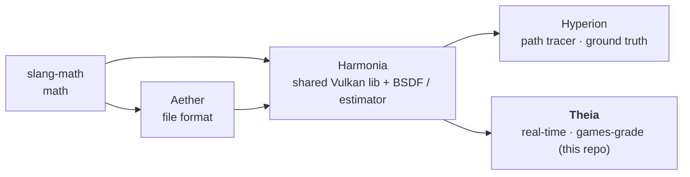

# PLAN — Theia

**Living source of truth for outstanding work.** Shipped items are removed from the work
lists; the shipped record is the *Baseline* below and `git log`. Only outstanding work is
tracked here.

**How to read this plan** — *human / PM:* *How to continue* is the prioritized next-up list.
*AI agent picking up work:* read `AGENTS.md` (orientation, gotchas — especially the
no-temporal-merge rule) → *How to continue* (your task) → *Governance* (definition of done +
guardrails) **before editing**.

## Context

Theia is the **real-time, games-grade tier** of a five-repo rendering pipeline:



The family goal: improve both renderers with the latest industry algorithms, adopting each
technique in the **shared Harmonia estimator + BSDF** wherever both benefit; per-renderer
only where they genuinely diverge. **Theia converges to Hyperion** (the unbiased ground
truth) — the gate is a strict-AND metric set (mean_diff / rel_mse / SSIM /
luminance-histogram) over 14 scenes; methodology and tools live in Harmonia
(`Harmonia/PLAN.md` *Parity methodology*, `Harmonia/tools/`). Most estimator work is tracked in
Harmonia; this file tracks Theia's roadmap and the items it consumes. Sibling plans: `Harmonia/PLAN.md`,
`Hyperion/PLAN.md`, `Aether/PLAN.md`, `slang-math/PLAN.md`.

**Shipped GI state (orientation):** Theia's interactive GI runs **ReSTIR PT** — one unified
reservoir driven by the shared path integrator, which **absorbs DI** (`useRestirDi` is forced
false whenever PT is on — the `gp.useRestirDi = m_useRestirDi && !m_useRestirPt` assignment in
`buildGiFrameParams` (`src/demo/Application.cpp`) and the GI record path; the DI candidate
path lives inside the same reservoir — the reservoir writes in `GiPass.cpp`
`updateDescriptors`) — plus spatial-only path reuse (see the
no-temporal-merge guardrail) and A-SVGF as an interactive-only presentation stage (identity
for offscreen capture). Stage order is **GI → MotionVector → TAA → Accumulation → Denoiser →
ToneMap** (renderer-side record order in `src/demo/Application.cpp` — GI `:549`/`:621`,
MotionVector `:629`/`:875`, TAA `:632`/`:882`; the shared Accumulation/Denoiser/ToneMap stages
in `Harmonia/src/harmonia/app/App.cpp:302/:313/:337`) — deliberate; do not reorder.

## At a glance

- **Release:** v0.7.17 - I6 verified (frames-per-flip shipped Harmonia-side v0.7.15, consumed by Theia; 5 CPU contract tests added); pins: slang-math v0.5.0, Aether v0.8.0, Harmonia v0.7.16.
  depth/camera, all under the large-module limits) + AR1 consumption. Lockstep
  reference: Harmonia v0.7.14, Hyperion v0.7.14 (Aether v0.7.7, slang-math v0.4.0).
- **Quality gates (family-uniform):** blocking lint (Q2-Q6) on every push -
  clang-format pinned 22.1.3, ruff contract in `ruff.toml` (identical x5), cppcheck,
  bandit, actionlint 1.7.12, yamllint. Coverage stays a local activity (the test
  suite needs a GPU).
- **Next:** MOD4 v1 needs a **Harmonia-side change** (swapchain present-fence +
  release path — see the MOD4 row) and is sequenced by the orchestrator. The
  shared-estimator next-up items (GI-SMS, C9, DN3, LS2, PERF5/PERF4, C11, C12)
  are tracked in `Harmonia/PLAN.md` and wire into `gi.comp.slang` when they land.
  slang-math override pin moved to **v0.5.0** (this repo's `CMakeLists.txt`
  declares `slang_math` ahead of the transitive Aether/Harmonia release pins —
  first-declaration-wins; family policy "use latest slang-math"; additive SM4
  release, no API change needed by Theia).
## How to continue

### Roadmap

| ID | Task | Deps | Status |
|----|------|------|--------|
| I6 | **Configurable frames-per-flip** (Theia window): render **N** accumulation frames per one swapchain present (**default N = 1** = current behaviour). N > 1 converges the *displayed* image faster per flip on a static/slow camera (each presented frame is the accumulation of N jittered sub-frames) at the cost of flip rate and input latency; accumulation still resets on camera move (as today). The interactive-window analogue of the headless `--offscreen-frames` path, distinct from TAA (which reprojects+blends rather than pure-accumulates). CLI flag `--frames-per-flip <N>` (default 1); validate against the convergence gate. Self-contained — VK6 present pacing is later polish, not a prerequisite. **Add the flag to the shared parser** (`Harmonia/src/harmonia/app/CliParser.cpp`), not to Theia's silent-swallow arg loop (that loop was the B5 bug — unknown args must hard-error). **Shipped:** `--frames-per-flip <N>` (default 1 = classic cadence) — the render half runs every frame, only the display/present half is gated per flip; N = 1 is byte-identical to the old loop. **Verified (this pass):** the cadence lives wholly in the pinned Harmonia v0.7.15 (`CliParser::applyCommonArg` flag → `AppConfig::framesPerFlip`; `AppPresent.cpp` mainLoop gate `m_framesSinceFlip >= max(framesPerFlip, 1)` around `presentFrame` only) — Theia consumes it unchanged via `main.cpp`'s applyCommonArg delegation, so there is no Theia-side flag loop. Accumulation/TAA/ReSTIR resets are per-render-frame (`Application::onUpdate` view-signature → `resetAccumulation()`, `m_cameraMoving` TAA gate) and run upstream of the flip gate, so N > 1 cannot miss a camera-move reset. CPU consumer-contract test added: `tests/module/test_cli_flags.cpp` (default = 1, resolve, clamp-to-1, invalid value consumes the token, independent of `--offscreen-frames`). | — | **done** |
| ANI3 | **Object motion vectors** — extend the MotionVectorPass beyond camera motion to animated instances (per-node velocity → TAA + ReSTIR temporal reuse). The plumbing is already in place but unused: `prevInstanceTransforms` is bound at `shaders/motion_vector.comp.slang:34` while the shader hardcodes the static-scene model (`:76`). | ANI1 (Aether) | backlog |
| MOD4 | **Swapchain recreate on resize → `VK_EXT_swapchain_maintenance1` release path** — v1 goal: on window resize, release the OLD swapchain (`vkReleaseSwapchainImagesEXT`) once its present fence (`VkSwapchainPresentFenceInfoEXT`) has signaled, so the new swapchain can be created without waiting on the old one's presentation-engine retirement. **Report (needs a Harmonia-side change; orchestrator sequences it):** the presentation stack is entirely Harmonia's (`App::handleResize` → `Swapchain::recreate`; SDL resize events + acquire/present `VK_ERROR_OUT_OF_DATE_KHR`/`VK_SUBOPTIMAL_KHR` all funnel there), and the pinned Harmonia v0.7.15 has the maintenance1 extension **disabled** (`Context.cpp`: the driver-side *scaling* attempt was reverted — `supportedPresentScaling = 0` for all present modes, driver 616.92) with no present-fence / release usage anywhere (`Swapchain::present` chains only `VkPresentId2KHR`; `recreate` passes `oldSwapchain` then move-assigns — RAII destroys the old handle under `App::handleResize`'s `vkDeviceWaitIdle`). The fence+release sub-feature is independent of the scaling probe. Needed Harmonia change: (1) re-enable `VK_EXT_swapchain_maintenance1` + the `swapchainMaintenance1` device feature, (2) `Swapchain::present` chains `VkSwapchainPresentFenceInfoEXT` (per-present/per-image fence), (3) `Swapchain::recreate` waits the old present fence, then `vkReleaseSwapchainImagesEXT` for still-acquired images, before retiring the old handle, (4) narrow `App::handleResize`'s whole-device `vkDeviceWaitIdle` to slot-scoped sync, (5) revisit the `IRenderer::onResize` contract (Theia's hook tears down/rebuilds GiPass/MotionVector/TAA/ForwardRenderer immediately — safe only under device-idle today). Follow-ups once landed: pre-rotation (`VkSwapchainPresentScalingCreateInfoEXT` when drivers mature), present-fence reuse. Recreate-on-resize remains the proven behavior until the Harmonia change lands. | Harmonia change | **report** |
| SM6-Theia | **slang-math trig migration slice** - verified **zero migratable sites** (sweep v0.7.0-era, 3 patterns over `src/theia` + `src/demo`): the cited CameraController trig is the spherical-to-cartesian formula - five scalar std:: calls over two scalar angles, not the per-component vector pattern; the remaining sites are scalar-on-scalar, which the scalar/vector collision rule sanctions (std:: stays). The saturate slice was already consumed (prior migration). No pin bump applies - slang-math arrives transitively via Harmonia since the dead direct declare was removed. Track origin: slang-math/PLAN.md SM6. | slang-math v0.7.0 | **done (verified empty)** |
| PERF5 | **Megakernel → wavefront GI split** (Padilla et al. 2026, arXiv:2605.27323; family item in `Harmonia/PLAN.md` §5.1 — this is the Theia wire): restructure `gi.comp.slang` (2266 lines — ReSTIR PT + medium walk + path trace fused in one dispatch) into **generate → trace → shade** waves over a persistent GPU ray/hit buffer, enabling PERF4 ray reordering. **Stage-1 contract: bit-identical rendered output
(AMENDED in 10c to the calibrated gate — see the design section §3)** — scheduling moves only; same RNG streams, same estimator, same reservoir logic. **Stages:** 10a design + per-pass timing instrumentation (done — see the design section below) → 10b generate/trace/shade split of the per-sample indirect walks → 10c path-reservoir candidates (local walk + spatial replays) into the wavefront → 10d async shadow rays + medium-walk segmentation (consumes Harmonia's M2 estimator shadow-split) → 10e GPU-driven live-count dispatch + stream compaction (GD law; PERF4 sort hookup). | Harmonia PERF5 (estimator untouched in 10a/10b) | **in progress** (10a–10b done; 10c done under the AMENDED calibrated gate — see "Verification gate" in the design section; dragon_teapot verdict open for orchestrator adjudication; 10d–10e open) |

### PERF5 wavefront design (stage 10a)

The scheduling architecture for the Theia wire of the family PERF5 item (Harmonia PLAN
§5.1: Padilla et al. 2026, wavefront ~16% faster than forward megakernel, attributed to
cache locality; gates PERF4 ray reordering). `gi.comp.slang` (2266 lines) currently fuses
the entire multi-bounce walk in one compute dispatch: primary re-trace, ReSTIR DI/PT
reservoirs, the `estimateGiSampleCore` bounce loop (inline closest-hit via
`traceClosestHit`, inline shadow rays via `TheiaTracer::traceTransmittance`, inline
volumetric segments via `runMediumWalk`), and the HDR composite. PERF5 restructures the
*scheduling* into specialized passes over persistent GPU path buffers. **Stage-1 contract:
bit-identical rendered output** — the split is purely structural, so every later stage
(10b–10e, PERF4) is diffed against an unchanged estimator. (10c amendment: the
verification contract is now the **calibrated gate** — §3 "Verification gate" below.)

**1. Pass decomposition — generate → trace → shade (→ regenerate).**

- **Generate** (per frame, once): G-buffer load (`t_giBuffer` worldPos / instance
  sentinel), camera-ray enqueue for every non-background pixel (slot kinds 0–3 below),
  collect-buffer init. No tracing, no shading, no RNG consumed.
- **Trace**: closest-hit query for every live path in the current wave's ray buffer →
  hit buffer (`instanceIdx/primitiveIdx/barycentrics/t/frontFace`, miss sentinel). The
  `RayQuery` loop moves verbatim from `traceClosestHit` (`gi.comp.slang:357`); vertex
  reconstruction (worldPos/normals/uv/tangent from instance + primitive + barycentrics,
  same expression order) moves to the consumer.
- **Shade**: resume each path's record — surface reconstruction (`makeSurfaceHit`),
  A3(a) regularization hook, reconnection capture, the shared
  `integrateSurface` (its three **inline shadow rays stay inline in stage 1** — see
  10d), env-miss contribution, radiance accumulation **in the record**, inline medium
  walk, then either terminate → collect write, or write the continuation ray into the
  next wave's ray buffer ("regenerate"). Shade is wave-0's primary-vertex work too
  (surface reconstruction from the traced camera ray, reservoir passes, primary env NEE,
  primary BSDF sample) — the pipeline is uniform from wave 0.
- **Stays monolithic in stage 1** (each is a self-contained FP/RNG sequence; splitting
  them buys nothing until 10c/10d): the ReSTIR DI reservoir passes (`restirDiDirect` —
  candidate RIS + temporal + spatial reuse + its one shadow ray), the path-reservoir
  spatial replays (`traceGiPathCandidateNoRR`), the local path candidate
  (`traceGiPathCandidate`), `runMediumWalk`, and the OpenPBR opacity pass-through chains
  (a null interaction resumes the same ray *inside one shade invocation*, bounded by
  `kMaxNullInteractions` — this keeps the wave count at `maxDepth + 1` instead of
  `maxDepth + kMaxNullInteractions + 1`). TAA, motion vectors, A-SVGF, accumulation and
  tonemap are already separate passes (Application record order GI → MotionVector → TAA
  → Accumulation → Denoiser → ToneMap); untouched.

**2. Buffer layout (Slang structured buffers; Slang `float3` = 16 B stride/align).**

```slang
struct WavePath {              // one suspended path segment (the megakernel loop state)
    float3 origin;             // 16
    float3 direction;          // 16
    float3 throughput;         // 16
    float3 radiance;           // 16  accumulated IN the record — per-path FP order preserved
    float3 mediumSigmaT;       // 16  medium-walk suspend/resume (10d; written at BSDF medium entry)
    float3 mediumAlbedo;       // 16
    float  lastBsdfPdf;        // 4   MIS input
    float  tMin;               // 4   kRayEpsilon | kNullInteractionEpsilon | kMediumEpsilon
    float  tMax;               // 4   kInf for surface bounces; free-flight dist for medium segments (10d)
    uint   bouncesRemaining;   // 4   megakernel `bounce` budget (primaryCharge pre-applied)
    uint   iters;              // 4   null-interaction guard (kMaxNullInteractions budget)
    uint   depth;              // 4   absolute surface depth (evalEmissionGuarded / kRRMinDepth)
    uint   pixelIndex;         // 4
    uint   sampleIndex;        // 4   c1 adaptive sample slot (collect index)
    uint3  rng;                // 12  RngState{key,index,dim} — THE RNG CRATE rides in the record
    float  mediumG;            // 4   medium-walk suspend/resume
    float  mediumEta;          // 4
    uint   mediumWalkIters;    // 4   kMaxMediumWalk budget consumed this entry
    uint   flags;              // 4   bit0 alive, bit1 terminated, bit2 passedThrough,
                               //     bit3 specularBounce(delta), bit4 insideMedium
};                             // 156 B → 160 B (16-aligned)
```

Medium-walk suspend/resume enumeration (exactly what `runMediumWalk` needs, Harmonia
`medium_walk.slang`): the record's own `origin/direction/throughput/radiance/rng`, the
flag `insideMedium`, `mediumSigmaT/mediumAlbedo` (pure-absorber branch derives from
albedo — `mediumIsPureAbsorber` needs no extra field), `mediumG`, `mediumEta`, and the
walk's own iteration budget `mediumWalkIters`. **Stage 1 keeps the walk inline in shade**
(the walk starts and completes within one dispatch — `sampleBSDF` sets the medium entry,
the walk runs, the post-walk exit ray is what gets written), so these fields are carried
but unconsumed until 10d; including them now avoids a mid-stage buffer re-layout.

```slang
struct WaveHit {               // trace-pass output, same index space as WavePath
    float2 barycentrics;       // 8
    float  t;                  // 4   CommittedRayT (medium boundary transmittance needs it)
    uint   instanceIdx;        // 4   0xFFFFFFFF = miss
    uint   primitiveIdx;       // 4
    uint   frontFace;          // 4   committed-hit front-face bit
    uint   pad;                // 4
};                             // 32 B

struct WaveCollect {           // per-pixel termination + composite inputs
    float3 sampleIndirect[4];  // 64  one slot per c1 adaptive sample (maxSamples = 4)
    float3 restirDirect;       // 16
    float3 restirPathIndirect; // 16
    float  restirM;            // 4   M-aware denoiser alpha
    uint   sampleCount;        // 4
    uint   pad[2];             // 8
};                             // 112 B
```

**Regeneration queue:** stage 1 has no separate queue — the ray buffer ping-pongs
per wave and slots are **fixed per pixel** (slot = `pixelIndex * 8 + kind`: kinds 0–3 =
the pixel's adaptive-sample paths, 4 = the path-reservoir local candidate, 5–7 = the
three spatial-replay candidates). Fixed slots mean no allocation atomics → a
deterministic index space (helps bit-identity) and every shade thread writes its
successor slot unconditionally (`alive=1` continuation or `alive=0` dead — the buffers
are never cleared per frame, the alive bit is the truth). Wave dispatch is full-width
`numthreads(8,8,1)`, same shape as today's GI dispatch; dead slots exit on the alive
flag. 10e adds the GPU-driven queue header (`{liveCount}` at offset 0, written by a
compaction pass, consumed by `vkCmdDispatchIndirect` — the `forward_cull` pattern) so
the GD law holds for the wavefront too.

**Byte math** (fixed slots → size is resolution × slot count, **independent of
`maxDepth`**; depth only bounds the wave count. Current config: `maxDepth = 3`
(scene default, `Application.cpp` `value_or(3u)`), `maxSamples = 4`, replays = 3,
local = 1 → 8 slots/pixel; ray buffer ×2 for the wave ping-pong):

| buffer | stride | 320×240 (76 800 px) | 1080p (2 073 600 px) | 4K (8 294 400 px) |
|----|----|----|----|----|
| ray ×2 (WavePath, 160 B × 8 slots) | 1280 B/px | 196 608 000 B (187.5 MiB) | 5 308 416 000 B (4.94 GiB) | 21 233 664 000 B (19.78 GiB) |
| hit ×1 (WaveHit, 32 B × 8) | 256 B/px | 19 660 800 B (18.75 MiB) | 530 841 600 B (506.25 MiB) | 2 123 366 400 B (1.98 GiB) |
| collect ×1 (WaveCollect, 112 B) | 112 B/px | 8 601 600 B (8.20 MiB) | 232 243 200 B (221.5 MiB) | 928 972 800 B (885.9 MiB) |
| **wavefront total** | 1648 B/px | **224 870 400 B (214.5 MiB)** | **6 071 500 800 B (5.65 GiB)** | **24 286 003 200 B (22.62 GiB)** |

Existing ReSTIR reservoir buffers (64 B ×2 + 512 B ×2 per pixel = 84.4 MiB at parity
size) are unchanged. All sizes sit comfortably in the ~100 GB-class unified-memory
target; the parity/iteration resolution (320×240) costs ~215 MiB.

**3. Bit-identity contract.**

- **RNG stream ownership:** the per-pixel-sample `RngState` (Harmonia `rng.slang`:
  `{key, index, dim}`, Owen-scrambled Sobol) lives **in the ray record** — the crate
  crosses pass boundaries inside `WavePath.rng`. Seeds are composed exactly where they
  are today (`composeRngSeed` at generate for sample walks; `pathCandidateSeed` /
  `pathReplaySeed` for reservoir candidates); `dim` advances exactly as the megakernel
  consumes draws because shade executes the same statement sequence per vertex. No draw
  is added, removed, or reordered anywhere in the split — timestamps and barriers do not
  consume RNG. The replay tokens stored in `PathReservoir` (`rngKey/rngIndex`) are
  unaffected.
- **FP ordering — what must NOT be reassociated:**
  1. the per-path radiance chain (`state.radiance += ...`: env-miss, emission, NEE — in
     path order). Radiance accumulates **in the record**, and the wave barrier gives
     bounce-N happens-before bounce-N+1, so the addition order along each path is
     exactly the megakernel's, even though different threads touch consecutive waves;
  2. the per-pixel sample sum (`sumIndirect + sumEnvNee` per sample, `× invN` after) —
     the composite pass sums collect slots in **s order 0..sampleCount-1**, the
     megakernel's loop order, then applies the identical final expression
     (`hdr[px].xyz + (Σ + envNee) * invN + restirDirect + restirPathIndirect`);
  3. every MIS weight (`envPdf / (envPdf + bsdfPdf)`), the medium walk's throughput
     chain, and the firefly clamp — all remain inside the untouched shared estimator /
     the same statement order.
- No atomic radiance accumulation anywhere (order nondeterminism); no fast-math (repo
  law: `/fp:strict` host, strict Slang default). Scheduling changes when/where an op
  runs, never which ops a path executes.
- **Verification gate — AMENDED in 10c to the CALIBRATED gate (binding; supersedes
  the byte-equality contract).** The orchestrator renders
  `theia.exe --scene <s> --output <capture>.exr --width 320 --height 240
  --offscreen-frames 256` on the pre-split baseline captures and on every stage
  branch, on all three gate scenes (cornell_classic, cornell_spheres,
  dragon_teapot), and requires **`compare_renders.py <baseline> <candidate>` →
  mean_diff `0.000` AND SSIM `1.000000` AND max_diff ≤ 1/255 display units**.
  The ReSTIR-PT captures are run-to-run pixel-reproducible, so the gate is
  stable.
- **Root cause (why byte-equality was replaced — record for 10d+):** the driver
  **recomputes committed-hit barycentrics/rayT at the RayQuery site**, and FP
  contraction follows the surrounding compiled context; Slang emits **no
  `NoContraction` decorations**, so byte-equality across compiled contexts was
  never a guaranteeable contract. Four bisect experiments established exactly
  **two driver-codegen classes**: the inline trace in its own context
  (revert → 0 differing px), and ANY restructure (→ 7387/76800 px at 1–2 ULP,
  max 2.6e-7 linear on cornell_classic @256f — one deterministic class,
  byte-equal across all restructured variants). **Not an estimator change.**
  Upstream-reportable to Slang (missing `NoContraction` on ray-query
  recomputes).
- **The estimator invariants stay FULLY binding** under the calibrated gate:
  same RNG streams, same draws, same statement order — only the driver's
  recompute context may differ. A stage that changes a seed, a draw, or the
  per-path statement order is a FAIL regardless of the display metrics.
- **10c measured results (the calibrated artifact, exact):**

  | scene | mean_diff | SSIM | max_diff (1/255) | differing px (float-exact) | max linear |
  |----|----|----|----|----|----|
  | cornell_classic | 0.000000 | 1.000000000 | 0.0000 | 7387/76800 (9.62%) | 2.608e-07 |
  | cornell_spheres | 0.000001 | 1.000000000 | 0.0385 | 1004/76800 (1.31%) | 1.834e-04 |
  | dragon_teapot | 0.005414 | 0.999967309 | 64.4042 | 6196/76800 (8.07%) | 3.590e-01 |

  cornell ×2 PASS (classical cornell reproduces the bisect prediction
  pixel-count-exact; the tonemapped 8-bit PNGs are byte-identical to the
  baselines — display-indistinguishable). **dragon_teapot exceeds the calibrated
  envelope** — adjudicated: **land, under the medium-scene envelope (below)**: the 1–2 ULP
  committed-hit shift reaches the glass teapot's `runMediumWalk`, where sampled
  free-flight distances vs boundary-hit distances are near-ties — a ~1e-7
  primary-origin shift flips ~6 paths O(1) (measured: 6 px > 1e-1 linear,
  matching the tie-probability estimate; green-channel dominated — the hero
  wavelength; scattered speckle across 72 8×8 tiles via ReSTIR spatial-reuse
  propagation, no contiguous region → no hit/miss or fallback bug). Proven
  deterministic: a second render of the same build is float-exact (0 differing
  px; only EXR container bytes differ). There is no wiring variant that avoids
  this: byte-identical primary barycentrics require consuming them inside the
  query's compiled context — the exact thing the root cause rules out.

  **Adjudication evidence (monolithic RNG re-seed experiment):** same binary,
  same scene, same settings, only `--rng-seed` default vs 20261030 — a
  legitimate re-seed produces mean_diff **4.794** / SSIM **0.8948** on this
  scene, ~900× larger than the wavefront deviation (0.005414 / 0.999967); the
  re-seed re-rolls every stochastic decision, the wavefront re-rolls 6
  near-tie coin-flips. **Medium-scene envelope (binding, supersedes the
  per-pixel max for medium-class scenes): mean_diff ≤ 0.05, SSIM ≥ 0.9999,
  differences scattered (no contiguous region), and deterministic
  (float-exact re-render)** — for a Monte Carlo estimator, distributional
  equivalence under re-seeding is the correct no-behavior-change notion. The
  sharp per-pixel gate (mean_diff 0.000 / SSIM 1.0 / max_diff ≤ 1/255) stays
  binding for non-medium scenes. The artifact remains upstream-reportable
  (Slang `NoContraction`).

**4. Stage plan (file-level) and abort criteria.**

- **10b — generate/trace/shade split of the per-sample walks** (`estimateGiSampleCore`'s
  bounce loop): new `shaders/wave_common.slang` (structs above + reconstruction helpers),
  `shaders/gi_generate.comp.slang`, `shaders/gi_trace.comp.slang`,
  `shaders/gi_shade.comp.slang` (all added to `THEIA_ENTRY_SHADERS`); `gi.comp.slang`
  reduced to generate/shade bodies; `src/theia/gi/GiPass.*` gains the wave buffers + 3
  pipelines + per-wave dispatch/barrier recording; `src/demo/Application*` unchanged
  (`GiPass::record` signature stays).
- **10c — DONE (shipped as the wavefront trace pass + record-consuming shade;
  calibrated gate (b)):** the verbatim `RayQuery` traversal moved out of the
  megakernel into `shaders/wavefront_trace.comp.slang` (committed `b5734c7`:
  RayQuery into the hit buffer, GI shade-only), and the consumer wiring landed
  on top: shade reads the recorded `WaveHit` — `reconstructGiHit` is the
  verbatim continuation (traceClosestHit's vertex fetch + reconstruction
  statements), the miss sentinel (Q1) triggers the G-buffer fallback, and the
  inline wave-0 primary trace in `gi.comp.slang` is GONE — the trace pass is
  the single source of wave-0 hits. The ORIGINAL 10c scope below (path-reservoir
  candidates, slot kinds 4–7) did NOT ship in this stage — their enqueue stays a
  later stage. Gate numbers + the dragon_teapot calibration note: design section
  §3. Timing: gi = 2.38 ms on cornell @320×240/256f (generate + trace 4-slot +
  shade-with-record; the 4-slot same-ray trace is the +1.26 ms delta vs 10b's
  1.10 ms same-machine — the slot-0 single-trace optimization is 10d scope,
  where the slots diverge).
- **10d — DONE (shipped as the shade + regenerate loop: collect consumption, wave
  N+1 successors, slot-0 single-trace; the original 10d scope below is
  re-scoped):** the GI dispatch is the wavefront SHADE stage — the CPU records
  `maxDepth + 1` (trace, shade) pairs per frame (generate runs once, wave 0
  only). Wave 0 shades the primary vertices (surface reconstruction, ReSTIR
  reservoirs, per-sample opacity gate + primary env NEE + BSDF sample, inline
  medium walk) and regenerates wave 1's successors; waves ≥ 1 resume one record
  per slot — `reconstructGiHit` from the recorded WaveHit, the shared
  `integrateSurface`, the OpenPBR null-interaction chain INLINE in the
  invocation (bounded by the carried loop-entry budget, today's `continue` +
  re-trace), the inline medium walk — then either terminates the sample into
  its `WaveCollect` slot (the core epilogue verbatim: exposure, NaN guard,
  clamp) or writes the next successor. Radiance accumulates IN THE RECORD (the
  wave barrier is the bounce-N → bounce-N+1 happens-before edge, design §3);
  the RNG crate rides in the record; the last wave composites the collect
  chains in s order and applies the megakernel's final HDR expression
  unchanged. NO atomics-based radiance anywhere. The old per-sample
  accumulation path is REMOVED: `estimateGiSample` (the sample-walk wrapper)
  is gone; `estimateGiSampleCore` remains unchanged for the path-reservoir
  candidate walks (their slot enqueue — kinds 4..7 — stays a later stage), so
  `traceClosestHit` remains the inline tracer for the medium walk, the
  null-interaction chain and the replay hops. The medium fields are ACTIVATED
  as consumed state (the wave shade reconstructs `PathState` from the record
  instead of re-deriving constants) — with NO cross-wave suspension: the walk
  still starts and completes inside one shade invocation, so `insideMedium` is
  never live across a wave (the fields are state carriers, exactly as the
  design's stage-1 contract prescribes). **Slot-0 single-trace (adjudicated
  byte-safe under (b)):** the four adaptive-sample slots share the IDENTICAL
  camera ray (`makeCameraWavePath` varies only the RNG crate and collect index
  — no trace input), the trace pass traces kind 0 only at wave 0, and the
  shade reconstructs the primary once from record 0's hit for all samples; the
  slots diverge at first shade, never at trace time. **Design amendments
  (documented in code):** (1) `WaveCollect` grew 112 → 176 B — the design's
  single `sampleIndirect[4]` cannot express the composite's TWO summation
  chains bit-exactly (`sumIndirect` and `sumEnvNee` are separate
  left-associated accumulators in the megakernel); the collect now carries
  `sampleIndirect[4]` + `sampleEnvNee[4]` and the design's `pad` hosts the
  composite's activity/validity flags (`sampleCount = 0` = pixel inactive;
  bit0 = the legacy `maxSamples == 1 && !valid` early return). (2) The
  physical ray ping-pong is dissolved — the regenerate is IN-PLACE (one
  buffer, bindings alias one allocation's use; `m_wavePathBuf[1]` stays as the
  10e compaction scratch): at fixed-width full dispatches the design's
  dead-half re-write was ~250 MB/frame of stale-record traffic and dominated
  the frame on unified memory. (3) Dead slots are 4-byte `flags` member stores
  (no consumer of a dead record reads beyond the alive bit) and the generate
  pass enqueues kinds 4..7 / background slots the same way. (4) When the ReSTIR
  PT path reservoir owns ALL multi-bounce transport (the default), every
  per-sample slot is PROVABLY dead after the wave-0 shade, so the CPU collapses
  the train to ONE wave (`waveCount` push constant; the composite runs in the
  wave-0 shade) — the full train remains for the legacy per-sample walk modes
  (`--no-restir-pt-path`), where it was validated to converge to the same
  estimator value (mean 0.5096 @64f vs the converged 0.5097 baseline). No GPU
  readback, no indirect dispatch (fixed-width, Q1). **Timing (THEIA_PASS_TIMING,
  cornell @320×240/256f): gi = 1.46 ms** (ladder: 0.71 monolithic / 1.10 (10b) /
  2.33 (10c-unoptimized) / **1.46 (10d)** — the slot-0 recovery is the −0.87 ms
  delta vs 10c; the wavefront remains above the monolithic 0.71 at parity
  resolution (fixed dispatch train + record-buffer round-trips ≈ +0.75 ms,
  work-invariant across resolutions), so abort criterion (b)'s 1080p
  measurement must reproduce the paper's crossover before PERF4 stacks.
  **Gates (all three scenes, vs the 10c baselines — the numbers are
  pixel-for-pixel the 10c artifact, i.e. zero new deviation from the shade +
  regenerate restructure):** cornell_classic 0.000000 / 1.000000000 / 0.0000
  (7387/76800 px float-exact, max 2.608e-07 linear); cornell_spheres
  0.000001 / 1.000000000 / 0.0385 (1004/76800 px, max 1.834e-04);
  dragon_teapot 0.005414 / 0.999967309 under the medium-scene envelope
  (≤ 0.05 / ≥ 0.9999; 6196/76800 px float-exact, 6 px > 1e-1 linear — green
  channel in 6/6, scattered across 6 distinct 8×8 tiles, no contiguous
  region) — deterministic (second render of the same build float-exact, 0
  differing px). The artifact remains upstream-reportable (Slang
  `NoContraction`).
- **10d-legacy scope — async shadow rays + medium-walk segmentation (re-scoped;
  blocked on Harmonia M2):** consumes Harmonia's M2
  estimator split (the `ITracer` emit→trace→gather shadow flow — shared, identical for
  both renderers); Theia adds the shadow-ray queue + gather pass and switches
  `runMediumWalk` to per-segment waves via the WavePath medium fields; touches
  `wave_common.slang`, new `gi_shadow*.comp.slang`, `GiPass`, and the shared
  `path_integrator.slang` *consumer wiring only* (the estimator change itself is
  Harmonia's M2, strict-ordered before this).
- **10e — GPU-driven wavefront:** live-count header + `vkCmdDispatchIndirect` + stream
  compaction (GD law); PERF4 sort-key hookup point. Touches `GiPass` dispatch recording,
  a compaction pass, `wave_common.slang`.
- **Abort criteria (stop-and-present per stage):** (a) the verification gate (the
  calibrated gate, §3) fails on a
  stage after two concentrated fix attempts → revert that stage, present its
  `THEIA_PASS_TIMING` numbers and the diff diagnosis; (b) wavefront overhead (extra
  dispatches + barriers) exceeds the megakernel baseline by >10% at 1080p on the dev GPU
  → present measurements before stacking PERF4 (the paper's ~16% win must reproduce
  first); (c) Harmonia M2 slips → 10d stops after Theia-side prep, 10e can still ship
  (independent).

**5. SH-02 note (secondary-bounce roughness regularization).** The A3(a) hook sits in the
per-vertex shade at `gi.comp.slang:1231` (`a3RegularizationEnabled != 0 && bounce > 0 &&
!smoothDielectricTransmission` → lerp the local material's GGX alpha toward 0.3, coat
half). It mutates a **local copy** of `surf.mat` between `makeSurfaceHit` and
`integrateSurface` — exactly the shade-pass vertex boundary in the wavefront — so each
wave's shade invocation applies it unchanged; the flag rides the push constants
(identical in all passes). It never touches the medium walk (the `bounce > 0` gate is
surface-bounce-scoped and walk segments consume no bounce budget), so SH-02's shared
`medium_walk` module and the 10d segmentation are unaffected. **It must remain OFF in
captures** (`m_pureEstimatorCapture` → `useA3Regularization=false` → push-constant 0) —
the calibrated gate is only coherent against the unbiased estimator; the two-tier
output contract already enforces this for `--output`.

**Instrumentation baseline (10a, shipped):** `theia::PassTimer`
(`src/theia/renderer/PassTimer.hpp/.cpp`) — `THEIA_PASS_TIMING=1` records
`vkCmdWriteTimestamp2` pairs around GI / MotionVector / TAA (both the async-compute and
single-queue paths) and logs one `timing: gi <x.xx> ms | motion <x.xx> ms | taa <x.xx> ms`
line per frame batch; zero GPU cost when the toggle is off. Every later stage adds its
passes here, so 10b–10e measure against this baseline.


### Code health

| ID | Task | Deps | Status |
|----|------|------|--------|
| CH-T1 | **Review `theia/renderer` for an internal split** — 23 files / 5093 lines, the family's largest module (the `large module` proxy). Candidate seams: the mesh-shader geometry path vs GI (`GiPass`) vs the post-fx cluster (TAA / A-SVGF / MotionVector).
      Techniques (refactoring.guru): Extract Class for the seams; Extract Method + Replace Method with
      Method Object for `ForwardRenderer.cpp` (1342 lines) and `demo/Application.cpp` (1089 lines). Verdict first: split only where a seam is real; otherwise record accepted.
      Per-file bloat queue (`header_size`): DRAINED — `ForwardRenderer.cpp` split into
      `ForwardRenderer.cpp` (867) + `ForwardRendererPipelines.cpp` (499); `demo/Application.cpp`
      into `Application.cpp` (839) + `ApplicationCompute.cpp` (273). `header_size: error` promoted. | — | **in progress** |

Executed (file level): theia/renderer (23 files / 5093 lines) split into seven
focused modules - renderer core (795), pipelines (933), cull (945), gi (975), postfx (913),
depth (426), camera (135) - all under the large-module limits, gate green with 20 declared
edges. VERDICT (after the full end-to-end read): REJECT the rig extraction.
The async-compute submission flow is the Application's framework-contract implementation:
`onBeforeSceneStages` is a harmonia::app::App hook, the Application submits BOTH its
graphics and async-compute queues against the App-provided device/pool infrastructure, and
the stages command buffers come from the App command pool. An Extract Class would invert
that framework relationship (the rig would need to hold App state) - the classic failed
extraction. What WAS extractable landed: the queue-transfer barrier helper (T-03 root,
harmonia::core::imageBarrier) and the Move Method of the attachment transitions into
ForwardRenderer (the narrow face). `large module: demo` stands as a documented report-only
signal of the IRenderer-adapter + frame-coordination shape. The theia/pipelines orphan
stays the accepted TU-split artifact.
AR1 executed: Theia's Scene implements the harmonia/scene_rt hooks
(`createTriangleMesh` / `finishBuild`) and owns its TLAS; harmonia/scene is rt-free.
T-04 verdict: REJECT - Scene::uploadBuffer is a deliberate adapter
between the harmonia expected-API and the scene VkResult+out-param flow, applied
uniformly at 17 call sites; removal churns them without behavior or readability gain.
This item sits in the frame-coordination cluster of the family categorization in
Harmonia/PLAN.md; internal order: pipelines class -> ComputeRig -> T-03, with Q1 (coverage)
as the precondition.

Accepted by design (no action): the `demo -> theia/renderer -> theia/scene`
chain measures as a pass-through/Middle-Man proxy — it is the designed layer chain.

### ReSTIR-PT refinements (GI-ENH — core landed; exploitation remains)

**Landed:** (b) vector-valued resampling weights (§6.3), (c) Gaussian
paired-neighbor self-inverse maps (§3), (a) k=2 + k≥3 reconnection shifts (telescoping
GRIS Jacobian, Eq. 5 footprint criteria), **paper-faithful resampling** (shift OR replay per candidate - the pairwise-MIS
average and the paired shift-sharing shortcut were both dropped: shift-sharing
consumed the reverse-direction shift, and the paper's section 3 pairing only
amortises the pair of shifts that pairwise MIS needs), **forced NEE reconnection** (§6.2.3 — reconnect to x_k
using NEE only, higher eligibility), **Russian roulette at initial sampling only** (§6.2.4),
and the **critical `flags |=` fix** (reconnection shift was silently never firing).
Multi-frame captures are run-to-run pixel-reproducible. Remaining:

- **Hybrid shift, remaining (paper-faithful gaps - read `DQLin/ReSTIR_PT` before touching):**
- *Prefix-replay invertibility.* The paper: "Shift invertibility is checked when connecting
  from y_{k-1} to x_k." The CONNECTION-time half is implemented (near-field rejection on the
  shifted edge, gated on Hybrid exactly as `computeShiftedIntegrandReconnection` does).
  The PREFIX half is NOT: the reference's `handleHit` sets `invertible = false` on
  non-invertible prefixes (NEE-bounce / diffuse-assignment cases) and
  `invalidateAndTerminateReplayPath` zeroes `L`/`thp`. That needs the prefix-replay
  generalisation below, and is the prime suspect for the residual -0.5% mean shift under k=3.
- *k >= 4*: the reference's `rcVertexLength` is adaptive over the whole path; ours is capped
  at the second surface because only the k=2 (no replay) and k=3 (one-hop) shift bodies exist.
- *alpha from sampled lobes*: the paper uses "a from the path's sampled lobes"; we use the
  material roughness as a proxy (sampled-lobe alpha is not tracked per vertex).
- *Exercising k=3*: the criteria pick the first pair on the test scenes (rough, long edges),
  so the k=3 body is barely hit. It needs a scene where the first pair fails (near-specular
  primary, or a sub-0.1 segment) before its correctness can be measured.

**Stream compaction** (§6.2.2) — reduce warp divergence in replay.
- **Dual motion vectors** (§6.4) — presentation stage only (A-SVGF/TAA reprojection).
- **Temporal reuse without recursion bias:** an unbiased temporal form (e.g. GRIS pairwise
  MIS with canonical-sample accounting) could restore temporal memory for the interactive
  (non-accumulated) path, where frame accumulation isn't available. Would also fix the DI
  reservoir's latent recursion bias. **Read the no-temporal-merge guardrail first** — the
  naive streamed merge is prohibited, and this item is the only sanctioned way back in.
  (Enhanced §5's duplication-map→temporal-cCap modulation presupposes a temporal merge and
  is N/A while spatial-only; our per-pass hash dedup (GI2.5) already covers the spatial
  duplicate case.)

### Consumed items (defined elsewhere)

- **GI-SMS** (caustics/SDS), **DN3** (converging denoiser — the à-trous replacement),
  **DN1** (RaNAD neural denoiser for the low-spp window; unblocked by VK1 cooperative matrix),
  **C11** (ReSTIR SSS — brings Theia's realtime SSS onto the shared random-walk model
  Hyperion already runs → SSS parity), **C9/C12** (BSDF)
  — all tracked in `Harmonia/PLAN.md`. **PERF5/PERF4** (wavefront — Theia is the harder
  wire: `gi.comp.slang` 2266 lines fuses ReSTIR PT + medium walk + path trace): the
  estimator/paper track stays in `Harmonia/PLAN.md` §5.1, but the Theia scheduling wire
  is now tracked **in this file** (roadmap row PERF5 + the stage-10a design section
  above); PERF4 is gated by its 10e.
- **VK4** (subgroup rotate/reconvergence → faster reservoir merging/compaction) and **VK5**
  (pipeline binaries → cuts Theia's cold start: 5 pipelines at init — opaque/transparent/sky/
  cull/GI — and speeds `.spv` hot-reload) — Harmonia covers the probe→enable; Theia consumes.
- **ANI2** (per-frame TLAS refit; needs PERF3), **ANI6** (animated parity gate; needs ANI7),
  **BV4** (wavefront AABB consumers; gated by PERF5) — tracked in `Harmonia/PLAN.md`.
- **NH2/NH3** (node hierarchy) once **NH1** (Aether) lands.

## Governance

**Definition of done (per change):** `ctest` green **+** a representative headless render
validation-clean **+** warning-clean build (clang-cl `/W4 /WX /permissive- /Zc:__cplusplus`,
Clang/GNU `-Wall -Wextra -Werror -Wpedantic`; a compiler warning is a build failure — fix the
cause, never silence it; a Vulkan validation message is a bug, never noise). **Per release:**
the above plus `verify-full` (verify + format-check + clang-tidy + cppcheck) **plus** the
parity harness (`Harmonia/tools/render_and_validate.py` over `validation_manifest.toml`)
**plus** `Harmonia/tools/check_vulkan_validation.py` over the full 30-scene gallery **plus**
regenerated screenshots.

**Screenshot standard:** gallery PNGs 1280×720 at **256 frames** accumulation; parity
*references* are a clean Hyperion **256 spp** EXR at the 320×240 parity resolution (never a
low-spp reference).

**Guardrails:**

- **The path reservoir has NO temporal merge — do not add one back** (verbatim rule, also in
  `AGENTS.md`): a streamed temporal merge double-counts re-selected history on heavy-tailed
  path candidates (measured −2.8% darker on cornell indirect @1024f, reproduced in Monte-Carlo
  simulation; M-caps don't fix it). Spatial reuse reads neighbours' **unmerged local**
  reservoirs (bindings 20/21 store local candidates only) — plain unbiased RIS. The only
  sanctioned route back to temporal memory is the unbiased GRIS pairwise-MIS form in
  *ReSTIR-PT refinements* above.
- **The denoiser is a presentation stage, never part of the estimator (v0.7.4 contract):**
  A-SVGF is forced off for offscreen capture (`--output`) in both renderers
  (`Harmonia/src/harmonia/app/App.cpp:372`); a capture is the raw scene-referred estimator
  result. The à-trous kernel has a fixed pixel radius — its effect scales with resolution and
  never vanishes with samples. Do not re-enable it on the capture path, do not describe it as
  converging. (DEN2 makes this a test; DN3 in Harmonia/PLAN.md aims to remove the need for
  the special case.)
- **Capture is estimator-pure (extended contract):** `--output` additionally disables Theia's
  remaining presentation aids — the firefly clamps (`forward_render.frag.slang`,
  `gi.comp.slang`; `fireflyClampEnabled` = rngFlags bit2 / GiPC field) and the A3(a)
  secondary-bounce roughness regularization (`useA3Regularization`) — and forces camera
  jitter **on** (`--no-camera-jitter` is ignored), so the capture integrates the same pixel
  footprint as Hyperion's per-sample jitter and converges to the unclamped ground truth
  (`src/demo/Application.cpp`, `m_pureEstimatorCapture`). The interactive window keeps all
  presentation aids. Consequence: capture renders now show unclamped firefly *variance* on
  HDR content — that is the estimator's true noise floor, not a bug (see
  `Harmonia/PLAN.md` §7 bias-vs-noise method).
- **Multi-frame captures are run-to-run pixel-reproducible — keep them that way.** Two sync
  bugs were fixed to guarantee it: the reservoir ping-pong needs its per-frame
  buffer barrier in `GiPass::record` (frame N's `Cur` writes → frame N+1's `Prev` reads had
  no dependency at all), and the GiPass descriptor set must be **per frame slot** — a single
  mutable set rebound every frame races in-flight frames under UPDATE_AFTER_BIND (the
  run-to-run nondeterminism root cause; the pool must be sized for ALL slots). Do not
  regress either; reproducible captures are the parity workflow's debugging foundation.
- **Convergence-to-Hyperion litmus:** a technique is acceptable on the converging path only
  if its contribution → 0 as samples/frames → ∞, OR it lives in a real-time-only layer
  (denoise, TAA, culling) bypassed in reference/accumulation mode. Irreducible bias is
  rejected from the converging path (presentation-only at most). Neural GI proxies are
  rejected outright (see Harmonia/PLAN.md *Research triage*).
- Shared-BSDF contracts defined by Harmonia apply here verbatim (`Harmonia/PLAN.md`
  guardrails): dielectric sidedness (raw outward `GiHit.geoNormal`), the Chiang 2019
  terminator factor at every NEE/continuation site (Theia-side: `gi.comp.slang:899,1017`,
  `forward_render.frag.slang:302,328`), object-space position-fetch vertices, MaterialX
  transmission-tint semantics, exact Beer–Lambert for pure absorbers, device-only AS builds.
- **Vulkan policy: latest + KHR/EXT, modern over legacy, no fallbacks** (probe→enable pattern
  for optional capabilities; absent-branch must be image-identical and free).
- **Build rules:** clang-cl + Ninja + vcvars; slangc `.slang`→`.spv` with
  `-matrix-layout-row-major`; new Theia compute entries → `THEIA_ENTRY_SHADERS` in
  `CMakeLists.txt`. Force-recompile `.spv` when shared Harmonia shaders change (CMake does not
  track Slang import chains — touch the consuming entry shaders).
- Fix bugs at once — root-caused and patched immediately. Solve directly, never defer.
- Tags are always pushed to GitHub (verify `git ls-remote --tags origin` == `git tag -l`).
  Release order: slang-math → Aether → Harmonia → **Theia**; bump the Harmonia FetchContent
  pin in the release commit.
- Commit per-repo; push only on explicit OK.
- Living document — done work is removed from this file; the record is the Baseline and
  `git log`.

## Baseline

- **v0.7.14** (consumes Harmonia v0.7.13): **code health: the scene module
  joins `namespace theia` + the arch gate.** `theia/scene` (`Scene`, `GpuInstance`,
  `GpuInstanceBounds`, `GpuMeshlet`) was the family's last global-namespace module — now
  `theia::` like the renderer, with the forward declarations moved inside the namespace.
  `tools/check_layers.py` (ctest `test_layers`, label `analysis`): the `scene` ←
  `renderer` ← `demo` DAG, file-level cycle detection, and any `hyperion/` include fails
  (**Theia never depends on Hyperion** — the sibling renderers are independent; shared
  code goes down into Harmonia). 19/19 ctest on Windows; Linux build-only green; 3-scene
  smoke at release settings pixel-identical (MAD = 0) to the gallery.
- **v0.7.13** (consumes Harmonia v0.7.12): **the layering migration.** Every `harmonia::`
  reference now names its layer (`harmonia::core::Buffer`, `harmonia::scene::SceneBase`,
  `harmonia::app::App`, …) to match Harmonia v0.7.12's layered namespaces; `theia::` is
  unchanged. Docs updated (names + citations). README gallery regenerated from this code
  — pixel-identical (MAD = 0) to the previous set; the 7 noise-prone shaderball scenes were
  refreshed (sub-1/255 accumulation nondeterminism). 18/18 ctest on Windows and Linux; zero
  validation errors and warnings.

- **v0.7.12** (consumes Harmonia v0.7.11): **range-08045 residual fix + VK15
  consumption.** LightCuller binding 0 (lights) and GpuCullPass bindings 0/1 (instances +
  bounds) still wrote descriptor ranges from `vkGetBufferMemoryRequirements().size` — the
  rounded *memory* size; both `dispatch()` entry points now take `const harmonia::core::Buffer&`
  through the shared writer's creation-size overloads and the memReq boilerplate is deleted
  (caught by the `shaderball_checker` validation smoke — a 400-byte storage buffer reported
  unbacked). Consumes Harmonia **v0.7.11** (VK15 — opacity micromap on the KHR AS API; the
  OMM cutout path proven image-identical, MAD = 0 vs the release gallery). 18/18 ctest on
  Windows and Linux; **zero validation errors and warnings** (interactive + offscreen).
- **v0.7.11** (consumes Harmonia v0.7.10 + transitive slang-math v0.3.0): **dual-OS
  CI; refactoring batch 1 (T-01/T-02); I6; descriptor-range fix; regenerated gallery.**
  Build-only CI on windows-latest + ubuntu-26.04 (the GPU suites stay local); portable env
  reads + the GCC missing-field-initializer mirror blocks. **T-01:** shared
  `buildGiFrameParams`/`buildMotionVectorParams` — every GI-ENH/PERF5 parameter lands once
  instead of twice (async vs single-queue drift becomes impossible). **T-02:**
  `createOneSetLayout` + the all-zero binding-flags arrays dropped (spec-equivalent to
  omitting the flags chain; `PARTIALLY_BOUND` kept for the bindless texture set). **I6**
  documented: `--frames-per-flip <N>` (shared parser; N = 1 byte-identical classic cadence).
  **Fix** (`range-08045` follow-through): descriptor writes carry buffer creation sizes;
  optional tile-light / env-CDF resources became non-owning `const Buffer*` (absent = null
  descriptor, unchanged). README gallery regenerated at release settings — **pixel-identical
  to the v0.7.10 gallery (MAD = 0 on all 30 scenes)**, hard evidence the refactor is image-neutral.
  18/18 ctest green on both OSes; interactive `--validation` clean.
- **v0.7.10** (consumes Harmonia v0.7.9): **reconnection shift made faithful to ReSTIR PT
  Enhanced (adaptive k, mode-gated selection, invertibility).** (Entry backfilled
  from the release commit.)
- **v0.7.9** (consumes Harmonia v0.7.9): **Theia matches Hyperion (bias floor 5.11 FAIL ->
  2.22 PASS).** (Entry backfilled from the release commit.)
- **v0.7.8**: **estimator-pure capture — the extended two-tier contract.**
  `--output` now disables every presentation aid — A-SVGF/TAA (v0.7.4), the firefly clamps
  (`forward_render.frag.slang` + `gi.comp.slang`; `fireflyClampEnabled` = rngFlags bit2 /
  GiPC field) and the A3(a) secondary-bounce roughness regularization — and forces camera
  jitter ON (`--no-camera-jitter` is ignored), so a capture integrates the same pixel
  footprint as Hyperion's per-sample jitter and converges to the unclamped ground truth
  (`Application.cpp` `m_pureEstimatorCapture`). **Parity re-baselined** (14-scene strict-AND
  @ 320×240 / 256f vs 256 spp): the clamp/jitter bias is gone (global mean ratio —
  cornell_classic 0.97→0.998, openpbr_metals 0.85→0.97); the gate is now variance-dominated
  (residual per-frame grain + HDR firefly speckle) — attacked by GI-ENH variance work
  (*ReSTIR-PT refinements*), never by re-tuning presentation aids. Tooling (presets /
  check_tidy.py + test_tidy / THEIA_SANITIZER / deterministic FP). 18 ctest green;
  30-scene gallery regenerated.
- **v0.7.7**: **C14/VK2 — real OpenPBR `geometry_opacity` cutout.** The
  rasterizer's alpha-test became a stochastic coverage draw (discard with probability 1-α,
  same per-pixel RNG stream as everything else) instead of a fixed cutoff against a dropped,
  non-OpenPBR `geometry_opacity_cutoff` parameter; both the forward shadow ray and the GI
  pass's inline `RayQuery` resolve non-opaque candidates
  (`CandidateType() == CANDIDATE_NON_OPAQUE_TRIANGLE`) — committing fully-present hits,
  accumulating ∏(1-α) otherwise. 17 ctest green; `shaderball_checker` with/without-extension
  image-identical.
- **v0.7.6**: consumed Harmonia's present pacing (VK6: `FIFO_LATEST_READY`, per-present IDs,
  `Swapchain::waitForPresent`) and the other capability adoptions live.
- **v0.7.5**: **B5** (unknown CLI args hard-error), **FB2** (CPU-count dispatch rung removed —
  two-way DGC→GD3 only), **FB3** (`--no-rt-gi` split-sum IBL deleted — RT-GI is the single
  path), **DEN2** (denoiser two-tier output-contract regression test).
- **v0.7.4**: two-tier denoiser output contract (A-SVGF forced off for `--output`).
- **v0.7.3**: R8 Extract Class (Application: EnvImportanceResources, CameraController;
  ForwardRenderer: GpuDrivenState + RenderState + DescriptorState); gallery regenerated.
- **v0.7.2**: Extract Function pass (recordFrame 780L, SceneOutputCopyPass::record 720L,
  createPipeline 567L); GPU-driven GD cleanups.
- **v0.7.1**: **GI2 full PT** — multi-bounce path reservoir for the indirect term (GRIS
  random-replay shift, spatial-only; **no temporal merge by design**). Parity preserved
  (cornell ≈1.9 vs Hyperion 256spp; consistency rate 0.47).
- **Retired interactivity items (I1–I5):** I1 shipped (sky/background pixels reprojected as
  infinitely-distant points in `shaders/motion_vector.comp.slang:51-74`); I2–I5 rested on a
  stage order that does not exist — the shipped order (above) is deliberate, so there is
  nothing left to reorder.
- Earlier history in `git log`.
