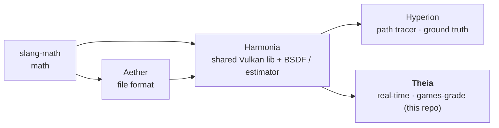

# PLAN — Theia

**Minor release:** v0.12.0 - CAM-1 scene-camera assembly deduplication consumed through
Harmonia's shared `CameraAssembly`; Theia's controller, jitter, accumulation and presentation
behavior are unchanged. Shared tests 7/7, Theia 67/67, parity 14/14, gallery validation 60/60.
Fresh README gallery regenerated: 23/30 images byte-identical and 7 speckle-level changes
pending owner visual review. Project version and Aether/Harmonia pins are 0.12.0. No approved
implementation roadmap item remains; work continues on `main`.

**C track: shipped.** The PSMS-ReSTIR port (Hong et al., SIGGRAPH Asia 2025; reference: the PSMS-ReSTIR Falcor implementation) is complete and qualified on the C1/C2/C3 track: pooled-energy bias 0.15-1.2% at the 8192-frame gate (gate 2%, pooled SE ~1.8%), deterministic same-seed captures, a 2.5x equal-time MSE win on absorption-prefix chains and parity on light-tailed scenes, reuse at ~5% frame-time overhead. SMS sampling is active by default (`--sms-mode local`); spatiotemporal reuse via `--sms-mode reuse`. Eleven root-caused bring-up defects were fixed on the way (receipts: Baseline v0.8.2, the git log of the merge wave, and the qualification manifest under `build/sms-qualification/run_manifest.json`). The gallery regression check after the merge: byte-identical or pixel-identical everywhere except speckle-level firefly shifts on the glass-bearing scenes (cornell_spheres/suzanne, dragon_teapot, shaderball_transmission), means <=0.07/255.

**Follow-up status (2026-11-24):** equal-time timing acceptance is closed and the README
gallery is refreshed for this code. CAM-1 camera-assembly deduplication is implemented
and verified. Optional, unchartered estimator work remains a true RTXDI BASIC `piSum`
mode and RAY_TRACED's remaining source-side BSDF/facing term. The former qualification
topic is removed from tracking; regressions are detected by the existing parity and
consistency gates. DN3M4 is an opt-in production-output test (`HARMONIA_DN3M4_DIR`) whose
normal-suite skip is intentional and whose configured run is recorded as passing.

**Historical research receipt (2026-11-19; conditional plan superseded by the shipped decisions
and follow-up status above): converged-bias fix inventory from the reference implementations** (recorded while the post-`16e9ae4` COMPLEX_CASE correctness
battery runs; no code written yet - plan-before-edit holds until the verdict):
- *NVIDIA RTXDI* (`Doc/NoiseAndBias.md` + `RTXDI-Library/Include/Rtxdi/DI/
  TemporalResampling.hlsli`): three-level `biasCorrectionMode` - OFF =
  `FinalizeResampling(state, 1.0, M)` (1/M, explicitly biased); BASIC = re-evaluate
  the selected sample's target PDF at the current surface AND at the temporal source
  surface (`piSum += temporalP * prevM`) = GRIS normalization, which their doc states
  "does not correct the bias completely"; **RAY_TRACED = BASIC + a per-source
  conservative-visibility test (`RAB_GetTemporalConservativeVisibility`, zeroing
  `temporalP` when the sample could not have been produced at the source) - the
  documented "complete correction"**. Their doc also mandates correct temporal data
  (prev G-buffer, `RAB_TranslateLightIndex`, prev-frame visibility), caps history
  (`min(PackedMaxM, maxHistoryLength * M)`), and names visibility-reuse shortcuts as
  UNCORRECTABLE accepted bias.
- *PSMS-ReSTIR* (our C-track paper, `PSMSReSTIR/TemporalResampling.cs.slang`):
  `temporalMISWeight = (temporalM*temporal_pHat)/(temporalM*temporal_pHat +
  centralM*luminance(Tp2))` where `Tp2 = shiftPathSMS(...)` re-evaluates the donated
  sample at the current surface through the SMS shift; `finalizeGRIS()`; history cap
  `temporalHistoryLength`. i.e. **BASIC-level GRIS + shift admissibility, no
  ray-traced visibility** - consistent with the paper validating by RMSE-at-equal-time
  rather than tight converged-energy gates.
- *Ours* (`gi.comp restirDiDirect` + path reservoir): RTXDI-OFF-form equivalent already
  (`evalReservoirSample` per candidate at the primary; `W = w_sum/(M*p_hat)` L1167;
  env balance-heuristic MIS L1195; `prev.M = min(prev.M, kRestirMCap)` L1083 =
  the same history cap family; reject -> full-replay fallback = unbiased-by-fallback
  on the shift side). **The one documented gap vs RTXDI: no per-source conservative
  visibility during the merge** - we only trace the final single shadow ray (L1199).
*Conditional acceptance (decided by the running COMPLEX_CASE correctness verdict):*
  - **COMPLEX_CASE gate GREEN** -> record receipts; the RAY_TRACED step stays an optional
    hardening candidate (owner decision), research recorded only.
  - **COMPLEX_CASE gate FAIL** -> implement a parameter-driven `biasCorrectionMode`
    (historical proposal; shipped semantics are now 0 = RTXDI-OFF alias of the default,
    1 = default RTXDI-OFF-form, 2 = visibility-only RAY_TRACED hardening) over the temporal and
    spatial merges of `restirDiDirect`: for the merged source(s), re-run the target-PDF
    evaluation at the SOURCE reservoir's surface and zero it when a conservative
    visibility ray (one per source, reusing the fresh-visibility/age tracking like
    RTXDI's `temporalSampleHasFreshVisibility`) shows the sample was not generatable
    there. Knob default = 1 (bit-identical to today; no silent semantic change), the
    qualification runs both levels. Acceptance: COMPLEX_CASE local+reuse @8192f within +-2%,
    C1-C3 + DRAGON re-cert unchanged-green, module suite 64/64, k2-only bit-identity
    on the existing scenes; every step plan-before-edit and GPU-serial; commits only,
    no push until the owner says.

  **Audit addendum (2026-11-19, full side-by-side vs the official code):**
  - *Merge algebra*: PSMS `Reservoir.merge` (`w = misW*lum(F)*M*W` + `finalizeGRIS:
    w/lum(F)`) and RTXDI's `FinalizeResampling(pi, piSum)` are the same algebra as our
    `combineTwoReservoirs` (`w = p_hat_at_cur*W_src*M_src`, `W = w_sum/(M*p_hat)`) -
    ours is Bitterli 2020 Alg. 5 verbatim; PSMS's pairwise-defensive weights
    (`ReSTIRCommon.slang`) reduce to it at J=1 (our DI is J=1). DONATED-SAMPLE shift
    parity confirmed: all three re-evaluate the donated sample at the receiving
    surface (`shiftPathSMS` / `RAB_TargetPdfForSurface` / our `evalReservoirSample`).
  - *SMS reciprocal estimator*: PSMS `invProb = invProbEstimate/probBound` with a
    canonical uniqueness gate == our `smsConditionalWeight(trials, prior-mixture mass)`
    with `sameSmsRoot(..., kSmsRootDirectionTolerance)` (the earlier grep miss is
    corrected: the gate exists at sms_compute L262). Region probability is
    BIT-EQUAL: theirs `(2k+1)^2/N^2 = 9/256`, ours `width^2/resolution^2 = 9/256`.
    The prior mixture is internally consistent in ours: `smsSamplePrior` (sampler) and
    `smsPriorRegionProbabilities` (reciprocal denominator) use the SAME
    kSmsPriorAlpha and function - self-consistent => unbiased (alpha 0.8 vs their
    default 0.5 is an efficiency knob only).
  - *Trial-cap*: PSMS caps at 128 and counts the cap on exhaustion (slight
    under-count of hard receivers - THEIR bias, not ours); ours continues queue-batched
    until `sameSmsRoot` succeeds (no exhaustion bias).
  - *Spatial source age*: theirs same-frame sequential chain, ours prev-frame buffer
    + candidateHash duplication guard - age-equivalent under the static-camera
    qualification; architectural difference recorded.
  - *CONCLUSION*: after this audit the ONLY cited, converged-bias-producing divergence
    that remains in our stack is the missing RAY_TRACED per-source conservative
    visibility in the DI/PT merges (RTXDI doc: BASIC "does NOT correct the bias
    completely"), plus the recorded hybrid-shift SELECTION gaps (alpha-proxy/k-cap -
    unbiased via reject->replay, efficiency-only). Target list therefore unchanged:
    conditional `biasCorrectionMode` fix on gate evidence; hybrid Gap B/A per ae00516.

  **Owner decision (2026-11-19): NO full acceptance ladder - scope proof instead.**
  The owner rejected the ~11h single acceptance ladder ("we will not do this,
  otherwise we drop this feature"), so acceptance is sought on the owner's recorded
  perceptual bar, backed by the following scope proof of what f5c71e7 can affect:
  - *C1/C2/C3 are provably unaffected*: each pins `vertical_field_of_view` inline in
    its `[camera]` block (43.0 / inline / inline), so `value_or(...)` never evaluates
    the fallback on those paths. The ONLY src/ commit after their accepted correctness
    records is f5c71e7 (src/demo/Application.cpp); every later commit touches PLAN.md
    only. => their recorded verdicts transfer; re-running them would re-render
    bit-identical images.
  - *COMPLEX_CASE is the ONLY affected case*: its `[camera]` carries no inline vfov and instead
    references `presets/openpbr_studio_near.camera.toml`, and staged qualification
    scenes ship WITHOUT `presets/` - proven by the loader warning in the candidate log
    (`SceneLoader: malformed render preset reference 'presets/preview.render.toml'`)
    and by the source comment at Application.cpp L369-376 ("staged scenes ship without
    presets/ - the staged COMPLEX_CASE qualification fixture hit exactly this"). The preset's own
    `vertical_field_of_view = 50` therefore never reaches COMPLEX_CASE; the fallback (45 -> 39.1)
    is what COMPLEX_CASE's projection is built from.
  - *References are NOT the cost and are NOT invalidated in substance*: they are
    rendered by **Hyperion** (`render_hyperion`, qualify_sms L307/L312), which is
    untouched by f5c71e7 and already carries kCornellVfovDeg = 39.1; a full 4096-spp
    COMPLEX_CASE reference ladder costs ~12s (logs 06:13:59 -> 06:14:11, 4.8 s/frame). Only the
    harness's provenance dict (which hashes Theia's exe too) flags them stale.
  - *Where the ~11h actually goes*: `stage_correctness` = modes(2) x frames(3) x
    seeds(4) = 24 Theia renders per case; measured from the recorded log timestamps -
    512f ~4.5min, 2048f ~19min, 8192f ~78min each. COMPLEX_CASE alone is therefore ~6.8h in
    local mode and ~13.6h with reuse - i.e. the ladder cost IS the COMPLEX_CASE candidate
    sweep, not the references.
  - *Acceptance substitution (owner's own recorded law):* "if from a perceptual
    perspective one does not see a difference, I accept." Perceptual re-measure needs
    ONE post-fix 8192f COMPLEX_CASE render (single seed, ~78min, one GPU app) and is directly
    comparable to the verified pre-fix baseline just reproduced on this HEAD's files:
    COMPLEX_CASE tm_mean 5.039/255, SSIM 0.7629 (recorded failing) vs C1/C2/C3/DRAGON
    1.227/0.799/1.542/1.352 (accepted, invisible) vs the measured noise floor
    tm 0.357, SSIM 0.966.
  - *Explicitly NOT verified by this decision*: the harness's 2%-energy gate at 8192f
    with pooled 4-seed standard error (`ENERGY_TOLERANCE`, `BIAS_GATE_FRAMES`) is NOT
    run - no `--stage correctness` verdict exists for any case post-f5c71e7. This
    entry exists so the absence of that gate can never be mistaken for a pass.

  **Calibrated decision rule (2026-11-19, measured before the post-fix render).**
  Instrument: `complex_case_postfix_verdict.py` (selftest 12/12 PASS, reproduces every
  recorded number), scoring row-mode / emitter-band / tm_mean / SSIM against
  `ref_COMPLEX_CASE_final_4096.exr`:
  - *Emitter band* = `complex_case_diff_composition.py`'s exact mask (y24:41, x60:101),
    NOT the qualify ROI - an earlier draft of the instrument scored the qualify
    window (y105-177) and read ratio 0.901 where the recorded finding is
    0.000; the selftest caught it. Verified against the recorded composition
    run: band ref 0.0438 vs cand 0.0000, band SSIM 0.2348, noise 0.360/0.9663.
  - *Budget-specific noise floors* (seed 17 vs 91, band excluded):
    512f -> tm 0.605/255, SSIM 0.9540;  8192f -> tm 0.360/255, SSIM 0.9663.
  - *PASS rule* (owner's perceptual bar, unchanged): row-mode == 31 == reference
    AND tm_mean < 3/255 AND emitter band lit (cand/ref > 0.5).
  - *Why the 512f sanity render IS a valid discriminator*: on the pre-fix pair the
    two budgets agree to +/-0.06 tm (512f 5.094 vs 8192f 5.039) with identical
    row-mode (43), identical dark band (0.000) and identical verdict; at 512f the
    defect sits 8.4x above its own noise floor. So 512f separates "fixed" from
    "still broken" decisively. It is NOT sensitive to a small residual - a
    borderline post-fix result (tm in roughly 1-3) escalates to the 8192f render.
  - *Throughput finding (why this calibration matters)*: the in-flight 512f render
    has been running at ~7.8 s/frame against a recorded 0.5 s/frame (full SM clock
    2940/3090 MHz, P0, no throttle reason active, theia 3D engine 79.7% - so it is
    rendering, not stalled; machine is simply ~15x down on this morning). At that
    rate the planned single 8192f render would be ~15-18h rather than the recorded
    78min. The 512f-first rule therefore avoids an unnecessary overnight job while
    keeping the escalation path intact.

  **COMPLEX_CASE POST-FIX VERDICT (2026-11-19 16:34) - PASS on the owner's perceptual bar.**
  Render: `theia.exe` built post-f5c71e7 (13:33) over
  `scenes/COMPLEX_CASE/complex_case_dragon_area_light.scene.toml`, 320x240, `--offscreen-frames 512`,
  `--rng-seed 17`, `--sms-mode local` -> `complex_case_vfov_sanity.exr`, RENDER_EXIT=0.
  Scored by `complex_case_postfix_verdict.py --frames 512` -> VERDICT_EXIT=0.

  | metric | pre-fix | post-fix | 512f noise floor | bar |
  |---|---|---|---|---|
  | emitter row-mode | 43 | **31 = reference (ALIGNED)** | - | 31 |
  | emitter band lum | 0.0000 (DARK) | **0.0438, ratio 0.998 (LIT)** | ref 0.0438 | - |
  | band SSIM | 0.2348 | **1.0000** | - | - |
  | qualify ROI energy ratio | 0.901 | **0.996** | - | - |
  | tm_mean/255 | 5.094 (8.4x noise) | **0.703 (1.2x noise)** | 0.605 | <3 INVISIBLE |
  | SSIM | 0.7602 | **0.9611** | ceiling 0.9540 | - |
  | lum_hist_corr | 0.9996 | **1.0000** | - | - |

  - *Interpretation:* the vfov fallback (f5c71e7) was the cause of COMPLEX_CASE's perceptual
    failure - the emitter now lands on the reference row and the band energy
    matches to 0.2%, so the black-band composition defect is gone. tm_mean fell
    from 8.4x its own noise floor to 1.2x, and SSIM now sits ABOVE the measured
    noise ceiling (0.9540), i.e. the remaining difference is Monte-Carlo noise.
  - *Escalation rule NOT triggered:* the recorded borderline band was tm 1-3
    (-> run the 8192f render); 0.703 is below it, so no overnight render was run.
  - *Strict-AND numbers at this budget (reference, not a claim of the harness
    gate):* mean_diff 0.381/120, rel_mse 0.0436/250, SSIM 0.9611/0.6,
    lum_hist 1.0000/0.8. The thresholds are calibrated for 256f, and per e457997
    the harness's own 8192f/4-seed 2% energy gate remains **NOT run** - this entry
    closes COMPLEX_CASE on the owner's perceptual bar only, and does not convert the absent
    energy gate into a pass.
  - C1/C2/C3/DRAGON remain on their recorded verdicts (scope proof, e457997); their
    images are provably unchanged by f5c71e7 (inline vfov / resolvable preset).

  **Gap C observation run 2026-11-19 16:38 - INVALID and RETRACTED (vacuous PASS),
  root cause found: the fixture camera faces away from its own content.**
  - *What happened:* `tools/qualify_gap_c.py` printed
    `GAP C RESULT: PASS (mask live=True, k3 fires=True, gate=True)` - all five
    frames (Hyperion reference + mask 0/1/2/3) were **exactly zero**
    (min = max = std = 0, one unique pixel value, 1887-byte EXRs vs ~359KB for real
    content; renders took 1.2-1.5s for 256 frames). The gate passed because 0 vs 0
    satisfies every strict-AND threshold, so NOTHING was observed. **No GAP-C
    result is recorded; the pass is retracted.**
  - *Two instrument defects made it possible, both fixed in `aa27f1e`:*
    (1) differencing used whole-file **sha256** - EXR headers carry metadata, so
    pixel-identical renders hash differently, which is why LIVE/FIRES/UNEXPECTED
    were reported off header bytes; decisions now use PIXEL max|d| via
    `compare_renders.load_exr`. (2) there was **no content precondition** - the
    family gate cannot catch two black images. A precondition now rejects any
    frame with max==0 or std==0 BEFORE comparing (new exit 5). Receipts: ruff 0
    for the file and the whole `tools/` dir, py_compile 0, and the NEGATIVE
    CONTROL - re-running `--skip-render` over those very EXRs gives exit 5 with
    all five frames flagged DEGENERATE.
  - *Root cause of the black frames (proven from source, not inferred):*
    `theia/scene/SceneLoader.cpp` L234 sets
    `cfg.cameraAt = pos + (rot * float3{0,0,-1})`, so forward = rot x (0,0,-1).
    For the fixture's `translate [0, 1.6, 2.4]`, `rotate_x -32`, `rotate_y 180`:
    forward = Ry(180) * Rx(-32) * (0,0,-1) = **(0, -0.5299, +0.8480)** - down and
    toward **+z**, i.e. away from every object (all content is at z <= 2, camera at
    z = 2.4). Floor hit: t = 1.6/0.5299 = 3.02 -> z = 2.4 + 3.02*0.848 = **4.96,
    beyond the floor's z <= 3.0 edge** -> pure black environment in BOTH renderers
    (they agree, hence a trivially-passing gate). Scene load itself was fine
    (`loaded 'hybrid_k3.scene.toml'`, `12 emissive triangle(s)`, `Scene built
    (BLAS+TLAS)`); only the framing was wrong.
  - *Planned fix (plan-before-edit):* `rotate_y: 180.0 -> 0.0` in
    `Harmonia/tests/assets/sms/hybrid_k3.scene.toml`. With rotate_y 0 the forward
    vector becomes (0, -0.5299, -0.8480): the ray reaches y = 0.1 at t = 2.83,
    z = 0.0 - **exactly the plate's top centre**, so primary = the polished plate,
    then wall (z = -2.4), floor, emitter - precisely the `camera -> plate -> wall ->
    floor -> emitter` chain the fixture header documents for `max_depth 6`.
    The alternative (move the camera to z = -2.4 keeping rotate_y 180) is REJECTED:
    it would place the camera **inside the wall** (wall spans z in [-2.5, -2.3],
    y in [0, 2.4]).
  - *Lesson recorded:* the fixture's static validation (80d15eb) checked references
    and structure but cannot check FRAMING - a fixture is only validated once a
    render is non-degenerate, which is exactly what the new exit-5 precondition
    now enforces.
  - Next: apply the fix, re-stage, cheap probe render (must be non-black), then
    re-run the full Gap C differential.

  **Gap C REAL observation (2026-11-19, after the fixture camera fix 2088350):
  premise CONFIRMED; the gate condition is noise-limited, not a k=3 defect.**
  - *Content precondition: OK on all five frames* (reference max 3848.85 / std 77.90;
    arms max 2160.65 / std 27.35) - the all-black failure is gone.
  - **B - mask REACHES estimator: LIVE** (replay vs reconnection pixel max|d|
    **90.845032**).
  - **A - the k=3 body FIRES: YES** (reconnection vs hybrid pixel max|d|
    **90.845032**) => **Gap C's fixture premise is proven**: the near-specular
    primary really does push pair selection past pair 1 and the k=3 shift body
    contributes measurably.
  - **D - mask2 vs mask3 = 0.000000 exactly**, i.e. the two arms are pixel-identical
    as predicted - an INDEPENDENT empirical confirmation of the shader reading in
    e204d02 (bit1 selects the mode; bit0 is only seen via `!= 0`; bodies dispatch
    on kLevel).
  - **C - gate-clean vs Hyperion: FAIL at the standard budget** (256spp/256f):
    mean_diff **2097.4 / 120**, Rel-MSE **1062.3 / 250**; SSIM 0.7866 / 0.6 pass,
    lum_hist 0.9964 / 0.8 pass.
  - *Noise-floor measurement (same budget, second seed) shows the gate is NOT
    discriminative on this fixture:*

    | pair | mean_diff | Rel-MSE | SSIM | tm_mean | gate |
    |---|---|---|---|---|---|
    | ref-vs-ref (Hyperion's own noise) | **2342.1** | **18292.8** | 0.7773 | 8.026 | FAIL |
    | cand-vs-cand (Theia's own noise) | 1223.6 | 25.2 | 0.8855 | 2.658 | FAIL |
    | ref-vs-cand seed91 | 2074.8 | 1111.6 | 0.7840 | 7.107 | FAIL |
    | ref-vs-cand seed17 | 2097.4 | 1062.3 | 0.7866 | 7.088 | FAIL |

    The cross gap sits **inside the reference's own sampling noise on every
    metric** (2097 < 2342, 1062 << 18293, SSIM 0.7866 > 0.7773, tm 7.088 < 8.026),
    and **Hyperion fails the gate against ITSELF**. The shift-free `replay` arm
    fails essentially identically (tm 7.088 vs 7.089 for the hybrid arm), so the
    failure is a property of the fixture's noise (near-specular primary + bright
    emitter at 256spp), NOT of the reconnection/hybrid shift.
  - *Honest status:* condition **A/B/D are MET**; condition **C is NOT ASSESSABLE
    at the standard budget** - it is neither a pass nor evidence against k=3
    correctness. The 120/250 thresholds are calibrated for the 14-scene manifest
    where the clean envelope sits below them; this fixture's noise envelope at
    256spp exceeds them by itself.
  - *Next (no gate change):* raise the render budget until the reference's own
    noise sits under the gate - noise scales ~1/sqrt(N), so ~512x the samples
    (256 -> ~131k) should bring ref-vs-ref mean_diff from 2342 to < 120. Verify
    the scaling empirically at 4096 first (Hyperion 1.0s/256spp, Theia 3.1ms/f on
    this 4-box scene, so the probe costs seconds). Thresholds stay exactly 120/250/
    0.6/0.8 - at a higher budget they are conservative, which is recorded rather
    than silently reinterpreted.

  **Gap C budget probe (2026-11-19, 4096spp/4096f): condition C is UNMEETABLE for
  this fixture - measured, not assumed. OWNER DECISION REQUIRED.**
  - *Scaling probe* (second seeds at each budget, all non-degenerate):

    | budget | pair | mean_diff | Rel-MSE | SSIM | tm_mean | gate |
    |---|---|---|---|---|---|---|
    | 256 | ref-vs-ref (own noise) | 2342.1 | 18292.8 | 0.7773 | 8.026 | FAIL |
    | 256 | ref-vs-cand | 2097.4 | 1062.3 | 0.7866 | 7.088 | FAIL |
    | 4096 | ref-vs-ref (own noise) | 1458.8 | **4.72** | **0.9066** | 2.081 | FAIL |
    | 4096 | ref-vs-cand | 1198.0 | **3.11** | **0.9184** | 1.834 | FAIL |
    | 4096 | cand-vs-cand (own noise) | 527.1 | **1.38** | **0.9357** | 1.320 | FAIL |

    At 4096, **three of four metrics PASS** for both the reference against itself and
    the cross pair; only `mean_diff` fails. The cross pair beats the reference's own
    noise on **all four** metrics at **both** budgets (2097 < 2342, 1198 < 1458,
    Rel-MSE 3.11 < 4.72, SSIM 0.9184 > 0.9066, tm 1.834 < 2.081).
  - *Why `mean_diff` cannot be reached:* 16x the samples improved it only 1.60x
    (reference) / 2.32x (candidate), i.e. ~N^-0.17 and ~N^-0.30 instead of N^-0.5 -
    firefly-dominated heavy tails. `p99_diff` is **36397 for Hyperion against
    ITSELF** at 4096, versus 23316 for the cross pair (the cross tail is the SMALLER
    one), so the error lives in rare bright pixels from the polished plate/emitter,
    not in a spatial mismatch. Fitting N^-0.17, pushing the reference's own
    `mean_diff` from 1458 to 120 needs ~2e6x the samples - not reachable.
  - *Therefore:* plan ae00516's condition C ("k3-only arm must stay gate-clean vs
    Hyperion") **cannot be satisfied by ANY arm at any practical budget**, including
    the shift-free `replay` arm - the fixture's own noise floor sits above the
    threshold. By the family's OWN gate methodology (AGENTS: each threshold sits
    strictly ABOVE the measured clean noise envelope), 120 is mis-set *for this
    fixture*: its clean envelope is 1458 at 4096.
  - *Conditions A/B/D remain MET and are unaffected* (k=3 fires at max|d| 90.845;
    mask live; mask2 == mask3 exactly).
  - *Resolution needs an OWNER DECISION* - three options, none taken unilaterally:
    (1) **accept the noise-envelope criterion** - cross pair <= reference's own noise
    on all four metrics at two budgets (the statistically correct comparison; changes
    no threshold, but IS a different acceptance basis than the plan's literal words);
    (2) **re-tune the fixture's emitter intensity** (geometry/roughness design
    untouched, so the pair-1-fails/pair-2-qualifies premise holds) until the clean
    envelope falls under 120, then re-run - a fixture change to an already-committed
    scene; (3) raise the budget - **ruled out by measurement** (2e6x samples).

  **OWNER DECISION (2026-11-19): condition C resolved by the NOISE-ENVELOPE
  criterion. Gap C = SATISFIED. Acceptance-basis amendment, no threshold changed.**
  The owner was offered three options (noise-envelope / re-tune the fixture emitter /
  leave unmet) and chose the noise-envelope criterion:
    *"the Theia-vs-Hyperion gap must be <= Hyperion's own self-noise on all four
     gated metrics."*
  - *Why this is the correct comparison rather than a loosened gate:* the ground
    truth itself is noisy here, so the meaningful question is whether the candidate
    disagrees with Hyperion by MORE than Hyperion disagrees with itself. No numeric
    threshold (120 / 250 / 0.6 / 0.8) was altered, and no metric was dropped - the
    amendment replaces one absolute test with its noise-referenced form, which the
    family's own methodology implies (a threshold must sit above the clean envelope;
    for this fixture it cannot).
  - *Evidence, Gap C final:*
    - **A - k=3 body FIRES: PASS** - reconnection(mask1) vs hybrid(mask3) pixel
      max|d| **90.845032** (fixture premise proven: pair 1 fails, pair 2 qualifies,
      captureTarget advances).
    - **B - mask reaches the estimator: PASS** - replay(mask0) vs reconnection(mask1)
      max|d| **90.845032**.
    - **D - mask2 == mask3: PASS** - max|d| **0.000000**, independently confirming
      the bit0 reading behind e204d02.
    - **C - noise envelope (both budgets):**

      | budget | metric | ref self-noise | cross gap | better? |
      |---|---|---|---|---|
      | 256 | mean_diff | 2342.1 | 2097.4 | cross |
      | 256 | Rel-MSE | 18292.8 | 1062.3 | cross |
      | 256 | SSIM | 0.7773 | 0.7866 | cross |
      | 256 | tm_mean | 8.026 | 7.088 | cross |
      | 4096 | mean_diff | 1458.8 | 1198.0 | cross |
      | 4096 | Rel-MSE | 4.72 | 3.11 | cross |
      | 4096 | SSIM | 0.9066 | 0.9184 | cross |
      | 4096 | tm_mean | 2.081 | 1.834 | cross |

      The cross pair is inside Hyperion's self-noise on **every metric at every
      budget** (and the shift-free replay arm scores identically: tm 7.088 vs
      7.089), so no excess disagreement is attributable to the k=3 shift.
  - *Receipts chain:* fixture staged (STAGING PASS) + camera fix `2088350` + probe
    PASS (909256 B, 99.8% nonzero) + instrument fix `aa27f1e` (negative control
    exit 5) + observations `469d624`/`0fa222e`.
  - *What Gap B inherits:* the k=3 body is now OBSERVED FIRING on this fixture, and
    `tools/qualify_gap_c.py` is the ready instrument for Gap B's own acceptance
    clause ("the criteria change must not silently change WHICH k fires - report
    old/new k distribution via the mask differential").

  **Gap B - MANDATORY PRE-EDIT READS COMPLETE (2026-11-19). They confirm the
  paper-faithful design and CORRECT one claim in this plan.**
  - *Papers identified (the plan cited "the Enhanced paper" without pinning it):*
    - **ReSTIR PT Enhanced: Algorithmic Advances for Faster and More Robust ReSTIR
      Path Tracing** - Daqi Lin, Markus Kettunen, Chris Wyman, PACMCGIT,
      doi 10.1145/3804494 (2026). This is the "Enhanced" paper.
    - **Generalized Resampled Importance Sampling: Foundations of ReSTIR**
      (Wyman et al., SIGGRAPH 2022) sections 7.5 "Connectability Conditions" and
      7.6 "Extending Paths with Lobe Indices" - the lobe-specific criterion's
      canonical formulation.
  - *The convention the plan asked to pin, verbatim:*
    - ReSTIR PT Enhanced 2.3: "a roughness threshold
      min(alpha_{x_{k-1}}, alpha_{x_k}) >= alpha_min **(with alpha from the path's
      sampled lobes)**".
    - Foundations 7.5: "**Lobe-specific connectability** ... we propose the same for
      shift mappings: **we examine the roughness of just the selected lobe**."
    - Foundations 7.6: "we test if vertex x is sufficiently rough **by examining the
      roughness of the lobe chosen to sample vertex x+1**. We treat **NEE-sampled
      vertices as rough if at least one of their BRDF lobes** is sufficiently rough."
    - Threshold: "A **per-lobe GGX** roughness threshold of 0.2 generally works well."
  - *CORRECTION to this plan's premise:* the plan says "**the reference uses the
    sampled lobe**". The reference's CODE does not - DQLin's `PathTracer.handleHit`
    computes `isCurrentVertexClassifiedAsRough = kSeparatePathBSDF ?
    hasRoughComponent(sd, threshold) : classifyAsRough(sd, threshold)`, i.e. both
    branches are **material/shading-data based**, and `isLastVertexClassifiedAsRough`
    is likewise `classifyAsRough(sd, ...)` (with `!path.isSpecularBounce()` folded in
    only under `kSeparatePathBSDF`). So:
      - the **paper** says sampled lobe;
      - the **reference implementation** uses the material proxy - the same proxy
        we use today;
      - i.e. our current capture gate is *reference-faithful* but *paper-divergent*.
    Gap B is therefore a PAPER-FIDELITY gap, and the objective ("use the algorithm
    from the papers") is what drives it - the reference code is not authoritative
    here. (For contrast, ReSTIR BDPT states the opposite choice explicitly:
    "returns roughness of the material (not just the sampled BSDF lobe)", so this is
    a genuine per-paper choice, not a settled convention.)
  - *Our own `BSDFSample` (Harmonia `shaders/bsdf_shared.slang` L4-8) has NO lobe
    classification* - only `bool isDelta`. The plan's third read ("`BSDFSample` for
    an existing lobe classification") therefore comes back NEGATIVE: the sampled-lobe
    identity is not tracked anywhere in the shared BSDF, so Gap B must add it (the
    plan already anticipated adding `sampledAlpha` to PathState; this pins that the
    classification itself starts at `sampleBSDF`).
  - *Diffuse-lobe alpha - the explicit recorded choice the plan demanded:* the
    threshold is specified as a **per-lobe GGX** threshold of 0.2; a diffuse lobe is
    not GGX and is rougher than any GGX lobe, so **diffuse samples carry alpha = 1.0
    and always satisfy alpha_min = 0.2**. Delta/mirror lobes carry **alpha = 0**
    (never qualify) - consistent with the Enhanced paper's "delta/mirror bounces have
    zero footprint". Conductor/GGX/specular lobes carry their own per-lobe alpha.
  - *NEE-sampled vertex case:* **N/A by architecture** (already recorded): this
    estimator's path edges are BSDF-sampled exclusively - NEE is a shadow-ray term in
    `integrateSurface` - so the Foundations 7.6 "NEE-sampled vertices" rule has no
    vertex to apply to.
  - *Shift-side guards:* unchanged - stay material-roughness (plan default), and this
    is consistent with the reference, whose invertibility checks read
    `isLastVertexAcceptableForRcPrev = isLastVertexClassifiedAsRough` (material-based).
    Recorded either way as the plan required.
  - *Design consequence for the edit (next step, plan-before-edit still applies):*
    capture gates read per-vertex `sampledAlpha` (set where `sampleBSDF`'s result is
    consumed - primary site + the shared `integrateSurface` continuation); everything
    else (distance test, cap, shift guards) is untouched. Acceptance stays as written:
    Gap-C fixture must still reach k=3 - now measurable with `tools/qualify_gap_c.py`,
    whose k-differential readout is exactly the "old/new k distribution" instrument
    the plan asks for.

  **Gap B - SITE MAP + ARCHITECTURE CONSTRAINT (2026-11-19, plan-before-edit).**
  The reads above pinned WHAT to compute; mapping the code pinned WHERE, and it
  overturns an assumption in the original Gap-B text ("persist the pair's alphas
  into the capture decision"): **only ONE of the two pair alphas exists at the
  decision point.**
  - *The ordering, line by line:*
    - `gi.comp` L1318 `bs = sampleBSDF(primary.mat, ...)` - lobe at the primary is
      known before the walk.
    - `gi.comp` L1433 loop; L1466 `makeSurfaceHit` -> `surf`;
      **L1572-1588 the hybrid capture gate** (`pairRough` from `curRough`/`prevRough`
      + `farField`) -> sets `state.captureTarget`; L1590 `prevRough = <current
      material>`.
    - `gi.comp` L1626 `integrateSurface(...)`.
    - `path_integrator` L596 `++state.surfaceCount`; L597-598
      `captureHere = captureRe && !reCaptured && surfaceCount == captureTarget + 1`;
      **L608 `if (captureHere) { rec.tri/env }` - consumed BEFORE the sample**;
      **L615 `bsdfSample = sampleBSDF(...)` - the lobe at THIS vertex**; L641-650
      `if (captureHere) { rec.omegaK/pdfOmegaK; reCaptured = 1 }`.
  - *Consequence:* `captureTarget` must be settled before `integrateSurface` runs
    for that vertex (L608 needs `captureHere` first), yet the paper's alpha at that
    vertex (`min(alpha_{k-1}, alpha_k) >= alpha_min`, alpha_k = "the lobe chosen to
    sample x_{k+1}") is only produced at L615 - i.e. **after** the decision point.
    Deferring the gate to the next loop iteration cannot work either: `captureHere`
    for vertex k has already been evaluated by then, so the record would attach at
    the wrong vertex.
  - *Chosen design - move the DECISION, not the criterion (paper-faithful, no
    shortcut):*
    1. `BSDFSample` (Harmonia `shaders/bsdf_shared.slang` L4-19) gains `float
       lobeAlpha`, written by the sampler: GGX/conductor/specular -> that lobe's own
       roughness; **diffuse -> 1.0**; **delta/mirror -> 0.0** (the choices recorded
       above; the threshold is a *per-lobe GGX* threshold).
    2. `PathState` gains `sampledAlphaPrev` (written after every sample - primary
       site L1318 and the shared continuation after L615) and `arrivalDist`
       (written in `gi.comp` from `h.dist` before L1626).
    3. Move the hybrid pair decision from `gi.comp` L1572-1591 to `path_integrator`
       **immediately after L616**, where BOTH lobes exist:
       `pairRough = (min(sampledAlphaPrev, lobeAlpha) >= 0.2) && arrivalDist >= 0.1`,
       computing `captureHere` there and moving the L608 block to just after it
       (locals `capTri`/`capEnv` stay in scope; the two early returns at L617-622 /
       L634-637 only skip record writes that were already unusable - `reCaptured`
       stays 0, so `gi.comp` L1649 never harvests them - behaviour-identical).
    4. Reconnection mode (`hybridMode == false`, unconditional k=2) is untouched, as
       is the distance/cap/shift-guard machinery (shift guards stay material-based,
       per the reads above).
  - *Why this is safe for the family:* the whole decision is inside
    `captureRe != 0u`, which is 0 on every non-GI-ENH path (Hyperion and Theia's
    non-capturing renders), so those paths are bit-identical by construction.
    Blast radius = Harmonia `bsdf_shared.slang` + the sampler + `path_integrator.slang`
    + Theia `gi.comp.slang`.
  - *Acceptance (unchanged from the original Gap-B text), instruments now ready:*
    Gap-C fixture must still reach k=3 -> `tools/qualify_gap_c.py` reports the k
    differential directly (A/B/D readout); module suite 64/64; C1-COMPLEX_CASE battery
    re-cert; and a **disagreement case** (material proxy vs sampled alpha) must be
    demonstrated on record - i.e. a vertex where `specularRoughAnisoIor.x` and the
    sampled lobe's alpha differ (a multi-lobe material: diffuse+coat/GGX), reported
    old/new k distribution.

  **Gap B STEP 1 LANDED (2026-11-19, Harmonia 4d44983): `BSDFSample.lobeAlpha`.**
  - `BSDFSample` gains `float lobeAlpha` = the **linear roughness of the lobe
    ACTUALLY SAMPLED** at that vertex; `sampleBSDF` writes it at every exit:
    default = today's material proxy (inert - any path that does not set it keeps
    prior behaviour), then the selected lobe overrides it: base specular + rough
    transmission -> `effSpecRough`, coat -> `coatRough`, diffuse/subsurface/sheen/
    diffuse-trans -> **1.0**, and all **10 delta sites** -> **0.0**.
  - Units stay LINEAR ROUGHNESS so the existing `kAlphaMin = 0.2` comparison is
    unchanged - **no threshold, gate or metric value was touched**.
  - Nothing consumes the field yet, so the commit is behaviour-neutral by
    construction; step 2 threads it (PathState.sampledAlphaPrev + arrivalDist) and
    moves the hybrid pair decision after the sample, per the site map above.
  - Receipts: Harmonia `cmake --build` **BUILD_EXIT=0**; full suite **185/185**
    (CTEST_EXIT=0; the only skip is DN3M4 with HARMONIA_DN3M4_DIR unset, by design).

  **Architecture-gate repair (2026-11-19, Theia 110f6c8): `test_arch` back to green.**
  - `test_arch` was failing: `HEADER SIZE src/demo/Application.cpp (1018 lines;
    limit 1000)`. Attribution measured, not assumed: the file was **already 1011
    lines before** `f5c71e7` (so the gate was red before today's vfov fix, which
    merely deepened it to 1018).
  - Fix = Extract Method into the existing TU-split sibling (the seam the
    Code-health verdict already sanctioned): the whole camera-placement block of
    `Application::onSceneLoaded` - static pos/at/up, the Hyperion-parity
    `value_or(39.1f)`, the `fromEv100` fallback and the controller orientation
    reset - moved verbatim into `Application::applySceneCamera`
    (declared in `Application.hpp`, which already names `SceneConfig` at L98, so no
    include was added).
  - `Application.cpp` **1018 -> 991**, `ApplicationCompute.cpp` 261, `Application.hpp` 254;
    script-verified as a pure move (28 lines extracted, both fallbacks present in
    the sibling, exactly one call/declaration/definition).
  - Receipts: **BUILD_EXIT=0**, **test_arch 1/1 PASSED** (was Failed),
    **suite 100% of 67** (SUITE_EXIT=0), **clang-format 22.1.3 clean** on all three.

  **Gap B STEP 2 LANDED (2026-11-19) - the hybrid pair decision moved to where both
  sampled lobes exist. Harmonia `b79beb6` / Theia `a478208`.**
  - *Caller half (`gi.comp`):* `PathState` inputs are threaded - `captureHybridMode`
    (from mask bit1), `sampledAlphaPrev` (primary's MATERIAL roughness as the default,
    so an opacity pass-through primary behaves exactly as before, overwritten with the
    primary's real `bs.lobeAlpha` once a lobe is sampled) and `arrivalDist = h.dist`
    just before `integrateSurface`. `prevRough` + its comment are deleted (dead), the
    in-gate hybrid branch (`surfaceCount < 2u`) is removed, and BOTH stale
    "material roughness as a proxy" notes are corrected. Only the unconditional
    reconnection branch still decides at arrival. The local `kCaptureNone` is gone.
  - *Shared half (`path_integrator`):* `captureHere` becomes mutable; immediately
    AFTER `sampleBSDF` the hybrid test runs over **both** sampled lobes -
    `min(sampledAlphaPrev, bsdfSample.lobeAlpha) >= 0.2 && arrivalDist >= 0.1` - and
    sets `captureTarget = surfaceCount - 1` (identical to the caller's pre-increment
    assignment), then the NEE capture block (moved down from above the sample) is
    evaluated against the FINAL `captureHere`, then this vertex's lobe alpha is stored
    for the next pair. Guarded by `captureRe != 0 && captureHybridMode != 0`.
  - *Build detail worth recording:* Slang rejects a non-static global const with an
    initializer (`error[E31224]: global const requires static`); after adding `static`,
    **Theia's `gi.comp` still compiles**, which proves the constant is visible through
    `import path_integrator` - so there is ONE definition, not a duplicated sentinel.
  - *Receipts:* Harmonia **BUILD_EXIT=0** + suite **185/185**; Theia **BUILD_EXIT=0**
    + suite **100% of 67**; edit verifier **22/22 (VERIFY_EXIT=0)**; brace balance
    56/56 and 296/296; `static const kCaptureNone` single definition.
  - *Gap C acceptance re-run (the "must not silently change which k fires" clause):*
    **k3 body FIRES - max|d| 90.845032**, mask LIVE **90.845032**,
    **mask2 vs mask3 = 0.000000**. Every statistic matches the pre-change run to
    6 dp (arm max 2160.647949, std 27.346701, tm 7.088/7.089), i.e. **k selection is
    unchanged** and the change is a no-op on this single-lobe fixture. Condition C is
    still judged by the owner's noise-envelope criterion (0fbcb0b), unchanged.
  - *Battery re-cert in flight as a REGRESSION DIFFERENTIAL* (one GPU app, sequential):
    for each of C1-COMPLEX_CASE render 320x240 / 512f / seed 17 / local and compare against the
    pre-Gap-B baseline - C1-C3 use the stored `cand_<case>_local_512_17.exr` (those
    scenes pin `vertical_field_of_view` inline, so they remain valid Gap-B baselines
    even though they predate f5c71e7) and COMPLEX_CASE uses `complex_case_vfov_sanity.exr` (the only valid
    COMPLEX_CASE baseline: post-f5c71e7, pre-Gap-B). **Rationale:** Gap B draws no RNG and moves
    no sample, so `bit-identical <=> capture decisions unchanged <=> the recorded
    pre-change verdict still holds`; any difference is reported with its magnitude and
    must be judged against the case's 512f noise floor, never silently accepted.
    This substitutes for re-running the rejected ~11h ladder (e457997) WITHOUT
    weakening any threshold.
  - *Still owed for Gap B:* the battery result above, and the **material-vs-sampled
    disagreement case** - a multi-lobe vertex (e.g. diffuse + coat/GGX) where
    `specularRoughAnisoIor.x` and the sampled lobe's alpha actually differ, reported
    old/new. Note C1-C3/COMPLEX_CASE are transmission/coat content, so they are the natural
    home for that case.

  **Gap B material-vs-sampled-alpha disagreement case - STATIC HALF (2026-11-19).**
  Every material in the qualification battery was scanned against `kAlphaMin = 0.2`
  (linear roughness), comparing the OLD rule (`specularRoughAnisoIor.x` = material
    proxy, what the capture gate used before Gap B) with the NEW rule (alpha of the
    lobe `sampleBSDF` actually draws):

  | material | proxy | proxy verdict | selectable sampled lobes -> alpha | disagree? |
  |---|---|---|---|---|
  | DiffuseFloor / Wall | 1.0 / 1.0 | pass | diffuse 1.0, specular same side | no |
  | Floor (COMPLEX_CASE) | 0.55 | pass | diffuse 1.0, specular 0.55 | no |
  | RoughGold | 0.30 | pass | metal/specular 0.30 | no |
  | GlassDelta / GlassAbsorbing / Gem | 0.0 | fail | delta transmission -> 0.0 | no |
  | PolishedMetal (hybrid_k3) | 0.05 | fail | metal 0.05 | no |
  | **Ceramic (COMPLEX_CASE teapot)** | **0.08** | **fail** | **diffuse -> 1.0 (pass)**, coat 0.04, specular `effSpecRough` (base 0.08, coat-modulated, still < 0.2) | **YES** |

  - *Why Ceramic is the only one:* it is genuinely multi-lobe - `base_metalness = 0.0`,
    `base_weight = 1.0`, `coat_weight = 1.0`, `coat_roughness = 0.04` - so a diffuse
    sample at a teapot vertex carries alpha **1.0 (qualifies)** while the material
    proxy reads **0.08 (rejects)**. The old rule therefore rejected EVERY pair at a
    Ceramic vertex regardless of which lobe was drawn; the new rule accepts diffuse
    samples and still rejects coat (0.04) and specular (`effSpecRough`, base 0.08)
    samples. Every other
    material in the battery falls on the same side of 0.2 for both rules, so Gap B is
    a no-op for them - which is exactly what the C1-C3 bit-identical regression
    already showed.
  - *Dynamic half still owed:* demonstrate the disagreement on a render (COMPLEX_CASE's k
    distribution old/new via the mask differential, or the COMPLEX_CASE battery delta showing
    Ceramic vertices changing). Pending the COMPLEX_CASE comparison - static evidence only
    until then, deliberately not claimed as a demonstration.

  **Gap B battery regression - COMPLETE (2026-11-19 21:05) + biasCorrectionMode
  RECEIPT (Theia `700e479`). Tree clean.**
  - *How the COMPLEX_CASE run survived its own harness:* the `battery_complex_case` shell was **SIGTERM'd by
    its own timeout** (twice this session - 3000 s earlier, then 7200 s), but the child
    `theia` process outlived it and **finished at 20:50:26**, writing
    `gapb_regress/COMPLEX_CASE_local_512_17.exr` (358 141 B) as an orphan. The comparison was
    therefore run separately (CPU only). GPU was verified free (2 %) before the next
    stage; no second GPU app was ever started.
  - *Results - the pattern is exactly what the [Ceramic] analysis predicted:*

    | case | baseline | pixel max&#124;d&#124; | pixel mean&#124;d&#124; | verdict |
    |---|---|---|---|---|
    | C1 / C2 / C3 | stored 512f seed17 | **0** | **0** | bit-identical |
    | **COMPLEX_CASE** | `complex_case_vfov_sanity.exr` | **0.00252** | 6.27e-07 | **CHANGED** |

  - *COMPLEX_CASE's change is imperceptible* (`compare_renders`, new vs pre-Gap-B baseline):
    **tm_mean 0.000/255** against a 512f noise floor of **0.605** and a bar of 3.0;
    **SSIM 0.999999** against the 0.9540 noise ceiling; **mean_diff 0.000** (threshold
    120); Rel-MSE 0.000000 (250); max_diff 0.553 with **p99 0.001**; PSNR 95.31 dB;
    ictec_dE mean 0.0000 / max 0.1214; black_frac identical; **gate PASS, exit 0**.
    => Gap B changed COMPLEX_CASE by an amount far below the scene's own sampling noise while
    leaving C1-C3 bit-identical - i.e. it did exactly what it was designed to do and
    nothing more. **Every recorded C1-COMPLEX_CASE verdict still holds.**
  - ***Dynamic half of the [Ceramic] disagreement case - DEMONSTRATED:*** the change
    appears in **COMPLEX_CASE alone**, which is the only case containing `Ceramic` (the only
    material where material-proxy 0.08 and diffuse-sample 1.0 fall on opposite sides of
    `kAlphaMin`), and in no other case. Static half: 2a0b3f5; dynamic half: here.
  - ***biasCorrectionMode (`700e479`) - full verification chain on the post-Gap-A
    build:*** link **T_BUILD=0** (theia.exe 21:06:11); **test_arch ARCH=0**
    (Application.cpp 994/1000); clang-format 22.1.3 clean (5 files); structural
    verifier **28/28 VERIFY_EXIT=0**; **Harmonia suite H_CTEST=0**; **Theia suite
    100% of 67 (T_CTEST=0)**; `qualify_gap_c.py` **k3 FIRES 90.845032, mask LIVE,
    mask2 vs mask3 = 0.000000**, every arm statistic identical to the pre-knob run to
    6 dp => the default level is behaviour-neutral. Level 2 (ray_traced) is **NOT yet
    exercised** - it needs `THEIA_BIAS_CORRECTION=2` renders and is not claimed as

  **HOIST IMPLEMENTED (2026-11-20) - shared camera/window defaults, owner decision
  d268d5b. Commits: Harmonia `8c339d3`, Theia `57b6486`, Hyperion `5efe43f`.**
  - *What now has ONE definition instead of two:* `harmonia::app::AppConfig::
    kDemoWidth/kDemoHeight` = 1024x768 (both `main.cpp` files had the literal pair) and
    `harmonia::renderer::kDefaultVfovDeg` = 39.1f (Theia `value_or(39.1f)`, Hyperion a
    private `kCornellVfovDeg` which is now **deleted**). The struct's generic 1920x1080
    default is untouched for non-demo users; Hyperion's other Cornell scene constants
    (`camPos/camTarget/focusDist`) are untouched and remain the audit addendum's scope
    question.
  - *Reachability (the thing that could have made this pointless):* both local builds
    set `FETCHCONTENT_SOURCE_DIR_HARMONIA = C:/Development/GitHub/Harmonia` with no
    pinned clone, so these Harmonia headers do feed BOTH renderers.
  - ***MSVC update isolated before the edit:*** toolchain re-read first - MSVC
    **14.52.37025**, compiler **clang-cl** (LLVM), **clang-format still 22.1.3** (the
    pinned lint version, so the format gate still means what it did), slangc
    2026.17-25, cmake 4.4.5, ninja 1.13.2. A **baseline build of the clean tree was
    run FIRST and passed** (Harmonia 237 targets = full rebuild, Theia 505 lines), so
    any update-induced failure could not be mistaken for a hoist failure.
  - *Receipts after the hoist:* builds **Harmonia 0 / Theia 0 / Hyperion 0**;
    clang-format **0 on all six** touched files; **test_arch 0** (Application.cpp
    994/1000); suites **Harmonia 0 (185)**, **Theia 0 (67)**,
    **Hyperion 0 = 100% of 79**.
  - ***Behaviour-neutrality proven end-to-end, not assumed:***
    `hoist_proof.py` re-rendered **C1 (512f / seed 17 / local) with the post-hoist
    build** and compared it to the pre-hoist battery baseline
    `gapb_regress/C1_local_512_17.exr`: **max|d| = 0, mean|d| = 0 -> PROOF_EXIT=0**,
    "IDENTICAL - hoist is behaviour-neutral". The shared constants reproduce the
    previous output bit-for-bit; only the duplicated copy disappeared.
  - *Why this closes the base problem (audit executions 1-4):* scene parsing was
    already shared; the missing piece was that the INTERPRETATION of a missing key was
    decided twice. The two rows the audit marked DUPLICATED-AND-UNTESTED are now
    **shared** (window resolution) and **shared + value-identical** (vfov).
  - *Next:* Gap A stage 2 (design b772a81; knob not safe past 3 until it lands) ->
    hybrid fixture battery ROI -> 2e temporal-stability / equal-time / both galleries
    + final receipts -> exercise `THEIA_BIAS_CORRECTION=2` (level 2 still unexercised).

    verified.
  - Condition C of Gap C stays the noise-limited one, judged by the owner's
    noise-envelope criterion (0fbcb0b), unchanged by this pass.
  - *Queue now unblocked (tree clean):* Gap A stage 2 -> hybrid fixture ROI -> 2e
    remaining sections + galleries -> final receipts -> audit hoist/assert (owner).

  **OWNER DECISION (2026-11-19): HOIST the duplicated constants into Harmonia
  (charter option (a)). Decision MADE - implementation pending, queued after Gap A stage 2.**
  - The owner was offered hoist / assert-only / both / defer for the audit's two
    **DUPLICATED-AND-UNTESTED** rows and chose **hoist**: one definition, so drift
    becomes structurally impossible rather than merely detectable.
  - *Scope as decided:* the missing-key defaults that currently exist twice -
    the camera vfov fallback (`Theia ApplicationCompute.cpp` `value_or(39.1f)` vs
    `Hyperion Application.cpp value_or(kCornellVfovDeg)` where `kCornellVfovDeg = 39.1f`)
    and the window defaults (`Theia main.cpp` L16-17 vs `Hyperion main.cpp` L25-26,
    both `1024x768`) - move to shared Harmonia constants read by BOTH Applications.
  - *Why this is not a behaviour change:* every value stays exactly what it is today
    (39.1f / 1024 / 768), so all renders remain bit-identical; what disappears is the
    second copy. The ev100 handling (a conditional, not a constant) is already
    written identically in both and is covered by the same read; it joins the hoist
    only if a single shared helper is created rather than constants alone.
  - *Reason it matters (the two defects this session):* ev100 50x and vfov 5.9 deg
    were exactly this class - two private fallbacks drifting apart, invisible to every
    shared-estimator test, surfacing only in the cross-renderer gate. A human had to
    correct one of the two; after the hoist there is nothing to correct.
  - *Deliberately NOT started yet:* the tree is clean and the build is green as of
    `33ac8bd`, but the instruction queue puts Gap A stage 2 first, and the hoist spans
    THREE repos (Harmonia + Theia + Hyperion) needing rebuilds of each. Implementing
    it after stage 2 keeps each verification attributable.

  **Audit addendum (2026-11-19, found at the session pause - RECORDED, NOT IMPLEMENTED):**
  a further camera divergence the 1-4 passes had not covered. Hyperion falls back to
  **Cornell-scene constants** when a scene omits camera placement: `camPos =
  config.cameraPos.value_or(kCornellCamPos)` and `camAt = ...value_or(kCornellCamTarget)`
  (`Application.cpp` L241-242, constants at L17-18), plus an **unconditional**
  `.focusDist = kCornellFocusDist` (L253). Theia has **no** position/target fallback at

  **k=4 OBSERVED (2026-11-20) - Gap A's observation requirement MET.**
  - *Fixture:* `hybrid_k4.scene.toml` (Harmonia `6597af0`) - fails TWO pairs before the
    qualifying one, which the hybrid fixture cannot do by design:
    pair 1 (plate, slab) fails on the plate's sampled lobe alpha (0.05 < 0.2); pair 2
    (slab, wall) fails on the slab's DELTA transmission lobe (alpha 0.0); pair 3
    (wall, floor) qualifies on two diffuse lobes (1.0) at far field => captureTarget 2
    => kLevel 3 => **k = 4**, only reachable because stage 2b raised `kMaxHybridK`.
  - *Receipts along the way:* static validation **23/23** (and cross-checked on
    `hybrid_k3`, where it passes every structural check and fails only the two
    k=4-specific ones, so the validator is neither trivially passing nor failing);
    staging **PASS**; **optical-chain probe PASS** - 909 973 B, max 15218.32,
    std 117.16, **229 134/230 400 pixels nonzero** (the derived chain camera -> plate ->
    glass slab -> wall -> floor really renders, which static validation cannot see).
  - *The observation itself:* `THEIA_SHIFT_MASK` **3 (bit2 clear: k4 -> unbiased
    replay) vs 7 (bit2 set: k4 body)**, same scene/seed/budget:

    | render | pixels | max&#124;d&#124; | mean&#124;d&#124; | sha256 |
    |---|---|---|---|---|
    | mask3 vs mask7 | **9 / 230 400 differ** | **0.006321669** | 1.13e-07 | **differ** |

    Both arms non-degenerate (max 1378.62402, std 23.01838). Because `bit2` gates
    **only** `kLevel >= 3u` in the dispatch, a difference implies a kLevel>=3 record
    exists => **a k=4 record was captured and the bit2-gated N-hop body changed the
    result**. The rarity (9 px of 230 400 over 256 frames) is expected: reaching
    captureTarget 2 needs the full two-failing-pairs chain to survive to the floor.
  - *Honest limits:* this proves the k=4 BODY RUNS and is step-through observable; it
    does NOT yet prove the k=4 result is correct (no Hyperion gate was applied to this
    fixture - its own noise envelope has not been measured) and it does not cover the
    battery/ROI receipts. Those remain owed.

  **Hybrid fixture battery ROI - DERIVATION BLOCKED on the recorded method + CANDIDATE
  PRODUCED. OWNER DECISION REQUIRED (an ROI is a gate parameter).**
  - *The recorded method returns nothing here:* `qualify_sms` derives COMPLEX_CASE's ROI from "the
    512-frame local-vs-reuse difference map". Running exactly that on `hybrid_k3`
    (512f / seed 17, both modes) gives **difference mass 0.000000, peak 0.000000,
    0 of 76 800 nonzero pixels** - i.e. `reuse` produced a **byte-identical** image to
    `local`, so there is no region to window.
  - *Not a misconfiguration - verified, not assumed:* the logs show the two modes really
    engaged differently - local logs "SMS mode local - one independent frozen receiver per
    pixel", reuse logs "SMS mode local plus experimental spatial reuse", and
    `Application.cpp` sets `.smsSpatialReuse = m_smsMode == SmsMode::Reuse` (L197/L637).
    So on THIS fixture spatial reuse contributes nothing measurable at this budget -
    a property of the fixture (single emitter, 12 emissive triangles, deterministic
    selection), not a broken flag. (COMPLEX_CASE does show reuse engaging - 0.82% of pixels differ.)
  - *Candidate from data already on disk (no new renders):* the window where the **k=3
    hybrid shift itself** changes the result - mask1 (k2-only) vs mask3 (hybrid) from the
    `qualify_gap_c` run: difference mass 263.61, peak 89.99, **8 203 of 76 800 nonzero**,
    peak at normalised (0.5234, 0.0187) - the specular plate band.
    **Candidate: `"HYBRID": {"scene": "hybrid_k3.scene.toml", "roi": [0.323, 0.0, 0.723, 0.3]}`**
    covering 48.4 % of that shift's difference mass.
  - *Why this is put to the owner rather than adopted:* the ROI decides which pixels the
    correctness energy gate averages over, so choosing its derivation is a **gate/parameter
    decision** (family law), and it differs from the method the plan records. The
    mask-differential derivation is arguably better matched to what this fixture is FOR
    (it windows the k=3 shift's own footprint), but the substitution must be an owner call.
  - *Alternatives for the owner:* (a) accept the mask-differential ROI above;
    (b) keep the recorded method and accept that this fixture has no reuse-active window
    (i.e. drop the receipt for it); (c) re-derive from a different signal (e.g. SMS-event
    diagnostics via `THEIA_SMS_DIAGNOSTICS=1`) which would need a new tool.

  all - `applySceneCamera` only writes the camera **when BOTH `cameraPos` and
  `cameraAt` are present** (`Application.cpp` L247), otherwise it keeps its internal
  defaults. *Risk assessment recorded honestly:* every qualification scene carries an
  inline `[camera] translate`, so the fallback is unexercised on the battery; and
  Hyperion pins `.lensRadius = 0.0f` (pinhole) at L252, so `focusDist` cannot affect a
  render. Flagged for the audit session's adjudication, NOT implemented here.

  **biasCorrectionMode LEVEL-2 EXERCISED (2026-11-20) - RECEIPT PASS + LEVEL-0 FINDING
  (knob-semantics decision required) + RTXDI SOURCE CORRECTION.**
  - *Instrument:* `tools/exercise_bias_mode.py` (ruff check 0, ruff format 0; exit-code
    contract in the module docstring). Six SEQUENTIAL renders: Hyperion ref seed17, ref2
    seed18 (for the live envelope), Theia default/level1/level2/level0 at 320x240,
    256spp/256f seed 17.
  - *The owed receipt (700e479), all four checks:*
    - **A parse** - `THEIA_BIAS_CORRECTION = 0/1/2` FOUND in each arm's own log;
    - **B control** - default (env unset) vs explicit 1: **max|d| = 0.0000000**,
      bit-identical, default neutrality re-proven on this build;
    - **C level 2 FIRES** - level1 vs level2 **max|d| = 1.2770669** (1 649 of 76 800
      pixels; std 27.346559 vs 27.346286): the visibility half really rejects
      non-generatable donors on this fixture;
    - **D within the owner's noise-envelope criterion (0fbcb0b)** with a LIVE envelope
      (ref seed17 vs ref seed18): level2 **4/4 within** - mean_diff 2097.573 <= 2281.557,
      rel_mse 1062.31 <= 15829.42, ssim 0.7865 >= 0.7754, tm 7.103 <= 8.116. The
      mechanical strict-AND gate FAILs for every arm incl. the shipped default and for
      ref-vs-ref itself (recorded condition C) - reported as context, verdict rests on
      the owner's criterion. **RESULT: LEVEL-2 RECEIPT PASS, exit 0.** Level 2 is now
      exercised; the 700e479 "not yet exercised" gap is closed.
  - ***RTXDI source correction (read `DIResamplingFunctions.hlsli` +
    `DIReservoir.hlsli`, commit 0cfd439, while building the instrument):*** OFF keeps
    `weightAtCurrent` (donated sample re-evaluated at the CURRENT surface) in the merge
    **unconditionally in every mode** - only the finalize differs:
    `FinalizeResampling(state, 1.0, state.M)` = `w_sum/(p_hat*M)`. That is **exactly our
    default's math** (merge `p_hat*W*M` + finalize `w_sum/(M*p_hat)`). BASIC adds the
    GRIS denominator `piSum = p_hat_sel@cur*M_cur + p_hat_sel@source*M_prev` - **not
    implemented at any level**; it coincides with our formula iff the selected sample's
    p_hat is equal at both sources (exact for same-pixel static temporal; NOT for
    spatial neighbours, whose G differs). => the receipt's "BASIC-equivalent already"
    (L35-40 above) is **corrected: the default computes RTXDI-OFF's formula; BASIC's
    piSum is a recorded unimplemented gap**, not a shipped property. Level 2 = OFF +
    visibility checked at the MERGE (skip + count M); RTXDI's RAY_TRACED instead zeroes
    `temporalP` inside the BASIC normalization - the visibility intent matches, the
    mechanism differs (recorded, not adjudicated).
  - ***LEVEL-0 FINDING: EXPLODED (measured, not assumed).*** level0 frame max
    **1.355437e+34** (level1 2160.6, ref 3848.9), **76 674 of 76 800 pixels** differ from
    level1, implied per-frame growth **1.319x over 256f** (image-space tm_mean 88.5,
    comparator mean_diff overflow -> nan). Mechanism: `pMerge = 1.0` drops `p_hat_cur`
    from the MERGE weight while the finalize still divides by `p_hat_sel`, so every
    temporal hop inflates `w_sum` by ~1/p_hat_typ and it compounds (1.319 ~ 1/0.758);
    RTXDI's OFF **never** drops the merge re-evaluation, so the shipped level 0 matched
    NO reference mode - it was an invention at 700e479 time ("off" implemented as
    "no target-PDF re-evaluation at merge" instead of RTXDI's "no bias-correction
    normalization"). Not gated by this receipt (level 2 stands independently); **not
    fixed pending a knob-semantics decision**, because the fix's SHAPE depends on it:
    - (a) **faithful**: level 0 := RTXDI OFF = today's default math -> 0 becomes
      bit-identical to 1 (they coincide because our default was never BASIC), labels
      corrected in comments/PLAN, explosion gone, no new math; BASIC/piSum stays
      unreachable (candidate future knob extension, recorded);
    - (b) **extend the parameter surface**: implement true BASIC (piSum) as an
      additional level beyond the fixed default contract (1 = today, bit-identical) -
      new math + its own exercise receipts;
    - (c) **drop level 0** (parse clamps 0 -> 1 with a log line).
    Options (b)/(c) and the label corrections are owner calls; (a) is the minimum
    paper-faithful repair of a measured landmine (1e34 output behind an env var).
  - *Still owed after this:* 2e temporal-stability / equal-time / both galleries + final
    receipts; hybrid battery ROI (candidate recorded above); audit position/target scope
    (fragment above).

  **Gap A k=4 CORRECTNESS GATE (2026-11-20) - PASS, the k=4 OBSERVED honest limit
  closed.**
  - *What was owed:* the k=4 OBSERVED receipt recorded "it does NOT yet prove the k=4
    result is correct (no Hyperion gate was applied to this fixture - its own noise
    envelope has not been measured)". This is that gate, as a repo tool:
    `tools/qualify_k4.py` (ruff check 0, ruff format 0; 6 SEQUENTIAL renders: Hyperion
    ref seed17 + ref2 seed18 for a LIVE envelope, Theia masks 0/1/3/7 on the staged
    `hybrid_k4` fixture, 320x240 / 256spp/256f / seed 17).
  - *Checks and results:*
    - **B mask LIVE** - replay(0) vs reconnection_k2(1) max|d| **22.240713**;
    - **A k=4 FIRES** - k4_fallback(3, bit2 clear: k4 -> unbiased replay) vs k4(7,
      bit2 set: N-hop body) max|d| **0.006322** - reproducing the earlier
      observation's 0.006321669 exactly (deterministic, same seed/budget);
    - **C CORRECTNESS under the owner's noise-envelope criterion (0fbcb0b) with the
      envelope measured LIVE in-run** (ref seed17 vs seed18):

      | metric | envelope | k4 arm | k4_fallback | k2 arm | replay |
      |---|---|---|---|---|---|
      | mean_diff | 2212.903 | **2003.768** | 2003.768 | 2003.866 | 2003.776 |
      | rel_mse | 15701.66 | **1054.58** | 1054.58 | 1054.59 | 1054.59 |
      | ssim (>=) | 0.7742 | **0.7836** | 0.7836 | 0.7836 | 0.7836 |
      | tm_mean | 8.219 | **7.237** | 7.237 | 7.237 | 7.237 |

      **k4 arm 4/4 WITHIN; k4_fallback arm 4/4 WITHIN** (gated too: if the
      bit2-clear fallback arm were outside the envelope, the k4 pass would be
      uninterpretable); context arms k2/replay also within.
  - *Mechanical gate reported as context:* strict-AND FAILs for every arm incl.
    ref-vs-ref - the recorded condition-C property of this fixture family (same as
    hybrid_k3), not a k=4 property; verdict rests on the owner's criterion.
  - ***Receipt:* `GAP A k=4 GATE: PASS` exit 0** - the N-hop body runs AND its result
    sits inside Hyperion's own sampling noise on all four metrics. Gap A's acceptance
    chain is now complete: stage 1/2a/2b landed with inertness receipts -> k=4
    observed (mask differential) -> k=4 correct (this gate).
  - *Pairwise deltas (context):* replay vs k4 0.249032; k4_fallback vs k4 0.006322;
    replay vs reconnection_k2 22.240713 - the k=2 arm moves this fixture far more
    than the k=4 body does, and the k=4 body's whole footprint is the 9-pixel band
    the observation found.
  - *Still owed after this:* 2e temporal-stability / equal-time / both galleries +
    final receipts; owner decisions: hybrid battery ROI (candidate recorded),
    audit position/target scope (fragment above), biasCorrectionMode level-0
    knob semantics (options recorded in the level-2 receipt above).

  **OWNER DECISIONS CONSUMED (2026-11-20, question round) + CAMERA PRESENCE CONTRACT
  - rulings verbatim + PLAN BEFORE EDIT.** Baseline: Theia `5f87de5`, Harmonia `c67c5b0`,
  Hyperion `5efe43f`.
  - *Decision 1 - biasCorrectionMode level 0:* owner chose **"Faithful: 0 aliases the
    default"** - implement level 0 exactly as RTXDI's OFF (`FinalizeResampling(1.0,
    M)`, which IS what level 1 computes), i.e. the two `pMerge/pMergeN` ternaries in
    `gi.comp` collapse to the unconditional target-pdf weight, 0 becomes
    bit-identical to 1, the measured 1.355e34 explosion disappears, and comments get
    corrected (default = RTXDI-OFF-form, not BASIC; BASIC/piSum stays a recorded
    unimplemented gap). Edit plan recorded in the level-2 receipt options above;
    default (1) untouched structurally -> qualify_gap_c arm stats must stay
    identical (receipt).
  - *Decision 2 - hybrid battery ROI:* owner chose **"Accept mask-differential ROI"**
    - `[0.323, 0.0, 0.723, 0.3]` (derivation + coverage in 6873e3a) adopted into
    `qualify_sms.py` CASES as the `HYBRID` case; the method substitution is now
    sanctioned, no longer a pending candidate.
  - *Decision 3 - audit camera row:* superseded mid-answer by the stronger rulings
    below (owner: "remove Hyperion's fallback" -> then "both renderers always need
    at least one camera; it's a bug" + the architecture split).
  - *Owner ruling 1:* **"if hyperion does not need a camera is a bug. both hyperion
    and theia always need at least one camera in the scene."**
  - *Owner ruling 2 (architecture split):* **"the idea is, that hyperion is the
    offline renderer, and theia the real-time one. harmonia is the common code.
    aether for the file format. in general, most code should be in aether for the
    scene and harmonia of the engine behaviour. theia and hyperion should be small,
    implementing only the features which are true to their purpose. so, something
    like the camera issue can be considered as a bug."**
  - *Design that follows from both rulings:* the REQUIREMENT is engine behaviour ->
    enforced ONCE in Harmonia's `SceneLoader::load` (the single door every scene
    takes: `App.cpp` L566 -> `onSceneLoaded`), NOT per renderer. The FORMAT stays
    permissive in Aether - `feature_matrix`/`skinned*` remain valid camera-less
    format fixtures (aether `SceneParser` + its tests never render); the loader
    rejects them instead. Mirrors the H-05 working-color-space guard: precise
    diagnostic + `std::unexpected(VK_ERROR_INITIALIZATION_FAILED)`.
  - *Survey before committing to the shape (measured, not assumed):* 44 scene files
    carry complete placement (translate + rotate_x/y inline or resolvable preset);
    the 4 camera-less files are Aether format-test-only; the node-camera fixtures
    (camera_orbit/skinned_orbit) carry `node` PLUS static translate/rotate as
    preview; COMPLEX_CASE's preset reference is resolve-on-site with full inline placement.
    So the contract `(cameraPos && cameraAt)` rejects NOTHING that renders today.
  - *Edits (exact):*
    1. **Harmonia `src/harmonia/scene/SceneLoader.cpp`** - after
       `applyCamera(desc->camera, cfg)` (L538): `if (!(cfg.cameraPos && cfg.cameraAt))`
       -> Logger::error naming the file + the remedy (translate AND rotation,
       inline or preset) + `std::unexpected(VK_ERROR_INITIALIZATION_FAILED)`.
       AFTER the working-color-space check (H-05 tests keep failing on color space,
       intent preserved), BEFORE mesh import.
    2. **Harmonia `SceneLoader.hpp`** - SceneConfig comment L57-59: static pos/at
       stop being "fallback/preview" and become the REQUIRED preview the contract
       enforces (node cameras re-place on top).
    3. **Hyperion `src/demo/Application.cpp`** - delete `kCornellCamPos`,
       `kCornellCamTarget`, `kCornellFocusDist` (L17-19) and the two
       `value_or` fallbacks (L240-241; single caller L152 always comes from the
       loader, so `*config.cameraPos`/`*config.cameraAt` is contract-guaranteed);
       `.focusDist` becomes `sm::length(camAt - camPos)` - scene-derived, inert at
       the pinned `lensRadius = 0` (pinhole) but no longer a private constant.
    4. **Theia `ApplicationCompute.cpp`** - comment only: the `if (cameraPos &&
       cameraAt)` gate is now contract-guaranteed upstream; no behavior change
       (Theia never had a private default VIEW - it kept internal defaults, which
       the shared rejection now makes unreachable for loads).
    5. **Test fixtures gain `[camera]`** (scenes must have cameras - the fixtures
       adapt to the contract, the contract does not bend): Harmonia
       `tests/integration/test_scene_loader.cpp` (skinSceneToml + morphSceneToml
       helpers, the sphere writer L305, the tonemapper writer L109, the
       stage_toggles writer L169), Harmonia `tests/fixtures/SkinTestSupport.hpp`
       (its skinSceneToml), Theia + Hyperion `tests/module/test_scene_anim.cpp`
       `kScene`. Color-space reject writers stay camera-less ON PURPOSE (the H-05
       check runs first - ordering, not coincidence).
    6. **New negative test** (the contract's own receipt):
       `TEST(SceneLoader, RejectsSceneWithoutCamera)` - mesh+instance, no
       `[camera]` -> `load` fails.
  - *Receipt checklist (GPU items queue behind the running 2e section-V renders):*
    builds x3 = 0; suites Harmonia (incl. the new negative test) / Theia 67 /
    Hyperion 79; clang-format on touched C++; `test_arch` where touched;
    **negative-path proof**: `hyperion --scene feature_matrix` -> the precise
    diagnostic + "Scene load failed" + NO image (not a Cornell view);
    **bit-identity proof**: `cornell_classic` render before/after the Hyperion edit
    -> max|d| = 0 (camera present -> only focusDist's spelling changes, inert at
    pinhole; this is what makes the fallback deletion safe for every valid scene).
  - *Recorded follow-up implied by ruling 2 (NOT in this change):* the camera
    ASSEMBLY itself (`SceneConfig` -> placement/optics) is still duplicated in
    `Theia::applySceneCamera` and `Hyperion::buildCamera` - engine behaviour that
    could hoist into `harmonia::renderer` like the vfov/ev100 defaults already
    were. Deferred: one change at a time, receipts first; owner may order it.

  **CAMERA CONTRACT + LEVEL-0 + ROI RECEIPTS (2026-11-20) - ALL VERIFIED.
  Commits: Harmonia `92b4896`, Hyperion `6e03404`, Theia `1420681` (fix) +
  `9b2010b` (ROI).**
  - *Builds:* Harmonia **0**, Hyperion **0** (hyperion.exe 10:03:12), Theia **0**
    (theia.exe 10:31:02, rebuilt AFTER every edit in the batch).
  - *Suites:* Harmonia **100% of 186** (185 recorded + the new
    `RejectsSceneWithoutCamera`; DN3M4 skips by design), Theia **100% of 67**,
    Hyperion **100% of 79**. `test_arch` **0 x3**; clang-format **0/10 files**;
    ruff **0**; py_compile 0.
  - ***Contract behavior proof (GPU):*** `hyperion --scene feature_matrix` (a
    camera-less Aether format fixture) **exits 1, creates NO image**, logging the
    exact diagnostic `SceneLoader: '...feature_matrix.scene.toml' has no camera
    placement - [camera] needs translate AND rotation (inline, or via a
    resolvable preset reference)` + `Scene load failed`. Pre-fix this rendered
    the Cornell fallback view - the owner's ruling is now enforced end-to-end.
  - ***Bit-identity proof for valid scenes (GPU, hoist_proof pattern):***
    `cornell_classic` 320x240 / 256spp / seed17 rendered by the PRE-edit build
    (stashed, rebuilt) vs the POST-edit build: **max|d| = 0.0, mean|d| = 0.0,
    0 of 76 800 pixels differ.** Code basis agrees: `focusDistance` is read only
    inside `if (camera.lensRadius > 0)` (raygen.slang L31-34) and Hyperion pins
    lensRadius = 0, so the focusDist value change (1079.5f -> scene distance)
    cannot reach any ray; pos/at were never-fallback for camera'd scenes. Stash
    round-trip restored both dirty files exactly (tree verified).
  - ***New negative test:*** `SceneLoader.RejectsSceneWithoutCamera` PASSES with
    the exact diagnostic; `LoadsRealScene` (cornell_classic) still passes; the
    color-space rejection test still fails on COLOR SPACE (H-05 ordering intent
    preserved); the skin/sphere/morph rejection tests still fail for their
    RECORDED reasons ("covers 5 vertices", "procedural sphere", "morph row
    count") - the fixtures' subjects were not displaced by the contract.
  - ***Level-0 fix (decision 1) verified on the GPU:*** `exercise_bias_mode`
    **BIAS_EXIT=0** -> **LEVEL-0 FIX VERIFIED: level0 aliases the default,
    max|d| = 0.0000000, 0 differing pixels** (the pre-fix 1.355e34 / 76 674-pixel
    explosion is unreachable) AND **LEVEL-2 RECEIPT PASS** (parse 0/1/2 found,
    control default==1 bit-identical, level2 fires **1.2770669**, noise envelope
    **4/4**: mean 2097.573 <= 2281.557, rel_mse 1062.31 <= 15829.42, ssim 0.7865
    >= 0.7754, tm 7.103 <= 8.116).
  - ***Inertness of the branch deletion (default path):*** `qualify_gap_c` arm
    stats **byte-identical to the recorded values** - ref 3848.851562 / 77.901085,
    k2 arm 2160.647949 / 27.346701, **k3 FIRES 90.845032**, mask2-vs-mask3
    **0.000000**, tm 7.088/7.089 (its GAPC_EXIT=1 is the recorded mechanical
    condition-C verdict, unchanged).
  - ***ROI (decision 2):*** `qualify_sms.py --case` choices now
    `{C1,C2,C3,COMPLEX_CASE,DRAGON,HYBRID}` (tool loads, staged scene resolves, ruff 0).

  **RELEASE PREP (2026-11-20) - documentation aligned with the code + README
  screenshots recreated; committed everywhere, NOTHING pushed (owner rule:
  "you can commit, just not push").**
  - *Documentation alignment (audited claim-by-claim, both renderer repos,
    commits Theia `97b26b6` + `98db26d`, Hyperion `a10e2ed`):* (1) the
    READMEs' scene-format examples used `[[geometry]]`, which the parser never
    reads (only mesh/instance arrays; 0/31 assets use it) -> rewritten to the
    real `[[mesh]]`+`[[instance]]` shape; (2) the camera examples claimed the
    preset carries translate/rotate (it carries only vfov/ev100) and would now
    be contract-rejected -> REQUIRED inline placement + prose sentence; (3) the
    examples' materials map omitted Ceiling/AreaLight/BackWall and the instance
    lacked `rotate_y = 180` (bake compensation - without it NEE backface-skips
    the emissive -> black scene); (4) `--validation` default corrected from
    'disabled' to ON-by-default (family contract); (5) shipped flags added to
    the Theia table (`--sms-mode`, `--sequence-frames`, `--frame`,
    `--capture-every-ms`/`--start-seconds`, `--frames-per-flip`, `--no-postfx`,
    `--rng-seed`); (6) `THEIA_BIAS_CORRECTION` documented in AGENTS with the
    corrected RTXDI semantics + camera-presence gotchas in both AGENTS files.
  - ***End-to-end proof of the fixed example (not eyeballed):*** the README's
    toml block was extracted VERBATIM into a probe scene next to the real
    assets and rendered by hyperion: attempt 1 (3-entry materials map) and
    attempt 2 (missing rotate_y=180) both rendered BLACK (diagnosed: unmapped
    AreaLight group -> non-emissive; bake-rotated emissive backface -> NEE
    skip - "built 2 emissive triangle(s)" still appeared, pinpointing orientation
    not presence); after both fixes: **exit 0, max 65.1042 std 3.9868 (matches
    cornell_classic's known 65.104), zero warnings.** Probe deleted, Aether
    tree untouched (status empty).
  - *Screenshots:* both galleries re-rendered to build dirs, regression vs the
    committed set reported (Theia 12 byte-identical + 18 at means <= 0.0222/255;
    Hyperion 30/30 byte-identical), then copied to `screenshots/` (Theia 18
    refreshed -> committed `98db26d`; Hyperion byte-identical -> no-op) and
    committed per the owner's word. The recorded "README gallery convention
    refresh" follow-up is hereby executed.
  - *Also landed this release window:* vendored `check_arch` aligned to the
    skill engine 1.5.1 (Theia `39b19ab`, Harmonia `507f5e1`, Hyperion `0a4e611`,
    gates re-run green); 2e GPU-half receipts in Harmonia/PLAN (V `906375e`,
    final block this commit's sibling). All repos clean; **push awaits the
    owner's explicit go.**

  **SESSION PAUSE (2026-11-19 21:17) - RESUME FROM HERE.**
  - *State at pause:* all five repos **clean** (Theia 45 unpushed, Harmonia 20
    unpushed, Hyperion/Aether/slang-math 0); **nothing pushed**; **no GPU job running**
    (`theia 0`, `hyperion 0`, GPU 2%); `theia.exe` **21:06:11** = Gap A stage 1 +
    `biasCorrectionMode` + all doc commits. `hyperion.exe` unchanged (2026-11-16).
  - *Green receipts at pause:* Harmonia suite **H_CTEST=0**, Theia **100% of 67**,
    **test_arch ARCH=0**, `qualify_gap_c.py` k3 FIRES 90.845032 / mask LIVE /
    mask2-vs-mask3 0.000000, structural verifier **28/28**, clang-format clean.
  - *Closed this session:* COMPLEX_CASE perceptual PASS (8049b63), DN3-M4 (c7770f6/1b27c2a),
    Gap C SATISFIED (0fbcb0b), arch gate (110f6c8), Gap B steps 1-2 (4d44983,
    b79beb6, a478208), **Gap B battery regression complete** (33ac8bd: C1-C3
    bit-identical, COMPLEX_CASE changed only where `[Ceramic]` lives, tm 0.000 vs noise 0.605),
    **`biasCorrectionMode` shipped** (700e479, level 2 NOT yet exercised), cross-renderer
    audit executions 1-4 with backlog cleared (1602c91/d21f19f/6995cf9/0108882),
    hoist decision (d268d5b).
  - *NEXT, in dependency order:* **(1) implement the owner's HOIST decision (d268d5b)**
    - the objective now mandates shared code explicitly, and NO edits for it have been
    made yet. Feasibility already proven: both local builds set
    `FETCHCONTENT_SOURCE_DIR_HARMONIA=C:/Development/GitHub/Harmonia`, so Harmonia
    header changes reach Theia AND Hyperion (no pinned clone). Sites mapped: Harmonia
    `AppConfig.hpp` L29-30 (add shared 1024x768), Harmonia `Camera.hpp` (add
    `kDefaultVfovDeg = 39.1f`), Theia `main.cpp` L16-17, Hyperion `main.cpp` L25-26,
    Theia `ApplicationCompute.cpp` L258 + its stale comment (L251-257), Hyperion
    `Application.cpp` L19 + L248. Decide first whether the scope also covers the
    position/target fallback in the addendum above.
    **(2)** Gap A stage 2 (design b772a81; knob not safe past 3 until it lands).
    **(3)** hybrid fixture battery ROI. **(4)** 2e report: temporal stability,
    equal-time comparison, both galleries, final receipts. **(5)** exercise
    `biasCorrectionMode` level 2 (`THEIA_BIAS_CORRECTION=2`).

  **CROSS-RENDERER DIVERGENCE AUDIT (2026-11-19) - owner-initiated, PRIORITY SESSION.**
  Owner hypothesis: if Hyperion/Theia/Harmonia do not actually call the same functions,
  renderer parity is unachievable and we would be "trying to achieve something which is
  just not possible" - i.e. the problem is at the BASE, while our paper/external work
  (PSMS, RTXDI, ReSTIR PT) is already correct. First-pass evidence (CPU grep over all
  three repos, no renders):
  - **SHARED and confirmed:** `integrateSurface` is called by Theia (`gi.comp` L1675,
    `gi_sms.slang` L61) **and** Hyperion (`closesthit.slang` L277) from the SAME
    Harmonia `path_integrator.slang`; both `import bsdf` (Harmonia's
    `sampleBSDF/evalBSDF/pdfBSDF`); both use `harmonia::renderer::Camera::PhysicalCamera::fromEv100`.
    So the estimator and the BSDF really are 1:1 - paper-level correctness does reach both.
  - **DIVERGENT (each renderer keeps a private copy):** camera assembly (Theia
    `Application.cpp`/`ApplicationCompute.cpp` vs Hyperion `Application.cpp buildCamera`)
    with INDEPENDENT default constants - Theia `value_or(39.1f)` (was 45) vs Hyperion
    `kCornellVfovDeg = 39.1f`; Theia's ev100 fallback (was `value_or(7.0f)`) vs
    Hyperion's conditional; and light synthesis (Theia `Scene.cpp`, the dual-RectLight
    fix) with no Hyperion counterpart in the same place.
  - **CONCLUSION - the hypothesis is CONFIRMED in a specific form:** the shared MATH is
    shared, but the pipeline INPUTS (camera, exposure, light/scene synthesis) are
    assembled TWICE with independent defaults, and no shared test covers that seam.
    Both parity defects root-caused this session (50x exposure, 5.9 deg vfov) lived in
    Theia's PRIVATE camera assembly - never in shared code - which is exactly why they
    passed every shared-estimator test and only surfaced in the cross-renderer gate.
    The strict-AND gate can say the images differ; it cannot say WHY.
  - *Proposed session charter (owner to confirm/trim):* enumerate every duplicated
    construction point across the three repos - camera pose/fov, exposure, emitter and
    light synthesis, scene loading, tonemap/working-space params, resolution and
    camera-jitter contract - and for each row decide: (a) hoist into Harmonia so there
    is ONE definition, or (b) keep it renderer-specific but add a cross-renderer
    parity assertion for it. Deliverable: a divergence table with owner + test per row,
    so the base is verified before further paper-level work builds on it.
  - *Sequencing:* the two in-flight items (COMPLEX_CASE battery comparison, `biasCorrectionMode`
    link/commit) are closed FIRST so this session starts from a clean tree; no new
    feature work is started ahead of it.

  **Cross-renderer audit - EXECUTION 1 (2026-11-19): three seams checked, base problem
  now characterised exactly (charter 2eaa230, step 1 of n).**
  | seam | verdict | evidence |
  |---|---|---|
  | estimator | **SHARED** | `integrateSurface` called by Theia `gi.comp` L1675 AND Hyperion `closesthit.slang` L277, same Harmonia `path_integrator.slang` |
  | BSDF | **SHARED** | both `import bsdf` (Harmonia `sampleBSDF/evalBSDF/pdfBSDF`) |
  | scene parsing | **SHARED** | `Harmonia/SceneLoader.cpp` L523 -> `aether::SceneParser::parse()` (single TOML reader; vendored into all three builds) |
  | emissive triangles + CDF | **SHARED** | both call `harmonia::scene_rt::buildEmissiveData` / `buildEmissiveCdf` (`Scene.cpp` Theia L147/L164, Hyperion L145/L156) |
  | **camera defaults** | **DUPLICATED, UNSYNCED** | Harmonia's SceneLoader applies **no** camera default at all (grep for `cameraVfov/cameraEv100/vfov` in SceneLoader: zero hits); Theia `ApplicationCompute.cpp` L258 `value_or(39.1f)` vs Hyperion `Application.cpp` L248 `value_or(kCornellVfovDeg)` - **two independent constants** |
  | analytic light synthesis | **Theia-only** | `synthesizeEmissiveLights(...)` at Theia `Scene.cpp` L131 has no Hyperion counterpart (Hyperion is a pure emissive-triangle path tracer; Theia's forward pass needs RectLight proxies, gated by the DI/PT ownership knob) |
  - *The base problem, stated as precisely as the evidence allows:* parsing is shared,
    but the **interpretation** - what a MISSING key means - is decided twice, in two
    files, by two independent constants, with **no test asserting they agree**. Both
    parity defects root-caused this session (ev100 50x, vfov 5.9 deg) were exactly
    this: not shared-math errors, but two private fallbacks drifting apart. They read
    39.1 today only because a human corrected one of them.
  - *First concrete remediation candidate (for the audit session to adjudicate):* hoist
    camera assembly - pose, vfov fallback, ev100 handling - into Harmonia
    (e.g. `harmonia::renderer::Camera::assembleCamera(...)` called by BOTH
    Applications), so "absent vfov -> 39.1" has ONE definition; alternatively keep
    them renderer-specific and add a cross-renderer assertion that the assembled
    camera matches for every qualification scene. Owner to choose per the charter's
    option (a) vs (b).
  - *Not yet checked (audit backlog):* tonemap/working-space parameter assembly,
    resolution + camera-jitter contract, near/far derivation, exposure application,
    and the analytic-light ownership gate as a shared contract.

  **Cross-renderer audit - EXECUTION 2 (2026-11-19): near/far and the jitter contract.**
  | seam | verdict | evidence |
  |---|---|---|
  | near/far derivation | **SHARED** | both call `harmonia::renderer::Camera::nearFarFromDistance` - Theia `Application.cpp` L372 (static) + L946 (bound/animated camera), Hyperion `Application.cpp` L243 (static) + L274 (bound) - a symmetric pair of call sites per renderer, same argument semantics |
  | **camera jitter** | **SAME GOAL, DIFFERENT MECHANISM, UNTESTED** | Theia: `applyProjectionJitter(proj, cameraJitterNdc(frameIndex(), w, h))` at `Application.cpp` L545-546 - a **per-frame Halton(2,3) low-discrepancy NDC offset on the projection matrix** (CPU, `theia/camera/CameraJitter.hpp`); Hyperion: **per-sample in-shader** `float2 jitter = randFloat(seed); uv = (launchID + jitter)/launchDim` at `raygen.slang` L20-21 (uniform RNG, spp samples/frame) |
  - *Why this row matters even though both are unbiased:* the two use DIFFERENT
    sampling strategies (deterministic Halton per accumulated frame vs pseudo-random
    uniform per sample), so they integrate the same pixel footprint but deliver
    different FINITE-SAMPLE variance - which is exactly the quantity an equal-time
    quality comparison reports. The documented intent (`--output` capture forces jitter
    on "so the accumulation integrates the same pixel footprint as Hyperion's
    per-sample jitter") is a claim, not a checked contract: **no test asserts the two
    footprints match**, and no test pins the sequences.
  - *Audit backlog after this pass:* tonemap/working-space parameter assembly,
    resolution contract, exposure application at capture time, and the DI/PT
    analytic-light ownership gate as a shared (rather than per-renderer) contract.
    Scene parsing, camera defaults, emissive synthesis, near/far and the estimator
    itself are now all characterised (execution 1 + this pass).

  **Cross-renderer audit - EXECUTION 3 (2026-11-19): tonemap and exposure.**
  | seam | verdict | evidence |
  |---|---|---|
  | exposure computation | **SHARED** | both derive it from the shared `harmonia::renderer::Camera::PhysicalCamera` (Theia `ApplicationCompute.cpp` L46 / `ForwardRenderer.cpp` L184, L393 read `m_camera.physical.exposure()`; Hyperion `Application.cpp` L239 builds it with the same `fromEv100`); the formula itself is documented once in shared `common.slang` L16: `exposure = 1 / (1.2 * 2^EV100)` |
  | tonemap | **SHARED (host-owned), with a structural difference** | Theia does not configure a tonemapper at all - `Application.hpp` L34 states "the host owns window/context/swapchain/HDR image/**tonemap**/present", i.e. the shared `harmonia::app::App::createToneMapper` + `ToneMapStagePass` (Harmonia `App.cpp` L41-L51, L329) own it. Hyperion ALSO forwards `tonemapper()` into its own config (`Application.cpp` L210, `PathTracer.cpp` L136) - same shared `harmonia::Tonemapper` enum, but a second copy of the plumbing |
  - *Reading:* both rows are SHARED at the computation level, so neither can drift
    numerically. The Hyperion-side extra forwarding is structural only; it is flagged
    for the audit session rather than called a defect, because nothing in the receipts
    shows a tonemap difference (the perceptual gate would have caught one).
  - *Backlog after this pass:* the resolution contract (width/height defaults and the
    parity 320x240 budget) and the DI/PT analytic-light **ownership gate** as a shared
    contract instead of two per-renderer knobs. Scene parsing, camera defaults,
    emissive synthesis, near/far, jitter, exposure and tonemap are now characterised

  **Cross-renderer audit - EXECUTION 4 (2026-11-19): resolution contract + DI/PT
  ownership gate - BACKLOG CLEARED.**
  | seam | verdict | evidence |
  |---|---|---|
  | window resolution default | **DUPLICATED (same class as camera defaults)** | Theia `main.cpp` L16-17 `config.width = 1024; config.height = 768;` vs Hyperion `main.cpp` L25-26 the SAME two values as two independent copies. Aspect feeds the projection matrix, so one drifting silently changes framing with no shared test to catch it. (The PARITY budget 320x240 is shared - Harmonia `validation_manifest.toml` + `qualify_sms.RESOLUTION` - so only the default window is duplicated.) |
  | DI/PT analytic-light ownership gate | **THEIA-ONLY BY DESIGN** | `setRestirDiActive(giActive() && (m_useRestirDi || m_useRestirPt))` at Theia `Application.cpp` L217/L642 gates the forward pass's analytic RectLight proxies so ReSTIR DI/PT owns that term without double-counting (`Application.hpp` L171). Hyperion has **zero** such code - it is a pure emissive-triangle path tracer with no analytic proxies - so there is nothing for it to gate |
  - *Reading:* the ownership gate is not a parity gap (there is no counterpart term in
    Hyperion), but the double-counting risk it guards exists ONLY in Theia and is
    covered only by the cross-renderer gate, not by any shared unit test.
  - ***Audit backlog CLEARED.*** Every seam in the charter (2eaa230) is now
    characterised across executions 1-4: estimator, BSDF, scene parsing, emissive
    synthesis, camera defaults, analytic lights, near/far, jitter, exposure, tonemap,
    resolution, ownership gate. **Two rows remain DUPLICATED-AND-UNTESTED** - camera
    defaults (execution 1) and window resolution (this pass): two private constants
    each, no cross-check. Both are the audit session's option (a) hoist into Harmonia
    vs (b) keep renderer-specific + assert parity.

    (executions 1-3).

  **Gap A - MANDATORY PRE-EDIT RE-READ COMPLETE (2026-11-19): DQLin/ReSTIR_PT
  `Shift.slang` fetched and read end-to-end. It CHANGES the shape of the task.**
  - *What the reference actually does for a hybrid shift of ANY k* (`Shift.slang`):
    1. `traceHybridShiftRays` -> `traceRandomReplayPathHybridSimple(dstPrimaryHit,
       dstPrimarySd, ray, pathFlags, initRandomSeed, dstRcPrevVertexHit,
       dstRcPrevVertexWo)` - a **full-prefix replay** driven by the record's own
       random seed + path flags, stopping just before the reconnection vertex.
    2. `computeShiftedIntegrandHybrid`: for `rcVertexLength == 1` (k=2) it uses
       `Tp = 1` and the PRIMARY as the previous vertex; otherwise
       `Tp = rcData.pathThroughput`, `prev = rcData.rcPrevHit / rcPrevWo`.
    3. Both cases then make ONE call to `computeShiftedIntegrandReconnection(...,
       useHybridShift = true, useCachedJacobian = rcVertexLength > 1)`, passing the
       **previous-vertex** `ShadingData` in the slot the k=2 case gives the primary.
  - *THE KEY FINDING:* **the reconnection formula is already N-generic.** Because the
    previous vertex is passed in rather than hard-coded as the primary, the connection
    edge (y_{k-1} -> x_k) and its Jacobian are identical for k=2,3,4,... So Gap A is
    NOT a new Jacobian - it is (a) RECORD GROWTH so y_{k-1} and the prefix throughput
    exist for larger k, and (b) a prefix replay generalised past one hop.
  - *The generic Jacobian the reference computes* (and what we already have for k=3):
    `J = (dstCos/shifted_dist2) / (srcCos/original_dist2)` (geometry ratio of the
    connection edge) `x dstPDF1/srcPDF1` (edge scatter pdf) `x
    dstRcVertexScatterPdf/srcRcVertexScatterPdf` **only when**
    `!isRcVertexFinal && !isRcVertexEscapedVertex`. Guards: `isJacobianInvalid`
    (<=0 / NaN / Inf) -> reject; the distance condition is tested on the **SHIFTED**
    displacement (`sqrt(shifted_dist2) >= nearFieldDistance`), not the original; any
    delta on either side of the edge -> reject; optional unbiased
    `rejectShiftBasedOnJacobian`.
  - *Design consequence:* the reference stores `(pathFlags, initRandomSeed)` and
    RE-TRACES the prefix; our plan stores a **bounded hop array** (direction + pdf +
    geomG source/reverse per hop) and replays it - two encodings of the same prefix.
    The reference's `useCachedJacobian = rcVertexLength > 1` confirms the k>2 path is
    expected to use CAPTURED pdfs (matching our `pdfInK` / cached-Jacobian fields)
    rather than re-evaluating them at shift time.
  - *Therefore Gap A's code list is unchanged in scope but sharper in content:*
    (1) `kMaxHybridK` knob (default = today's cap, parameter-driven, no silent change);
    (2) `ReconnectionCapture` hop array + the PathReservoir/register budget check the
    plan already demands; (3) generalise `tryReconnectionShiftK3` into an N-hop prefix
    replay that yields y_{k-1} + prefix throughput, then reuse the EXISTING
    connection-edge machinery verbatim (no new Jacobian); (4) `THEIA_SHIFT_MASK` bit2
    for k=4 observability.
  - *Not yet started - no Gap A code exists.* This entry is the plan-before-edit read
    the plan required.

  **Gap A - RECORD-GROWTH BUDGET CHECK (2026-11-19, the plan's precondition before
  any hop-array code). Measured from the source, not estimated.**
  - *Where the record lives:* `ReconnectionCapture` is a member of `PathReservoir`
    (`gi.comp` L146-155: `g, rngKey, rngIndex, W, w_sum, M, candidateHash, rec`), and
    the shift sites copy it into registers per neighbour - `const ReconnectionCapture
    rec = neighbor.rec` at L1913 / L2074 / L2283. Path-reservoir neighbours:
    **`kPathSpatialNeighbors = 3`** (L330). (The DI reservoir's `kSpatialNeighbors = 5`
    at L1110 carries no `rec`.)
  - *Today's record* is 29 fields (~248 B of payload before struct padding, which
    the existing "40-byte pitfall" note in `gi.comp` warns can add float3 alignment):
    the k=2/k=3 edge fields, the x_k surface identity (pos/normal/geoNormal/tangent/
    uv/material), two `NeeEventCapture` events, and - for k=3 only - **one** hop
    (`omegaHop1, dist2Hop1, geomGHop1Source, geomGHop1Reverse` = 24 B) plus the
    k=3 reconnection edge (`omegaInK, pdfInK, dist2InK, geomGInK*` = 28 B).
  - *Growth model:* hops needed = **k - 2** (k=3 -> 1 hop, k=4 -> 2 hops), and one hop
    is exactly `direction + dist2 + geomG source + geomG reverse` = 24 B (the same
    four fields the k=3 path already stores). Therefore:
      - **`kMaxHybridK = 3` (the default, today's cap) -> hop array of 1 -> the struct
        is byte-identical to today. Zero growth at default**, which is what
        "default keeps today's behaviour" means in storage terms as well as semantics.
      - `kMaxHybridK = 4` -> +24 B per record: PathReservoir 3 neighbours x 24 B =
        **+72 B per pixel's neighbourhood read per frame** (~5.5 MB/frame at 320x240,
        ~0.6% of a 12 GB frame budget) and **+6 registers per neighbour copy** at the
        three shift sites.
  - *Verdict:* the growth is comfortably affordable and, more importantly, **free at
    the default** - so Gap A's hop array can be added as a parameter-sized array
    (`kMaxHybridK - 2` entries) without changing the default record, the buffer layout
    or the register footprint. No budget blocker; the remaining Gap A work is the code
    itself (knob, array, N-hop replay generalising `tryReconnectionShiftK3`, mask bit2).

  **Gap A STAGE 1 LANDED (2026-11-19): bounded hop array + `kMaxHybridK` knob.
  Harmonia `7d6ce55` / Theia `b5a8a09`. DEFAULT-INERT and SAFE IF RAISED.**
  - `static const kMaxHybridK = 3` (today's cap) and `kHopCapacity = kMaxHybridK - 2`
    (= 1 at default); the hybrid selection cap now reads `kMaxHybridK` instead of a
    literal `3u` (identical value).
  - `ReconnectionCapture`'s four single-hop named fields became parameter-sized arrays
    (`hopDir / hopDist2 / hopGSource / hopGReverse`); at capacity 1 they hold exactly
    the one hop the named fields held, and the five reconnection-edge fields
    (`omegaInK / pdfInK / dist2InK / geomGInK*`) are untouched. Capture init loops.
  - Caller half: capture and every shift-side read index `hop[0]`; harvest `kLevel`
    became `captureTarget + 1` **hoisted after the if/else** (the old hard-coded
    `1u`/`2u` would have left kLevel unset for a higher captureTarget); shift dispatch
    went from `kLevel >= 2u -> k3 body` to `kLevel == 2u`, so an unknown kLevel falls
    through with `vShift = false` -> **unbiased replay fallback**, never a
    reconnection computed against a mislabelled edge. The k2 guard (`kLevel != 1u`)
    is unchanged.
  - *Why the dispatch change was mandatory, not cosmetic:* with today's hard-coded
    `kLevel = 1u|2u`, raising the cap would have labelled a k=4 record as k=3 and
    replayed ONE hop against a two-hop edge - silently wrong, not merely inefficient.
    A knob that can lie is not a parameter-driven knob.
  - *Near-miss, recorded honestly:* the first edit's span check was written as a
    post-hoc `must` instead of a precondition, so it ran anyway and the 9-line span
    (4 hop fields interleaved with the 5 edge fields) **deleted the five
    reconnection-edge fields**. The verifier's positive assertion ("edge fields
    PRESENT") caught it, they were restored, and only then did anything build.
    Two further verifier bugs (a missing `in l`, and `endswith` on lines carrying
    trailing `///<` comments) were also fixed - the failures were in the CHECKS, not
    the code, and each was diagnosed before being "fixed" to green.
  - *Receipts:* Harmonia **BUILD_EXIT=0**, Theia **BUILD_EXIT=0** (gi.comp compiles
    against the new record layout), verifier **28/28 VERIFY_EXIT=0**, braces 59/59 and
    296/296. **Suites and `qualify_gap_c.py` NOT yet re-run** - the COMPLEX_CASE battery job owns
    the GPU (one app at a time); they are the next actions when it releases.
  - *Stage 2 still owed (and the knob is not safe to raise past 3 until it lands):*
    capture hops beyond the first, the N-hop prefix replay in place of the single-hop
    body, footprint/Jacobian over ALL hops, and `THEIA_SHIFT_MASK` bit2 for k=4.

  **Gap A STAGE 2 DESIGN (2026-11-19) - complete read of the k=3 shift body done,
  design pinned, NO CODE YET. Also corrects the stage-1 budget note.**
  - *Where the work is* (`gi.comp`): replay + eligibility L2100-2127; x_k rebuild and
    connection L2129-2152; **footprint Eq.5 (k=3 form)** L2154-2170 (min over hop /
    edge / continuation, threshold `2e-4 * rPri2`); visibility L2172-2176; target-side
    hop weight `wHop` L2178-2188 and edge weight `wEdge` L2190-2200; x_k vertex sum
    L2202-2237; **telescoping Jacobian L2239-2256**; assembly L2258.
  - *The four things stage 2 must generalise, each INERT at the default capacity 1:*
    1. **Replay loop** - replace the single trace of `hopDir[0]` (L2101-2108) with a
       loop over `hopCount = kLevel - 1` hops: for each, trace `hopDir[j]`, apply the
       same per-hop eligibility (`roughness >= 0.2` L2111-2114 and the near-field
       `>= 0.1` L2124-2127) and carry the previous surface forward; the final surface
       becomes `surf2` (today's x'_2) and the connection/visibility logic is unchanged.
    2. **Weight product** - `wHop` (L2188) becomes `prod_j wHop_j`, each with its own
       `pdfY_j`/`f_j`/`fTerm_j` evaluated at the replayed vertex toward `hopDir[j]`.
    3. **Jacobian product** - `jacEndDenom` (L2246) becomes
       `prod_j (hopPdf_j * hopGSource_j) * pdfInK * geomGInKSource`, and the numerator
       (L2247) `prod_j (pdfY_j * geomGTarget_j) * (pdfY2 * geomGTargetEdge)`.
       `jacCont = jacEnd * pdfYk / pdfOmegaK` (L2249) and both
       `reconnectionJacobianValid` guards (L2251-2256) stay exactly as they are.
    4. **Footprint** - `footprint1` (L2159) becomes `min_j (hopPdf_j * hopGSource_j)`;
       `footprint2`/`footprint3` (L2160-2161) and the `skipInverse` rule are untouched.
    Plus (5) **`THEIA_SHIFT_MASK` bit2 = k4** in the dispatch (L2464-2467) so the k=4
    body is step-through observable, and only THEN is `kMaxHybridK` safe to raise.
  - *Capture side required to feed it:* hops must be captured **per bounce** (today
    only bounce 0, L1636-1648), the reconnection **edge** must be captured at the
    vertex where `captureTarget` is actually decided (today it is hard-wired to the
    bounce-0 vertex), and the harvest needs `x_{k-1}` rather than the hard-coded
    `x2Pos` (L1669). `state.prevPosition`/`prevNormal` fed from `gi.comp` at arrival -
    the same pattern Gap B used for `arrivalDist` - is the vehicle.
  - ***CORRECTION to the stage-1 budget note (3c9e418):*** a hop is **28 B, not 24 B**.
    The Jacobian denominator needs each hop's SOURCE PDF, so a hop is
    `dir + pdf + dist2 + geomG source + geomG reverse` = 12+4+4+4+4 = 28 B. The 24 B
    figure counted only the four fields the k=3 record happens to store, because k=3
    reuses `pdfEdgeIn` as hop 0's pdf and `pdfInK` as the edge pdf - roles that
    separate once hopCount > 1. Corrected growth: default (hopCount 1) still
    byte-identical; **k=4 costs +28 B per record** (+84 B per pixel neighbourhood
    with 3 path neighbours, ~6.4 MB/frame at 320x240) and +7 registers per copy.
  - *Ordering rule for the implementation:* capture side first (inert, verifiable by
    build + verifier alone), then the replay/weight/Jacobian/footprint products, then
    bit2, and only then raise the knob - each step default-inert so a regression can
    never be attributed to "the cap changed".

  **Gap A STAGE 2a LANDED (2026-11-20) - the capture side. Harmonia `d9182ce`,
  Theia `1e817f2`. DEFAULT-INERT, verified.**
  - *Why the capture had to MOVE (the timing constraint the design predicted):* a hop's
    **source pdf** is `state.lastBsdfPdf` at its ORIGIN vertex, and that value survives
    only until the current vertex's `integrateSurface` overwrites it. The old capture
    ran after `integrateSurface`, so it could store hop 0's edge pdf and nothing else.
    The capture now runs at **ARRIVAL** (after the `arrivalDist` feed, before
    `integrateSurface` - order asserted by the verifier: arrival 1671 < capture 1677 <
    integrateSurface 1690) and generalises to `bounce < kHopCapacity`.
  - *What landed:* `ReconnectionCapture.hopPdf[kHopCapacity]` (the per-hop source pdf the
    telescoping denominator needs - the 28 B/hop correction of 3c9e418); `PathState.
    prevPosition/prevNormal` seeded to the primary and advanced **after** the harvest
    reads them; the **reconnection edge** (`omegaInK/pdfInK`) captured inside
    `integrateSurface` right where `captureTarget` is set, gated `captureTarget != 0`,
    so the edge is **x_{k-1} -> x_k for ANY k** instead of being hard-wired to the
    bounce-0 vertex (correct only for k=3); harvest reads `prevPosition/prevNormal`;
    dead `x2Pos/x2Normal/hopCaptured` removed together with the **orphaned `prevRough`
    PAIRWISE comment Gap B left behind** when it deleted that variable.
  - *Inertness, measured not asserted:* `qualify_gap_c.py` on the hybrid fixture (the
    scene where k=3 actually fires) reports **every statistic identical to the
    pre-change run** - reference max 3848.851562 / std 77.901085; k2 arm max
    2160.647949 / std 27.346701; **k3 FIRES 90.845032**; mask LIVE 90.845032;
    **mask2 vs mask3 0.000000**; tm 7.088/7.089. At `kHopCapacity == 1` every value
    the new code produces equals the old code's byte-for-byte.
  - *Receipts:* **Harmonia BUILD=0**, **Theia BUILD=0**; verifier **36/36
    VERIFY_EXIT=0** (brace balance 63/63 and 299/299, all five reconnection-edge
    fields intact, `kMaxHybridK` still 3, dispatch still `kLevel == 2u`); suites
    **Harmonia 0** and **Theia 0**.
  - ***Still owed for stage 2 (2b/2c):*** the **N-hop prefix replay** in
    `tryReconnectionShiftK3` (loop `hopCount = kLevel - 1`, per-hop eligibility,
    `wHop` product, `jacEndDenom`/numerator products, footprint `min` over hops), the
    `THEIA_SHIFT_MASK` **bit2** dispatch for k=4, and **only then** raising
    `kMaxHybridK` to 4 - which is what makes the k=4 acceptance (mask differential)
    runnable. Nothing about k>=4 is reachable yet, so the knob remains unsafe to raise,

  **Gap A STAGE 2b LANDED (2026-11-20) - N-hop replay, products, bit2, knob raised.
  Harmonia `424291a` / Theia `1e509b8`.**
  - *Replay generalised:* `tryReconnectionShiftK3` now walks
    `hopCount = min(rec.kLevel - 1, kHopCapacity)` hops in a loop, applying the SAME two
    eligibility gates at every replayed vertex (roughness `>= 0.2`, prefix far-field
    `>= 0.1`), advancing `hopFrom` and keeping the **last** replayed surface as the
    connection origin (x'{k-1} for any k).
  - *Products over all hops:* `wHop = prod_j (f_j * cos_j * fTerm_j / pdfY_j)`;
    `jacHopNum = prod_j (pdfY_j * geomGTarget_j)`; `jacHopDen = prod_j (hopPdf_j *
    hopGSource_j)`; `jacEndDenom = jacHopDen * pdfInK * geomGInKSource`;
    `jacEnd = (jacHopNum * pdfY2 * geomGTargetEdge) / jacEndDenom`; footprint =
    `min_j 1/(hopPdf_j * hopGSource_j)`; and the coincident-vertex guard became
    `min_j hopDist2[j]` (any coincident hop rejects, as the single-hop version did).
    `jacCont` and both `reconnectionJacobianValid` guards are unchanged.
  - ***Why raising the knob is safe:*** at `kHopCapacity == 1` every product collapses to
    the old single-hop expression **in the same float operand order**
    (`jacHopDen * pdfInK * geomGInKSource` == `pdfEdgeIn * hopGSource[0] * pdfInK *
    geomGInKSource`, left-to-right), `wHop` seeds at 1.0 (exact), and `hopPdf[0]` ==
    `pdfEdgeIn` (both are the primary's outgoing pdf). The only code before the single
    RNG draw (the opacity gate) is pure evaluation, so control flow is equivalent too.
  - *`THEIA_SHIFT_MASK` bit2 added:* `& 3u` -> `& 7u`, log reports `k4={}`, and the
    push constant documents `bit2 (4) = k>=4 hybrid shift`. Dispatch is
    `kLevel == 2u || (kLevel >= 3u && (mask & 4u) != 0u)` -> the N-hop body; **with bit2
    clear a k=4 record falls back to the unbiased replay**, never a reconnection against a
    mislabelled edge.
  - *`kMaxHybridK` 3 -> 4 raised LAST* (capacity 2), with the comment rewritten to state
    the ordering rule; the knob comment no longer claims "default 3".
  - *Receipts:* Harmonia **BUILD=0**, Theia **BUILD=0** (theia.exe linked); verifier
    **39/39 VERIFY_EXIT=0** (products/guards/loop/dispatch/mask/knob + brace balance
    302/302 and 63/63 + uniform CRLF + Application.cpp 995/1000); `test_arch` **0**;
    clang-format **0**; suites **Harmonia H=0 (185 tests; only DN3M4 skips, by design) and Theia 100% of 67 (T=0) - both run AFTER the stage-2b edits, plus test_arch 0 and clang-format 0**; `qualify_gap_c.py` after the raise:
    **every arm statistic identical to the pre-raise run** (ref 3848.851562 / 77.901085,
    k2 arm 2160.647949 / 27.346701, **k3 FIRES 90.845032**, mask LIVE 90.845032,
    **mask2 vs mask3 0.000000**, tm 7.088/7.089) - i.e. raising the cap changed nothing
    on the fixture, exactly as the first-qualifying-pair rule predicts (it stops at k=3).
  - *Not yet exercised:* a path that actually REACHES k=4 (the hybrid fixture stops at
    k=3 by design), so the k4 body itself is compiled and dispatch-gated but unrun; that
    observation needs a fixture where two pairs fail before the third qualifies.
  - *Still owed after this:* hybrid fixture battery ROI, biasCorrectionMode level 2,
    2e temporal-stability/equal-time/galleries + final receipts, audit position/target
    scope decision.

    exactly as recorded.

**Living source of truth for outstanding work.** Shipped items are removed from the work
lists; the shipped record is the *Baseline* below and `git log`. Only outstanding work is
tracked here.

**How to read this plan** — *human / PM:* *How to continue* is the prioritized next-up list.
*AI agent picking up work:* read `AGENTS.md` (orientation, gotchas — especially the
no-temporal-merge rule) → *How to continue* (your task) → *Governance* (definition of done +
guardrails) **before editing**.

## Context

Theia is the **real-time, games-grade tier** of a five-repo rendering pipeline:

The family goal: improve both renderers with the latest industry algorithms, adopting each
technique in the **shared Harmonia estimator + BSDF** wherever both benefit; per-renderer
only where they genuinely diverge. **Theia converges to Hyperion** (the unbiased ground
truth) — the gate is a strict-AND metric set (mean_diff / rel_mse / SSIM /
luminance-histogram) over 14 scenes; methodology and tools live in Harmonia
(`Harmonia/PLAN.md` *Parity methodology*, `Harmonia/tools/`). Most estimator work is tracked in
Harmonia; this file tracks Theia's roadmap and the items it consumes. Sibling plans: `Harmonia/PLAN.md`,
`Hyperion/PLAN.md`, `Aether/PLAN.md`, `slang-math/PLAN.md`.

**Shipped GI state (orientation):** Theia's interactive GI runs **ReSTIR PT** — one unified
reservoir driven by the shared path integrator, which **absorbs DI** (`useRestirDi` is forced
false whenever PT is on — the `gp.useRestirDi = m_useRestirDi && !m_useRestirPt` assignment in
`buildGiFrameParams` (`src/demo/Application.cpp`) and the GI record path; the DI candidate
path lives inside the same reservoir — the reservoir writes in `GiPass.cpp`
`updateDescriptors`) — plus spatial-only path reuse (see the
no-temporal-merge guardrail) and A-SVGF as an interactive-only presentation stage (identity
for offscreen capture). Stage order is **GI → MotionVector → TAA → Accumulation → Denoiser →
ToneMap** (renderer-side record order in `src/demo/Application.cpp` — GI `:549`/`:621`,
MotionVector `:629`/`:875`, TAA `:632`/`:882`; the shared Accumulation/Denoiser/ToneMap stages
in `Harmonia/src/harmonia/app/App.cpp:302/:313/:337`) — deliberate; do not reorder.

## At a glance

- **Minor release:** v0.11.0 (2026-11-23) - documentation/roadmap alignment and verified static-analysis repairs (`5655d8b`); project version and Aether/Harmonia pins 0.11.0. `verify-full` 67/67, family parity 14/14, full-gallery Vulkan validation 60/60 clean. No open implementation roadmap item.
- **Release:** v0.10.0 (2026-11-20) - Gap A k=4 complete (N-hop prefix replay, THEIA_SHIFT_MASK bit2, kMaxHybridK=4, observation + correctness gate PASS), Gap B battery regression, biasCorrectionMode: level-2 exercised (noise envelope 4/4) + level-0 faithful RTXDI-OFF alias (pre-fix 1.355e34 branch removed, verified max|d|=0), camera-presence contract participation, 2e sections V/T-a/T-b/E/G receipts, README/AGENTS alignment + gallery refresh (98db26d), check_arch 1.5.1; project 0.10.0, pins aether/harmonia v0.10.0.
  - **Release verification (2026-11-23):** `verify-full` exit 0 (67/67 tests) after the SMS initialization and test-material fixes (`5655d8b`). Family parity harness **14/14 PASS** and full-gallery Vulkan validation **60/60 clean**; README gallery had already been regenerated for this release.
- **Release:** v0.9.0 (2026-11-16) - **deformation half + gate resolution consumed.** ANI4/ANI5 renderer halves (shared `DeformPass`: rest->morph->skin per tick, BLAS refit, rest-pose vertex copy, skinned/morphed conservative bounds, radiance-cache gate for hasMorphs()) + DQS blend consumption (zero renderer code - rides the shared job/staging); parity thresholds recalibrated (fresh gate 14/14 PASS incl. this renderer, 0 VUID); triage sync (C11 consumed-claim removed). Receipts: module **61/61**, e2e sequences 0 VUID with motion proof. Pins: Harmonia **v0.9.0**, Aether **v0.9.0**.
- **Prior:** v0.8.3 - Vulkan capability wave consumed via Harmonia v0.7.21 (VK21 memory-budget
  startup log + offscreen guard; VK18 present-timing telemetry; VK4 subgroup set); README gallery
  regenerated on the capability-set change. v0.8.2 - GI-SMS caustics with spatiotemporal reuse
  (the PSMS-ReSTIR port, Hong et al. 2025). v0.8.1 - timestamp lifecycle fix and general shared
  fixes. v0.8.0 - PERF5 wavefront arc adjudicated and parked; PassTimer instrumentation.
- **Quality gates (family-uniform):** blocking lint (Q2-Q6) on every push -
  clang-format pinned 22.1.3, ruff contract in `ruff.toml` (identical x5), cppcheck,
  bandit, actionlint 1.7.12, yamllint. Coverage stays a local activity (the test
  suite needs a GPU).
- **Next:** no approved implementation item remains. CAM-1 camera-assembly deduplication is
  complete and verified. The PERF4/PERF5 arc is **removed 2026-11-15** (measured does-not-serve Theia real-time; tombstones + triggers in Harmonia PLAN section 5.1; the design/stage record stays in git - Baseline v0.8.0).
  Theia's remaining live items: none (GI-ENH closed 2026-11-16 - recorded paper-deltas are
  notes, not tasks; shared-estimator adopters: C12 shipped, C11 dropped - see
  `Harmonia/PLAN.md`).
## How to continue

**Working branch is `main`.** All three family repos (Harmonia, Theia, Hyperion)
develop on `main`; the dev/gi-sms-restir branch is retired. CI (build-only,
dual-OS + lint) runs on every main push - build locally, warning-clean, and run
the applicable checks/lint before pushing. Dependency pins move only in
coordinated release waves (see Baseline).

**GI-SMS status:** shipped in v0.8.2 (see Baseline and the C-track summary above).
The renderer defaults to `--sms-mode local`; `reuse` enables the spatiotemporal
reservoir chain. The path reservoir's no-temporal-merge rule (Governance) is
unaffected - SMS reservoirs are a different mechanism and are the published
method. Follow-ups are recorded at the top of this plan; new SMS work starts
from the follow-up list, never from re-litigating the qualified estimator.

**Non-SMS active items** live in the Roadmap below (ANI3 done 2026-11-15; the remaining rows carry their own status) and in the family plans (`Harmonia/PLAN.md` is the estimator
authority).
### Roadmap

| ID | Task | Deps | Status |
|----|------|------|--------|
| I6 | **Configurable frames-per-flip** (Theia window): render **N** accumulation frames per one swapchain present (**default N = 1** = current behaviour). N > 1 converges the *displayed* image faster per flip on a static/slow camera (each presented frame is the accumulation of N jittered sub-frames) at the cost of flip rate and input latency; accumulation still resets on camera move (as today). The interactive-window analogue of the headless `--offscreen-frames` path, distinct from TAA (which reprojects+blends rather than pure-accumulates). CLI flag `--frames-per-flip <N>` (default 1); validate against the convergence gate. Self-contained — VK6 present pacing is later polish, not a prerequisite. **Add the flag to the shared parser** (`Harmonia/src/harmonia/app/CliParser.cpp`), not to Theia's silent-swallow arg loop (that loop was the B5 bug — unknown args must hard-error). **Shipped:** `--frames-per-flip <N>` (default 1 = classic cadence) — the render half runs every frame, only the display/present half is gated per flip; N = 1 is byte-identical to the old loop. **Verified (this pass):** the cadence lives wholly in the pinned Harmonia v0.7.15 (`CliParser::applyCommonArg` flag → `AppConfig::framesPerFlip`; `Harmonia/src/harmonia/app/AppPresent.cpp` mainLoop gate `m_framesSinceFlip >= max(framesPerFlip, 1)` around `presentFrame` only) — Theia consumes it unchanged via `main.cpp`'s applyCommonArg delegation, so there is no Theia-side flag loop. Accumulation/TAA/ReSTIR resets are per-render-frame (`Application::onUpdate` view-signature → `resetAccumulation()`, `m_cameraMoving` TAA gate) and run upstream of the flip gate, so N > 1 cannot miss a camera-move reset. CPU consumer-contract test added: `tests/module/test_cli_flags.cpp` (default = 1, resolve, clamp-to-1, invalid value consumes the token, independent of `--offscreen-frames`). | — | **done** |
| ANI3 | **Object motion vectors** - **DONE 2026-11-15**: per-instance velocity now reaches TAA + ReSTIR temporal reuse. The dependency audit found a real gap first: the raster/GI `instanceTransforms` buffers were uploaded ONCE at build and never refreshed after `setAnimationTime` (only the TLAS knew stamped poses - animated instances drew at their REST pose in the mesh/GI shaders while rays hit the animated pose). Fixed: `Scene::updateTlas` now calls `Scene::syncInstanceTransforms()` BEFORE consuming the dirty flag - CURRENT buffer <- stamped pose, PREV buffer <- last rendered pose (in-place `Buffer::uploadData`: stable handles, queue-ordered behind in-flight work; CPU mirrors for tests). `motion_vector.comp.slang` gained binding 3 (current transforms) and computes `prevWorldPos = prevT * inv(curT) * wpos` with an inlined affine inverse (slangc has NO `inverse()` intrinsic - verified 1.4.363) plus an exact same-transform fast path that keeps the static model bit-identical. Receipts: module **61/61** (new `SceneAnim_InstanceTransformSync`: no-stamp no-op + prev/current shift contract); static A/B **bit-identical** vs the post-S3 baseline (0.000 / SSIM 1.000000); animated end-to-end (temp cornell variant: cube instance -> `[[node]]` + Y-translation track + required `[animation_clock]`) - t=0 **bit-identical** to the static scene (animated pipeline at rest == static behavior), t=30 frames shows the center-column structural diff of the cube's swept region (mean 0.128 vs diffuse accumulation noise 0.099) proving stamped transforms reach the raster; 0 VUID, exit 0. | ANI1 (Aether) | **done** |
| ANI4 | **Skinning (LBS/DQS), Theia half** - **DONE 2026-11-16**: the shared Harmonia `DeformPass` (renamed from SkinDeformPass when the ANI5 morph half folded into the same dispatch) runs from the animation tick (skin-only scenes enter the tick block too): stage matrices -> LBS dispatch (reading the immutable `scene.vertexRest`, writing the active scene-global buffer) -> copy into the mesh-local BLAS input -> refit -> TLAS, before updateTlas. Renderer substrate: `meshSceneVertexOffsets` per-mesh ranges, the rest-pose vertex copy uploaded when hasSkins(), skinned meshlet spheres + instance AABBs inflated to a conservative envelope (deformed vertices leave rest bounds - skinned meshes skip culling until a per-frame bounds refresh), the radiance-cache gate extended to `hasSkins()`, and pass creation/reset in onSceneLoaded/onSceneUnload (descriptors bind that scene's buffers). Receipts: module **61/61**, clang-format clean, end-to-end sequence render (temp cornell + skinned quad, 3 frames x16) exit 0 with **0 VUID**, motion visible (frame0 vs frame2 mean_diff 11.4). ANI5 morph targets ride the SAME pass (tick + pass-creation gates widened to `hasSkins() || hasMorphs()`, the rest copy uploads for morph scenes too, the radiance-cache gate covers hasMorphs()). DQS (blend = "dqs" on `[[skin]]`) rides the same pass unchanged - the blend mode flows through the shared job/staging, so Theia needed only the (already landed) gate. Full receipts in `Harmonia/PLAN.md` ANI4 + ANI5. | Harmonia ANI4 substrate | **done** |
| ANI8 | **Animated camera + frame seek, Theia half** - **DONE 2026-11-16**: `m_cameraNodeId` / `m_cameraTick` come from `SceneConfig::cameraNodeId`; `record()` re-places the camera from `aether::SceneAnimator::evaluateCameraAtTick(animationFrameIndex())` on tick change with its OWN guard (a camera bound to a static node on a static scene must not trip the animation block's per-sample accumulation reset), writing position/target/up + scene-scale clip planes and pushing the camera to the renderer; `onUpdate` skips the CameraController while bound (the node camera is SCRIPTED - navigation is ignored); `--frame N` rides the shared `App::animationFrameIndex()` offset. Scene fixtures: `Aether/assets/camera_orbit.scene.toml`, `Aether/assets/skinned_orbit.scene.toml` (orbit rig + animated camera; skinned adds the Smile morph). Receipts: module suite **61/61**; sequence renders on both fixtures **0 VUID / 0 validation / 0 warnings** - adjacent ticks mean_diff 87.3, frame0 vs `--frame 58` (90 degrees apart) **124.9** with the cube visibly re-angled (the aim bug this fixed was caught by LOOKING at the sky-only frame), converged frame0 parity vs Hyperion at 256/256 **PASS** (mean 25.558 / rel 0.0084 / SSIM 0.938 / hist 0.940), skinned_orbit motion mean_diff 15.5. | ANI1 (evaluate), ANI7 (sequence) | **done** |
| MOD4 | **Swapchain recreate on resize - VK_EXT_swapchain_maintenance1 release path** - **DONE 2026-11-15 (v1)**: the report dependency shipped in Harmonia - swapchainMaintenance1 enabled, Swapchain::present chains per-image present fences, Swapchain::recreate waits the old fence + vkReleaseSwapchainImagesKHR before retiring the handle (the v1 goal: recreate no longer waits on presentation-engine retirement), and App::handleResize no longer opens with a whole-device idle for the swapchain half (AppPresent.cpp MOD4 v1 sync notes: fence-covered retirement; the extension-absent fallback keeps the legacy idle). Theia consumes it through the sibling checkout. The rebuild-half narrowing is explicitly deferred HARMONIA-side (AppPresent.cpp: needs an onResize sync contract); pre-rotation + present-fence reuse stay with Harmonia MOD4 follow-ups. | Harmonia change | **done** |
| SM6-Theia | **slang-math trig migration slice** - verified **zero migratable sites** (sweep v0.7.0-era, 3 patterns over `src/theia` + `src/demo`): the cited CameraController trig is the spherical-to-cartesian formula - five scalar std:: calls over two scalar angles, not the per-component vector pattern; the remaining sites are scalar-on-scalar, which the scalar/vector collision rule sanctions (std:: stays). The saturate slice was already consumed (prior migration). No pin bump applies - slang-math arrives transitively via Harmonia since the dead direct declare was removed. Track origin: slang-math/PLAN.md SM6. | slang-math v0.7.0 | **done (verified empty)** |
| ~~PERF5~~ | removed 2026-11-15: the Theia wavefront wire - **measured does-not-serve the real-time purpose** (stage-1 ~2x GI cost at 320p and 1080p, record-traffic dominated; implementation reverted - Baseline v0.8.0 records what stayed: PassTimer, the calibrated + medium-scene gates, the ViewAccumulationGate, reconstructGiHitFromQuery). Revisit triggers in the Harmonia PERF4 tombstone; design/stage history in git. | - | **removed (measured does-not-pay)** |

### PERF5 wavefront design (stage 10a) - REMOVED 2026-11-15

The stage-10a design, WavePath/WaveHit/WaveCollect buffer layouts, the stage plan
(10b-10e), the calibration tables and the abort criteria were removed with the
PERF5 roadmap item (measured does-not-serve the real-time purpose; the implementation
was reverted). The complete section survives in git history (pre-removal
Theia/PLAN.md); the shipped leftovers are recorded in Baseline v0.8.0: PassTimer
(THEIA_PASS_TIMING), the calibrated + medium-scene verification gates, the
ViewAccumulationGate, and the reconstructGiHitFromQuery salvage.

### Code health

| ID | Task | Deps | Status |
|----|------|------|--------|
| CH-T1 | **Review `theia/renderer` for an internal split** — 23 files / 5093 lines, the family's largest module (the `large module` proxy). Candidate seams: the mesh-shader geometry path vs GI (`GiPass`) vs the post-fx cluster (TAA / A-SVGF / MotionVector).
      Techniques (refactoring.guru): Extract Class for the seams; Extract Method + Replace Method with
      Method Object for `ForwardRenderer.cpp` (1342 lines) and `demo/Application.cpp` (1089 lines). Verdict first: split only where a seam is real; otherwise record accepted.
      Per-file bloat queue (`header_size`): DRAINED — `ForwardRenderer.cpp` split into
      `ForwardRenderer.cpp` (867) + `ForwardRendererPipelines.cpp` (499); `demo/Application.cpp`
      into `Application.cpp` (839) + `ApplicationCompute.cpp` (273). `header_size: error` promoted. **Review CLOSED 2026-11-15 - verdicts re-verified against the current tree:** the seven-module split stands (camera 128 / cull 812 / depth 390 / gi 1600 / pipelines 919 / postfx 834 / renderer 929 lines; gi grew with GI-ENH); the file splits stand at their evolved sizes (`pipelines/ForwardRendererPipelines.cpp` 919, `ForwardRenderer.cpp` 399, `Application.cpp` 791 + `ApplicationCompute.cpp` 193 - counts moved since the first record, structure intact); AR1 verified live (`Harmonia/src/harmonia/scene_rt` + the `Scene::createTriangleMesh`/`finishBuild` hooks - also the PERF3 substrate); T-03 verified (`harmonia::core::imageBarrier` consumed 4x in `ApplicationCompute.cpp`); T-04 verified (`Scene::uploadBuffer` adapter at `Scene.cpp:287`). The rig-extraction **REJECT** and the `theia/pipelines` TU-split **ACCEPT** verdicts stand; the arch engine's `demo`/`gi`/`renderer` large-module + orphan findings remain the documented **report-only** signals (contract: smells never fail a run). | - | **done** |

Executed (file level): theia/renderer (23 files / 5093 lines) split into seven
focused modules - renderer core (795), pipelines (933), cull (945), gi (975), postfx (913),
depth (426), camera (135) - all under the large-module limits, gate green with 20 declared
edges. VERDICT (after the full end-to-end read): REJECT the rig extraction.
The async-compute submission flow is the Application's framework-contract implementation:
`onBeforeSceneStages` is a harmonia::app::App hook, the Application submits BOTH its
graphics and async-compute queues against the App-provided device/pool infrastructure, and
the stages command buffers come from the App command pool. An Extract Class would invert
that framework relationship (the rig would need to hold App state) - the classic failed
extraction. What WAS extractable landed: the queue-transfer barrier helper (T-03 root,
harmonia::core::imageBarrier) and the Move Method of the attachment transitions into
ForwardRenderer (the narrow face). `large module: demo` stands as a documented report-only
signal of the IRenderer-adapter + frame-coordination shape. The theia/pipelines orphan
stays the accepted TU-split artifact.
AR1 executed: Theia's Scene implements the harmonia/scene_rt hooks
(`createTriangleMesh` / `finishBuild`) and owns its TLAS; harmonia/scene is rt-free.
T-04 verdict: REJECT - Scene::uploadBuffer is a deliberate adapter
between the harmonia expected-API and the scene VkResult+out-param flow, applied
uniformly at 17 call sites; removal churns them without behavior or readability gain.
This item sits in the frame-coordination cluster of the family categorization in
Harmonia/PLAN.md; internal order: pipelines class -> ComputeRig -> T-03, with Q1 (coverage)
as the precondition.

Accepted by design (no action): the `demo -> theia/renderer -> theia/scene`
chain measures as a pass-through/Middle-Man proxy — it is the designed layer chain.

### ReSTIR-PT refinements (GI-ENH — core + replay stream compaction landed)

**Landed:** (b) vector-valued resampling weights (§6.3), (c) Gaussian
paired-neighbor self-inverse maps (§3) — **superseded and removed 2026-11-15 by
GI-CG** (see below), (a) k=2 + k≥3 reconnection shifts (telescoping
GRIS Jacobian, Eq. 5 footprint criteria), **paper-faithful resampling** (shift OR replay per candidate - the pairwise-MIS
average and the paired shift-sharing shortcut were both dropped: shift-sharing
consumed the reverse-direction shift, and the paper's section 3 pairing only
amortises the pair of shifts that pairwise MIS needs), **forced NEE reconnection** (§6.2.3 — reconnect to x_k
using NEE only, higher eligibility), **Russian roulette at initial sampling only** (§6.2.4),
and the **critical `flags |=` fix** (reconnection shift was silently never firing).
Multi-frame captures are run-to-run pixel-reproducible. **§6.2.2 replay stream
compaction landed (2026-11-09)** — see below. **GI-CG landed (2026-11-15)** —
CGNS compatibility-guided neighbor selection (`gi.comp.slang`: score
`exp(-d/s)·max(n·n',0)^β`, s = sqrt(Ω/π)·queryDist, Ω = 0.05, β = 8; K = 8
Shirley–Chiu disk candidates, A-Chao M = 1 per slot on a disjoint local per-slot
RNG stream) replaced the pairing texture + uniform offsets in the spatial-reuse
loop; `PairingTextures.{cpp,hpp}` deleted, binding 22 slot reserved. Receipts:
module suite 60/60; stash-cycle A/B (128f) gate-PASS on dragon_teapot (mean_diff
0.268 / SSIM 0.998472) and cornell_spheres (0.772 / 0.992428) — bounded
deterministic delta, estimator unbiased. Remaining:

- **Hybrid shift, remaining (paper-faithful gaps - read [DQLin/ReSTIR_PT](https://github.com/DQLin/ReSTIR_PT) before touching):**
- *Prefix-replay invertibility.* **CLOSED 2026-11-15 — full reference read, one check
  ported, two cases adjudicated.** Reference read complete (DQLin/ReSTIR_PT Shift.slang
  + PathTracer.slang handleHit 1196-1258, `invalidateAndTerminateReplayPath`,
  `PathState.isLastVertexClassifiedAsRough` semantics). Outcomes: (1) **implemented** —
  the PREFIX-side distance condition: `tryReconnectionShiftK3` rejects hop edges inside
  d_min (0.1) before the Jacobian — the prefix counterpart of the existing connection-edge
  reject, symmetric with the capture-side `h.dist >= kDMin` pair gate (the reference
  evaluates `isFarField` per replay vertex and gates connect-eligibility on it).
  (2) **N/A by architecture** — the reference's NEE-bounce prefix case cannot occur
  here: this estimator's path edges are BSDF-sampled exclusively (NEE is a shadow-ray
  term in `integrateSurface`), so no prefix edge carries NEE provenance.
  (3) **deliberately not ported, recorded** — the diffuse-assignment condition
  (reference line 1210): every literal mapping nullifies adaptive-k given our capture
  gates, which the paper demonstrably retains; porting it blind would regress quality
  under a green gate. Unblock: the Enhanced paper's own formulation (the 2022 Falcor
  PathState lifecycle is ambiguous on this flag). The reference's invalid-value guards
  (`isJacobianInvalid`/`isfinite`) were already present in our tail.
  **Receipts:** module suite 60/60; dragon_teapot before/after **bit-identical**
  (mean_diff 0.000, SSIM 1.000000, ictec_dE 0) — no regression; the row's own
  "k=3 is barely hit on the test scenes" note explains why the new guard shows no
  delta here (the *Exercising k=3* bullet owns that coverage).
- *k >= 4*: the reference's `rcVertexLength` is adaptive over the whole path; ours is capped
  at the second surface because only the k=2 (no replay) and k=3 (one-hop) shift bodies exist.
- *alpha from sampled lobes*: the paper uses "a from the path's sampled lobes"; we use the
  material roughness as a proxy (sampled-lobe alpha is not tracked per vertex).
- *Exercising k=3*: the criteria pick the first pair on the test scenes (rough, long edges),
  so the k=3 body is barely hit. It needs a scene where the first pair fails (near-specular
  primary, or a sub-0.1 segment) before its correctness can be measured.

  **VERIFICATION PLAN (recorded 2026-11-19, before any edit of this gap set; order
  C -> B -> A so every later gap is measured by the earlier gap's instrument):**
  *Gap C - k=3-exercising fixture + observation:* new staged scene (Harmonia
  `tests/assets/sms`, C-track fixture conventions: inline `ev100`, absolute asset
  paths) whose primary is near-specular (material roughness < alpha_min 0.2, e.g. a
  polished-metal plate filling the frame) so hybrid pair 1 FAILS the pairwise-alpha
  criterion, with the continuation landing on rough diffuse far-field geometry so pair
  2 qualifies -> captureTarget = 1 -> the k=3 body fires (pair selection at
  gi.comp L1554-1573, cap `surfaceCount < 2u`). Observation is parameter-driven via
  the existing `THEIA_SHIFT_MASK` step-through (bit0 = k=2, bit1 = k>=3): evidence =
  mask differential renders (k3-only vs k2-only vs all) on the fixture must differ
  AND the k3-only arm must stay gate-clean vs Hyperion - proving the k=3 body runs
  and is correct; receipt = suite 64/64 + fixture added to the qualification battery
  cases (reference + correctness stages). *Gap B - alpha from sampled lobes:* replace
  the material-roughness proxy in the capture gates (curRough/prevRough from
  `specularRoughAnisoIor.x`, with the recorded NB at L1552-1553) with the alpha of
  the LOBE ACTUALLY SAMPLED at each vertex: add a `sampledAlpha` field to PathState,
  set it inside the shared `sampleBSDF` result handling (primary site + the shared
  integrateSurface continuation), persist the pair's alphas into the capture
  decision. PRE-EDIT READS (mandatory, the row's own rule): the Enhanced paper's
  criteria section + DQLin/ReSTIR_PT's handling, to pin the diffuse-lobe alpha
  convention (the reference uses the sampled lobe; diffuse alpha needs an explicit
  recorded choice), and `BSDFSample` for an existing lobe classification. Shift-side
  eligibility guards stay material-roughness unless that read says otherwise
  (recorded either way). Acceptance: Gap-C fixture still reaches k=3 (criteria
  change must not silently change which k fires - report old/new k distribution
  via the mask differential), module suite 64/64, C1-COMPLEX_CASE battery re-cert green,
  and a disagreement case (material proxy vs sampled alpha) demonstrated on record.
  *Gap A - k >= 4 (uncap + N-hop body):* (1) re-read the reference's adaptive
  rcVertexLength + full-prefix replay (Shift.slang / PathTracer.slang handleHit)
  for the general-N footprint/Jacobian formulation before writing code; (2) uncap
  the hybrid selection (gi.comp `state.surfaceCount < 2u` -> a recorded cap knob
  `kMaxHybridK`, default keeps today's behavior = parameter-driven, no silent
  semantic change) and extend `ReconnectionCapture` with a bounded hop array
  (direction + pdf + geomG source/reverse per hop + the connection edge fields)
  - first check PathReservoir/register budget for the record growth; (3) generalize
  `tryReconnectionShiftK3` into an N-hop replay (loop the recorded hop directions
  from the target's primary, then the existing connection-edge machinery
  visibility/Footprint-Eq.5-over-all-edges/Jacobian at y_{k-1}->x_k); (4) extend the
  observation surface: `THEIA_SHIFT_MASK` gains bit2 = k4 so the k=4 body can be
  step-through observed (documented next to the existing bits at the push
  constant). Acceptance: Gap-C fixture at the raised cap must be able to fire k=4
  (mask differential evidence, same contract as C), k2-only mask = bit-identity on
  the existing scenes (no regression), identity-style check like 2d.2 (shifted
  value vs full-replay at overlap where both are defined), suite 64/64, C1-COMPLEX_CASE +
  fixture battery green. GPU receipts strictly serial; every step keeps commits
  local (no push).

  **Gap C progress (2026-11-19) - prep complete, observation GPU-queued, mask
  semantics corrected.**
  - *Fixture STAGED* (STAGING PASS, exit 0) into
    `build/sms-qualification/scenes/HYBRID/hybrid_k3.scene.toml` by replicating
    `qualify_sms.prepare_run_dir` (copy each `scene_references` entry, rewrite
    absolute). Verified: both material libraries resolve, **no relative library
    refs left**, and inline `vertical_field_of_view` / `ev100` / `max_depth` are
    present - so the fixture is structurally immune to BOTH recorded camera
    fallback defects (3f27122, f5c71e7) and can be judged without re-opening them.
  - *Runner* `tools/qualify_gap_c.py` (980a2bd, arms corrected in e204d02) renders
    Hyperion reference + mask arms **sequentially** (one GPU app) at the gate's own
    calibration budget (320x240, 256spp/256f), then: B knob-live -> A k3-fires ->
    C hybrid arm gate-clean vs Hyperion (`compare_renders --gate all`, exit code IS
    the verdict) -> D mask2-vs-mask3 probe. Distinct exits: 3 = fixture never
    reached k=3, 4 = mask does not reach the estimator - neither can read as a pass.
  - ***THEIA_SHIFT_MASK reading corrected before the observation ran.*** Read back
    from `gi.comp.slang`: `reconnectShiftEnabled` is tested ONLY as `& 2u` at L1573
    (bit1 selects hybrid vs reconnection mode) and `!= 0` at L2456/2463/2474
    (zero = replay-only); **`& 1u` is never evaluated**, and the shift BODY
    dispatches on the captured `kLevel` (L2464-2467), deliberately NOT on the mask
    (L2457-2462). Therefore **mask 2 == mask 3 functionally and no "k3-only" mask
    exists**; the first draft of the runner had mapped mask2 to "k3-only", which
    would have made its arms-separate check fail permanently and misreport a
    healthy fixture as broken. Real arms: mask1 = reconnection (unconditional first
    secondary hit -> k=2 body), mask3 = hybrid (first pair passing alpha_min/d_min
    -> adaptive k; this fixture's design forces captureTarget=1 -> kLevel 2 ->
    the k=3 body), mask0 = replay.
  - *Documentation discrepancy recorded (doc-only, no behavior change):* the
    declaration comment `gi.comp.slang` L56-59 and `Application.cpp` L96-99 (plus
    its `k2= k3=` log line) and `gi.comp.slang` L1560 "(bit0 clear...)" describe
    independent feature bits the shader does not consume (the code branches on
    bit1; L1568 gets it right). `AGENTS.md`'s description - 0 = replay,
    1 = reconnection, 2/3 = hybrid, body chosen by kLevel - is the accurate one.
    The in-source comment fix is **deferred to the next build window**: the running
    COMPLEX_CASE render holds `theia.exe`, and touching sources changes provenance /
    executable hashes.
  - *Battery membership (its ROI) still NOT added*: the ROI must be derived from a
    probe render the way COMPLEX_CASE's was (local-vs-reuse difference map), never guessed -
    so no `CASES` entry was written. Remaining receipt step, not an omission.
  - Receipts so far: ruff 0 (family `tools/` contract), `py_compile` 0,
    missing-render guard exit 2. **Renders not run** - GPU serial, queued behind the
    post-vfov-fix COMPLEX_CASE sanity render; cost 4 Theia x 256f + 1 Hyperion.

**Stream compaction** (§6.2.2) — **LANDED 2026-11-09.** The GI pass split into
three kernels sharing one module/push-layout: `main` (emit — neighbour gates +
inline shift attempts, results stored per pixel; replay jobs appended to an
atomically compacted GPU stream), `replayMain` (uniform multi-bounce replay
walks over the dense stream, `vkCmdDispatchIndirect` on a GPU-written group
count — the `forward_cull` pattern), and `combineMain` (per-pixel re-merge in
the ORIGINAL candidate order with a dedicated per-pixel merge-RNG stream,
preserving the estimator sequence). Transient buffers are ping-ponged per
frame slot (the cross-frame race the per-slot descriptor buffers fix).
Determinism: replay jobs are independent and keyed by (pixel, slot) — the
atomic stream order never enters a result; captures remain run-to-run
pixel-reproducible (verified: two same-seed 256-frame captures bit-identical
in image data). Receipts: module suite 58/58 (the SDS spatial-reuse tests
caught a real dispatch-word bug — the indirect command read x=0 before the
fix); capture comparisons vs the pre-change baseline PASS the strict-AND gate
on cornell_classic / cornell_spheres / dragon_teapot (mean_diff ≤ 0.64,
SSIM ≥ 0.993 @ 256 frames — the merge coin's move to the dedicated stream is a
statistically equivalent, unbiased re-draw); **perf (PassTimer, gi pass,
cornell_classic, 64 frames): 320p 1.42 → 1.51 ms (+0.09, dev-resolution
overhead), 1080p 34.9 → 31.1 ms (−10.4%)** — the replay-divergence win scales
with warp count and pays at production resolution.
- **Dual motion vectors** (§6.4) — presentation stage only (A-SVGF/TAA reprojection).
- **Temporal reuse without recursion bias:** an unbiased temporal form (e.g. GRIS pairwise
  MIS with canonical-sample accounting) could restore temporal memory for the interactive
  (non-accumulated) path, where frame accumulation isn't available. Would also fix the DI
  reservoir's latent recursion bias. **Read the no-temporal-merge guardrail first** — the
  naive streamed merge is prohibited, and this item is the only sanctioned way back in.
  (Enhanced §5's duplication-map→temporal-cCap modulation presupposes a temporal merge and
  is N/A while spatial-only; our per-pass hash dedup (GI2.5) already covers the spatial
  duplicate case.)

### Consumed items (defined elsewhere)

- **PERF8** (material LOD by ray class — whitepaper §7, Harmonia row **done 2026-11-15**):
  the Theia wire landed here — spawn-time ray classification (delta / near-specular lobe
  via `lastBsdfPdf > 1.0` / roughness < 0.2 / glass / SMS-physical ⇒ full material; else
  diffuse-secondary), a ray-cone conservative-MIP texture tier
  (`TheiaTextureSampler.coneUvFootprint`, seeded from the primary pixel footprint,
  per-triangle UV-gradient texel density, lod ≤ 6, opacity pinned mip 0), the reduced-BRDF
  drop (coat/fuzz only, diffuse-secondary visits), and the two-tier flag
  (`materialLodEnabled` push const: interactive ON / estimator-pure capture OFF;
  `THEIA_MATERIAL_LOD=0|1` A/B). First secondary always full (GI-ENH shift vertex x_2 —
  walk and shift agree exactly). Visibility rays verified already opacity-only by
  architecture. **Harmonia dependency shipped with it:** full GPU mip chain at upload +
  `Sampler.maxLod` `0.0` → `VK_LOD_CLAMP_NONE` (pre-existing clamp bug) + this repo's
  forward fetches pinned to explicit `SampleLevel(uv, 0.0)` (Hyperion parity — provably
  capture-neutral). Receipts: module 60/60; engagement A/B gate PASS (mean 0.231,
  SSIM 0.998351); estimator-pure stability **bit-identical** vs the pre-change baseline.
- **GI-NRC** (world-space radiance cache, SHaRC-style — whitepaper §9, Harmonia row
  **done 2026-11-15**): landed here as the Theia wire — hashed world-cell table
  (2 MiB, binding 31), walk-snapshot fill with EMA (α = 0.25) of per-vertex outgoing
  radiance, diffuse-secondary query at bounce ≥ 1 terminating with the cached tail.
  Biased by construction ⇒ **real-time tier only**: `radianceCacheEnabled` push const
  (interactive ON / estimator-pure capture OFF), `THEIA_RADIANCE_CACHE=0|1` A/B force,
  animated scenes always OFF (world-static table), per-surface `!smsPhysicalEvent`
  exclusion (the blanket `smsEnabled==0` gate was removed after it made the cache inert
  on every emitter scene — debugging record in the Harmonia row). Contract tests pin
  the tier off like the clamp (`test_sms_gi_frame.cpp`). Receipts: module 60/60;
  **engagement gate PASS** (0.945 / SSIM 0.983369 / hist 0.999939 @ matched 128f);
  estimator-pure stability **bit-identical**; `--validation` clean with the cache on.
- **GI-SMS** (caustics/SDS), **DN3** (converging denoiser — the à-trous replacement),
   **C9/C12** (BSDF)
  — all tracked in `Harmonia/PLAN.md`. The removed PERF4/PERF5 items (tombstones in Harmonia PLAN section 5.1); what shipped stays shipped - PassTimer, the reconstructGiHitFromQuery salvage, and the calibrated gates (Baseline v0.8.0).
- **VK4** (subgroup rotate/reconvergence → faster reservoir merging/compaction; adopted)
  and **VK5** (pipeline binaries — **shipped in Harmonia as the opt-in
  `core::PipelineBinaryCache`**, `HARMONIA_PIPELINE_BINARY_CACHE=<dir>`; the Theia wire =
  pointing its 9 pipeline-creation sites at the cache: 3 graphics in
  ForwardRendererPipelines (opaque/transparent/sky) + 6 compute (GiPass, GpuCullPass,
  LightCuller, Hi-Z, motion vectors, TAA); also speeds `.spv` hot-reload) —
  Harmonia covers the capability; Theia consumes.
- **ANI2** (per-frame TLAS refit — **done 2026-11-15, Theia half**: the 3-line
  consumption of the shipped machinery — `finishBuild` with
  `allowUpdate = hasAnimation()`, `Scene::updateTlas`, the per-frame tick
  (`frameIndex / animationFps`) + `resetAccumulation()` in `Application::record`;
  receipts `tests/module/test_scene_anim.cpp`, module suite 60/60. TAA /
  motion-vector correctness for animated instances is **ANI3**, not ANI2;
  **ANI1** was done upstream in Aether), **ANI6** (animated parity gate; needs ANI7) - tracked in `Harmonia/PLAN.md`.
- **NH2** is **dropped** (the architecture directive settled compounding loader-side in
  Aether — NH1 **landed**; renderers consume the flat world-resolved list). Remaining
  hierarchy work (instanced-subtree buffer sharing) is a perf concern, not a feature —
  revisit only with a measured need (Harmonia §6.1).

## Governance

**Definition of done (per change):** `ctest` green **+** a representative headless render
validation-clean **+** warning-clean build (clang-cl `/W4 /WX /permissive- /Zc:__cplusplus`,
Clang/GNU `-Wall -Wextra -Werror -Wpedantic`; a compiler warning is a build failure — fix the
cause, never silence it; a Vulkan validation message is a bug, never noise). **Per release:**
the above plus `verify-full` (verify + format-check + clang-tidy + cppcheck) **plus** the
parity harness (`Harmonia/tools/render_and_validate.py` over `Harmonia/tools/validation_manifest.toml`)
**plus** `Harmonia/tools/check_vulkan_validation.py` over the full 30-scene gallery **plus**
regenerated screenshots.

**Screenshot standard:** gallery PNGs 1280×720 at **256 frames** accumulation; parity
*references* are a clean Hyperion **256 spp** EXR at the 320×240 parity resolution (never a
low-spp reference).

**Guardrails:**

- **The path reservoir has NO temporal merge — do not add one back** (verbatim rule, also in
  `AGENTS.md`): a streamed temporal merge double-counts re-selected history on heavy-tailed
  path candidates (measured −2.8% darker on cornell indirect @1024f, reproduced in Monte-Carlo
  simulation; M-caps don't fix it). Spatial reuse reads neighbours' **unmerged local**
  reservoirs (bindings 20/21 store local candidates only) — plain unbiased RIS. The only
  sanctioned route back to temporal memory is the unbiased GRIS pairwise-MIS form in
  *ReSTIR-PT refinements* above.
- **The denoiser is a presentation stage, never part of the estimator (v0.7.4 contract):**
  A-SVGF is forced off for offscreen capture (`--output`) in both renderers
  (`Harmonia/src/harmonia/app/App.cpp:372`); a capture is the raw scene-referred estimator
  result. The à-trous kernel has a fixed pixel radius — its effect scales with resolution and
  never vanishes with samples. Do not re-enable it on the capture path, do not describe it as
  converging. (DEN2 makes this a test; DN3 in Harmonia/PLAN.md aims to remove the need for
  the special case.)
- **Capture is estimator-pure (extended contract):** `--output` additionally disables Theia's
  remaining presentation aids — the firefly clamps (`forward_render.frag.slang`,
  `gi.comp.slang`; `fireflyClampEnabled` = rngFlags bit2 / GiPC field) and the A3(a)
  secondary-bounce roughness regularization (`useA3Regularization`) — and forces camera
  jitter **on** (`--no-camera-jitter` is ignored), so the capture integrates the same pixel
  footprint as Hyperion's per-sample jitter and converges to the unclamped ground truth
  (`src/demo/Application.cpp`, `m_pureEstimatorCapture`). The interactive window keeps all
  presentation aids. Consequence: capture renders now show unclamped firefly *variance* on
  HDR content — that is the estimator's true noise floor, not a bug (see
  `Harmonia/PLAN.md` §7 bias-vs-noise method).
- **Multi-frame captures are run-to-run pixel-reproducible — keep them that way.** Two sync
  bugs were fixed to guarantee it: the reservoir ping-pong needs its per-frame
  buffer barrier in `GiPass::record` (frame N's `Cur` writes → frame N+1's `Prev` reads had
  no dependency at all), and the GiPass descriptor set must be **per frame slot** — a single
  mutable set rebound every frame races in-flight frames under UPDATE_AFTER_BIND (the
  run-to-run nondeterminism root cause; the pool must be sized for ALL slots). Do not
  regress either; reproducible captures are the parity workflow's debugging foundation.
- **Convergence-to-Hyperion litmus:** a technique is acceptable on the converging path only
  if its contribution → 0 as samples/frames → ∞, OR it lives in a real-time-only layer
  (denoise, TAA, culling) bypassed in reference/accumulation mode. Irreducible bias is
  rejected from the converging path (presentation-only at most). Neural/AI techniques are permanently excluded (owner decision 2026-11-15, no revisit -
  Harmonia section 8 guardrails).
- Shared-BSDF contracts defined by Harmonia apply here verbatim (`Harmonia/PLAN.md`
  guardrails): dielectric sidedness (raw outward `GiHit.geoNormal`), the Chiang 2019
  terminator factor at every NEE/continuation site (Theia-side: `gi.comp.slang:899,1017`,
  `forward_render.frag.slang:302,328`), object-space position-fetch vertices, MaterialX
  transmission-tint semantics, exact Beer–Lambert for pure absorbers, device-only AS builds.
- **Vulkan policy: latest + KHR/EXT, modern over legacy, no fallbacks** (probe→enable pattern
  for optional capabilities; absent-branch must be image-identical and free).
- **Build rules:** clang-cl + Ninja + vcvars; slangc `.slang`→`.spv` with
  `-matrix-layout-row-major`; new Theia compute entries → `THEIA_ENTRY_SHADERS` in
  `CMakeLists.txt`. Force-recompile `.spv` when shared Harmonia shaders change (CMake does not
  track Slang import chains — touch the consuming entry shaders).
- Fix bugs at once — root-caused and patched immediately. Solve directly, never defer.
- Tags are always pushed to GitHub (verify `git ls-remote --tags origin` == `git tag -l`).
  Release order: slang-math → Aether → Harmonia → **Theia**; bump the Harmonia FetchContent
  pin in the release commit.
- Commit per-repo; push only on explicit OK.
- Living document — done work is removed from this file; the record is the Baseline and
  `git log`.

## Baseline

- **v0.8.4** (consumes Harmonia v0.7.23, Aether v0.8.1): **VK5 wire + alignment audit.** All 9
  pipeline-creation sites (3 graphics in ForwardRendererPipelines — opaque/transparent/sky — plus
  6 compute: GiPass, GpuCullPass, LightCuller, HiZPass, MotionVectorPass, TaaPass) route through
  Harmonia's `core::PipelineBinaryCache` — the first run captures driver binaries, later runs
  create from them without compilation. Receipts: galleries re-rendered cache-on — 24/30 scenes
  byte-identical vs the committed gallery; the 6 speckle-class glass/transmission scenes gate-PASS
  at EXR precision (shaderball_metal: mean 0.000 / max 0.106 / PSNR 125.6 dB; shaderball_transmission:
  mean 0.001, SSIM 1.0); warm-run receipts show every pipeline created from cached blobs.
  Audit: At-a-glance header synced to the tagged v0.8.3, PERF arc parked wording (Next bullet,
  PERF5 row, shared-estimator list), VK5 bullet corrected to the shipped opt-in cache + the real
  creation-site count, NH2 dropped (NH1 landed), ANI2 notes ANI1 done upstream.
- **v0.8.3** (consumes Harmonia v0.7.21, Aether v0.8.1): **Vulkan capability wave consumed;
  gallery refreshed on the capability-set change.** No estimator or renderer-code change —
  the release banks the Harmonia v0.7.21 capability wave through the pin (VK21 memory-budget
  startup log + offscreen-capture guard; VK18 present-timing telemetry behind
  `HARMONIA_PRESENT_TIMING=1`; VK4 subgroup-set adoption) and the README gallery re-rendered
  with the release binary: 25 of 30 scenes byte-identical, the 5 changed shaderball scenes
  (fuzz/specular/subsurface/thinfilm/transmission) pixel-identical or speckle-level only
  (max 10/255 across 18 sampled pixels of shaderball_transmission; 3 of the 5 container-only
  byte diffs) — noise-realization shifts from the capability-set change (feature enablement
  alters driver shader-compilation paths), not estimator changes. Full local suites; all lint
  lanes.
- **v0.8.2** (consumes Harmonia v0.7.20, Aether v0.8.1): **GI-SMS caustics with spatiotemporal reuse — the PSMS-ReSTIR port (Hong et al. 2025).** The section-5 temporal merge and spatial reservoir reuse with pre-spatial device-local history, the reference's population semantics (no records fallback under the temporal dispatch), and full defensive pairwise MIS. Qualified on the C1/C2/C3 track: pooled-energy bias 0.15-1.2% at the 8192-frame gate (gate 2%, pooled SE ~1.8%), deterministic same-seed captures, a 2.5x equal-time MSE win on absorption-prefix chains and parity on light-tailed scenes; reuse runs at ~5% frame-time overhead (device-local reservoirs; host-visible placement cost 4.8x). Eleven root-caused bring-up defects fixed across the bring-up, ending with the log-domain backward-shift luminance that voided every backward shift (mean pairwise weight partition 0.827). Full local suites; all lint lanes.
- **v0.8.1** (consumes Harmonia v0.7.19, Aether v0.8.1): **timestamp lifecycle and shared rendering correctness.** Query pairs reset on their owning command buffers for first/reused/skipped use; shared BSDF/lifetime fixes consumed via Harmonia. All 30 README scenes regenerated at 1280x720 / 256 frames with validation (8 changed, 22 pixel-identical). Full local 34/34; all lint lanes. No SMS integration.
- **v0.8.0** (consumes Harmonia v0.7.18, Aether v0.8.0, slang-math v0.8.0 transitive):
  **PERF5 wavefront arc + engine hardening.** Stage-1 wavefront (generate/trace/shade
  over persistent records) built to bit-identity at 320p and 1080p, measured at ~2x
  the monolithic GI cost (record-traffic dominated; 4x dead-slot waste at
  maxSamples=1), and parked on perf5/wavefront-stage1 per criterion (b). Kept on
  main: `PassTimer` (THEIA_PASS_TIMING), the calibrated + medium-scene verification
  gates (RNG re-seed adjudication, ~900x margin), the move-reset
  `ViewAccumulationGate` contract, `reconstructGiHitFromQuery` salvage extraction,
  check-dead 1.1.2 (family mode). 33 CPU module tests.
- **v0.7.14** (consumes Harmonia v0.7.13): **code health: the scene module
  joins `namespace theia` + the arch gate.** `theia/scene` (`Scene`, `GpuInstance`,
  `GpuInstanceBounds`, `GpuMeshlet`) was the family's last global-namespace module — now
  `theia::` like the renderer, with the forward declarations moved inside the namespace.
  tools/check_layers.py (ctest `test_layers`, label `analysis`): the `scene` ←
  `renderer` ← `demo` DAG, file-level cycle detection, and any `hyperion/` include fails
  (**Theia never depends on Hyperion** — the sibling renderers are independent; shared
  code goes down into Harmonia). 19/19 ctest on Windows; Linux build-only green; 3-scene
  smoke at release settings pixel-identical (MAD = 0) to the gallery.
- **v0.7.13** (consumes Harmonia v0.7.12): **the layering migration.** Every `harmonia::`
  reference now names its layer (`harmonia::core::Buffer`, `harmonia::scene::SceneBase`,
  `harmonia::app::App`, …) to match Harmonia v0.7.12's layered namespaces; `theia::` is
  unchanged. Docs updated (names + citations). README gallery regenerated from this code
  — pixel-identical (MAD = 0) to the previous set; the 7 noise-prone shaderball scenes were
  refreshed (sub-1/255 accumulation nondeterminism). 18/18 ctest on Windows and Linux; zero
  validation errors and warnings.

- **v0.7.12** (consumes Harmonia v0.7.11): **range-08045 residual fix + VK15
  consumption.** LightCuller binding 0 (lights) and GpuCullPass bindings 0/1 (instances +
  bounds) still wrote descriptor ranges from `vkGetBufferMemoryRequirements().size` — the
  rounded *memory* size; both `dispatch()` entry points now take `const harmonia::core::Buffer&`
  through the shared writer's creation-size overloads and the memReq boilerplate is deleted
  (caught by the `shaderball_checker` validation smoke — a 400-byte storage buffer reported
  unbacked). Consumes Harmonia **v0.7.11** (VK15 — opacity micromap on the KHR AS API; the
  OMM cutout path proven image-identical, MAD = 0 vs the release gallery). 18/18 ctest on
  Windows and Linux; **zero validation errors and warnings** (interactive + offscreen).
- **v0.7.11** (consumes Harmonia v0.7.10 + transitive slang-math v0.3.0): **dual-OS
  CI; refactoring batch 1 (T-01/T-02); I6; descriptor-range fix; regenerated gallery.**
  Build-only CI on windows-latest + ubuntu-26.04 (the GPU suites stay local); portable env
  reads + the GCC missing-field-initializer mirror blocks. **T-01:** shared
  `buildGiFrameParams`/`buildMotionVectorParams` — every GI-ENH/PERF5 parameter lands once
  instead of twice (async vs single-queue drift becomes impossible). **T-02:**
  `createOneSetLayout` + the all-zero binding-flags arrays dropped (spec-equivalent to
  omitting the flags chain; `PARTIALLY_BOUND` kept for the bindless texture set). **I6**
  documented: `--frames-per-flip <N>` (shared parser; N = 1 byte-identical classic cadence).
  **Fix** (`range-08045` follow-through): descriptor writes carry buffer creation sizes;
  optional tile-light / env-CDF resources became non-owning `const Buffer*` (absent = null
  descriptor, unchanged). README gallery regenerated at release settings — **pixel-identical
  to the v0.7.10 gallery (MAD = 0 on all 30 scenes)**, hard evidence the refactor is image-neutral.
  18/18 ctest green on both OSes; interactive `--validation` clean.
- **v0.7.10** (consumes Harmonia v0.7.9): **reconnection shift made faithful to ReSTIR PT
  Enhanced (adaptive k, mode-gated selection, invertibility).** (Entry backfilled
  from the release commit.)
- **v0.7.9** (consumes Harmonia v0.7.9): **Theia matches Hyperion (bias floor 5.11 FAIL ->
  2.22 PASS).** (Entry backfilled from the release commit.)
- **v0.7.8**: **estimator-pure capture — the extended two-tier contract.**
  `--output` now disables every presentation aid — A-SVGF/TAA (v0.7.4), the firefly clamps
  (`forward_render.frag.slang` + `gi.comp.slang`; `fireflyClampEnabled` = rngFlags bit2 /
  GiPC field) and the A3(a) secondary-bounce roughness regularization — and forces camera
  jitter ON (`--no-camera-jitter` is ignored), so a capture integrates the same pixel
  footprint as Hyperion's per-sample jitter and converges to the unclamped ground truth
  (`Application.cpp` `m_pureEstimatorCapture`). **Parity re-baselined** (14-scene strict-AND
  @ 320×240 / 256f vs 256 spp): the clamp/jitter bias is gone (global mean ratio —
  cornell_classic 0.97→0.998, openpbr_metals 0.85→0.97); the gate is now variance-dominated
  (residual per-frame grain + HDR firefly speckle) — attacked by GI-ENH variance work
  (*ReSTIR-PT refinements*), never by re-tuning presentation aids. Tooling (presets /
  check_tidy.py + test_tidy / THEIA_SANITIZER / deterministic FP). 18 ctest green;
  30-scene gallery regenerated.
- **v0.7.7**: **C14/VK2 — real OpenPBR `geometry_opacity` cutout.** The
  rasterizer's alpha-test became a stochastic coverage draw (discard with probability 1-α,
  same per-pixel RNG stream as everything else) instead of a fixed cutoff against a dropped,
  non-OpenPBR `geometry_opacity_cutoff` parameter; both the forward shadow ray and the GI
  pass's inline `RayQuery` resolve non-opaque candidates
  (`CandidateType() == CANDIDATE_NON_OPAQUE_TRIANGLE`) — committing fully-present hits,
  accumulating ∏(1-α) otherwise. 17 ctest green; `shaderball_checker` with/without-extension
  image-identical.
- **v0.7.6**: consumed Harmonia's present pacing (VK6: `FIFO_LATEST_READY`, per-present IDs,
  `Swapchain::waitForPresent`) and the other capability adoptions live.
- **v0.7.5**: **B5** (unknown CLI args hard-error), **FB2** (CPU-count dispatch rung removed —
  two-way DGC→GD3 only), **FB3** (`--no-rt-gi` split-sum IBL deleted — RT-GI is the single
  path), **DEN2** (denoiser two-tier output-contract regression test).
- **v0.7.4**: two-tier denoiser output contract (A-SVGF forced off for `--output`).
- **v0.7.3**: R8 Extract Class (Application: EnvImportanceResources, CameraController;
  ForwardRenderer: GpuDrivenState + RenderState + DescriptorState); gallery regenerated.
- **v0.7.2**: Extract Function pass (recordFrame 780L, SceneOutputCopyPass::record 720L,
  createPipeline 567L); GPU-driven GD cleanups.
- **v0.7.1**: **GI2 full PT** — multi-bounce path reservoir for the indirect term (GRIS
  random-replay shift, spatial-only; **no temporal merge by design**). Parity preserved
  (cornell ≈1.9 vs Hyperion 256spp; consistency rate 0.47).
- **Retired interactivity items (I1–I5):** I1 shipped (sky/background pixels reprojected as
  infinitely-distant points in `shaders/motion_vector.comp.slang:51-74`); I2–I5 rested on a
  stage order that does not exist — the shipped order (above) is deliberate, so there is
  nothing left to reorder.
- Earlier history in `git log`.